<div align="center">

# Real machine tools

**Interaktívne 3D simulátory konvenčných strojov, presného CNC obrábania a elektroerózie priamo v prehliadači.**

[](https://real-machine-tools.marcel-bucala.workers.dev)


[](LICENSE)

<a href="https://real-machine-tools.marcel-bucala.workers.dev">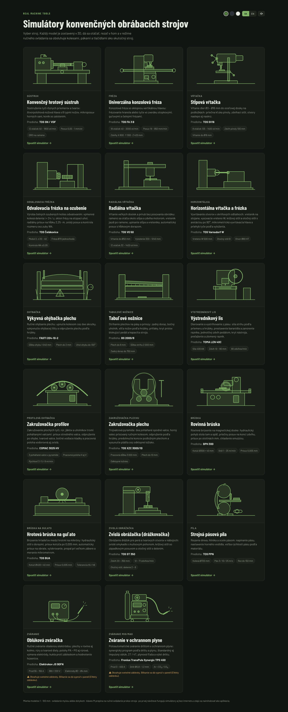</a>

</div>

Každý stroj je poskladaný z 3D tvarov priamo v kóde, bez externých modelov. Dá sa otáčať a približovať, jednotlivé časti sa po kliknutí zvýraznia a zobrazí sa ich popis. V stroji sa naozaj obrába: nôž odoberá materiál podľa svojho tvaru, fréza vyrezáva drážky, vrták vŕta diery, plech sa ohýba, brúsny kotúč odoberá stotiny milimetra a pásová píla reže dosku. Kontroly kolízií zabránia nezmyselným pohybom.

**Spoločné pre všetky stroje:** po prvej návšteve fungujú aj bez internetu a dajú sa nainštalovať ako aplikácia, slovenčina aj angličtina (prepínač SK / EN), tri vzhľady (zelený, tmavý, svetlý), voľba rozmeru a tvaru polotovaru, tlačidlo **Pozrieť obrobok** – kus sa vyberie zo stroja, dá sa otáčať a po „Upnúť späť“ sa vráti na pôvodné miesto.

## Stroje

Kliknutím na snímku otvoríš príslušný simulátor. Všetky stroje majú ručné ovládanie, vypnutie zvuku, prehliadku obrobku a export jeho aktuálneho stavu do STP.

<table>
  <tr>
    <td width="50%" valign="top">
      <a href="https://real-machine-tools.marcel-bucala.workers.dev/#sustruh">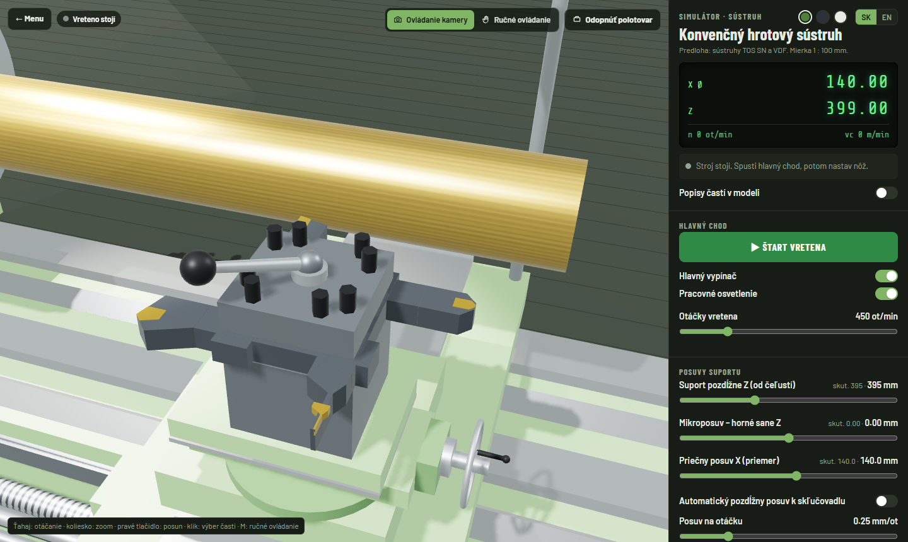</a>
      <h3>🛠️ Konvenčný hrotový sústruh</h3>
      <sub>predloha TOS SN / VDF · veľkosti SN 32 / 40 / 50 / 55 · tyč kruhová alebo šesťhran, mosadz / oceľ / hliník</sub>
      <ul>
      <li>4 veľkosti stroja (výška hrotov, dĺžka lôžka, otáčky, najväčší polotovar) – obrobok a nože vždy v skutočných mm</li>
      <li>prídavné vybavenie: plechový kryt skľučovadla s mikrospínačom, chladenie s hadicou Loc-Line, zadný kryt, pevná a pohyblivá luneta, kryt skrutiek, nožná brzda; dlhý tenký obrobok bez podopretia sa chveje</li>
      <li>štvorpolohová nožová hlava, 8 typov nožov v pravom aj ľavom prevedení a závitový nôž 60°, animovaná výmena</li>
      <li>rezanie metrických závitov P 0,75 – 3 mm cez maticu vodiacej skrutky, skrutkovicový profil závitu</li>
      <li>horné sane s mikroposuvom, páky odistenia hlavy, pinoly a koníka</li>
      <li>12 otáčok, prevodovka posuvov Norton, DRO na ramene, pracovná lampa</li>
      </ul>
    </td>
    <td width="50%" valign="top">
      <a href="https://real-machine-tools.marcel-bucala.workers.dev/#freza">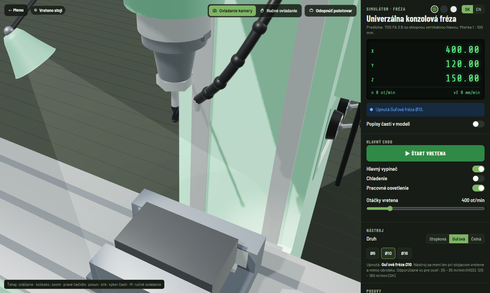</a>
      <h3>⚙️ Univerzálna konzolová fréza</h3>
      <sub>predloha TOS FA 3 B · hranol alebo tyč vo zveráku, tyč v deliacom prístroji</sub>
      <ul>
      <li>stopkové frézy Ø6 – Ø25, guľové Ø6 – Ø16, čelné Ø50 – Ø100</li>
      <li>stôl X, sane Y, konzola Z; automatický posuv stola, chladenie</li>
      <li>zverák sa prispôsobí šírke obrobku, kolízie s čeľusťami a podložkami</li>
      <li><b>deliaci prístroj</b> so skľučovadlom a koníkom: jednoduché delenie n = 40 / z (výpočet otáčok kľuky a kruhu dier), aretácia vretena, úlohy šesťhran a štvorhran</li>
      </ul>
    </td>
  </tr>
  <tr>
    <td width="50%" valign="top">
      <a href="https://real-machine-tools.marcel-bucala.workers.dev/#vrtacka">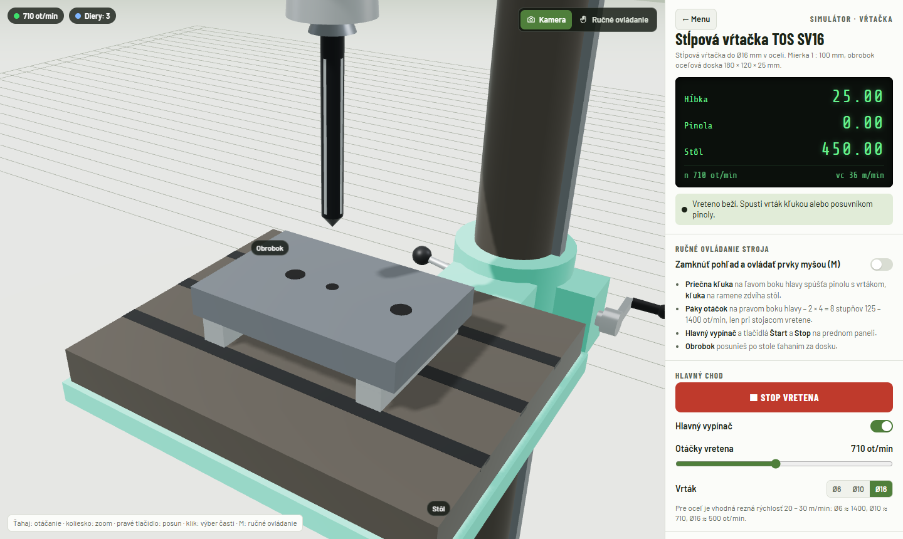</a>
      <h3>🔩 Stĺpová vŕtačka</h3>
      <sub>predloha TOS SV16 · oceľová doska na podložkách</sub>
      <ul>
      <li>priečna kľuka pinoly (100 mm), zdvíhací stôl na stĺpe</li>
      <li>vrtáky Ø3 – Ø16, diery naslepo aj naskrz</li>
      <li>posuv obmedzený na 0,12 mm/ot, ochrana podložiek a stola</li>
      </ul>
    </td>
    <td width="50%" valign="top">
      <a href="https://real-machine-tools.marcel-bucala.workers.dev/#ohybacka">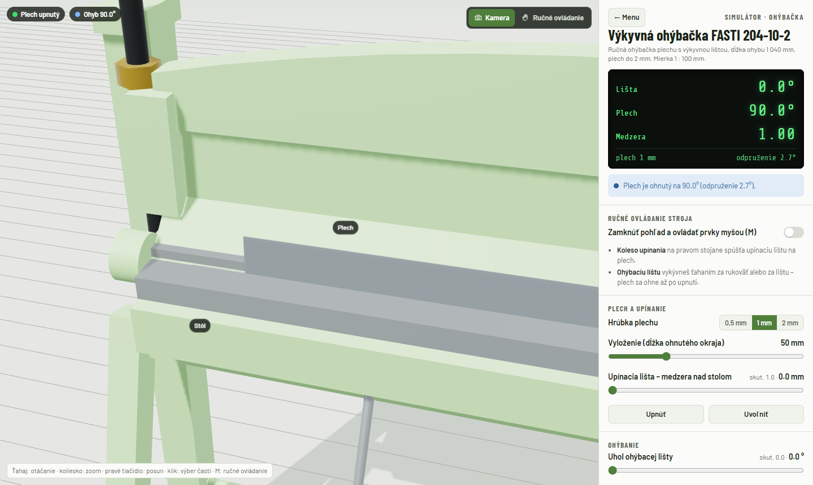</a>
      <h3>📐 Výkyvná ohýbačka plechu</h3>
      <sub>predloha FASTI 204-10-2 · dĺžka ohybu 1 040 mm, do 2 mm</sub>
      <ul>
      <li>upínacia lišta na kolese cez dve zdvíhacie skrutky</li>
      <li>vykývnutie ohýbacej lišty až do 130°</li>
      <li>odpruženie plechu podľa hrúbky, ohyb len po upnutí</li>
      </ul>
    </td>
  </tr>
  <tr>
    <td width="50%" valign="top">
      <a href="https://real-machine-tools.marcel-bucala.workers.dev/#bruska">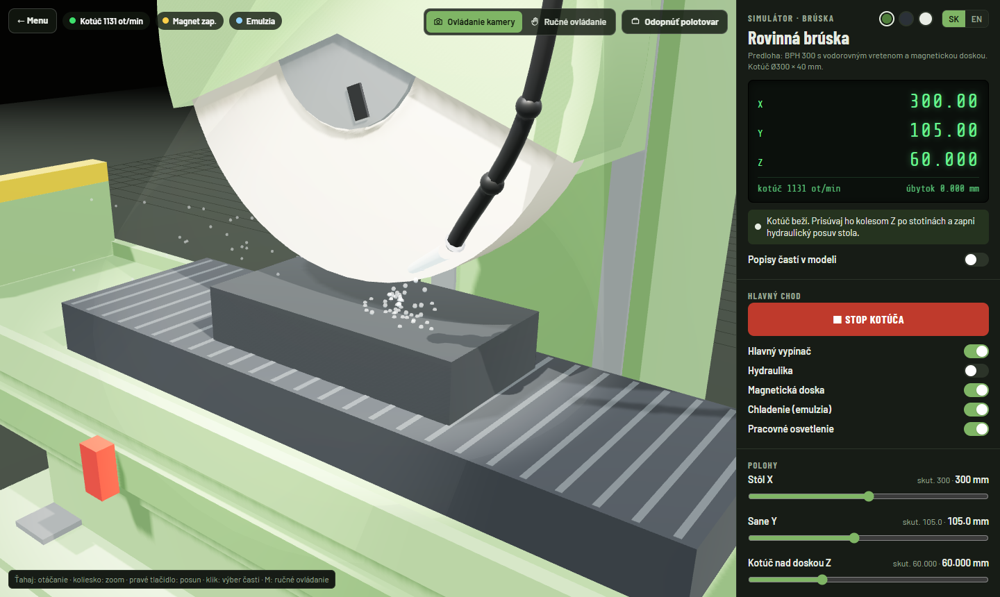</a>
      <h3>✨ Rovinná brúska</h3>
      <sub>predloha BPH 300 · kotúč Ø300 × 40 mm · magnetická doska</sub>
      <ul>
      <li>hydraulický pohyb stola tam a späť, priečny posuv na konci zdvihu</li>
      <li>prísuv po 0,005 mm, iskry, kvapky a hmla emulzie</li>
      <li>kontrola magnetu a prísuvu (max. 0,1 mm na prechod)</li>
      </ul>
    </td>
    <td width="50%" valign="top">
      <a href="https://real-machine-tools.marcel-bucala.workers.dev/#pila">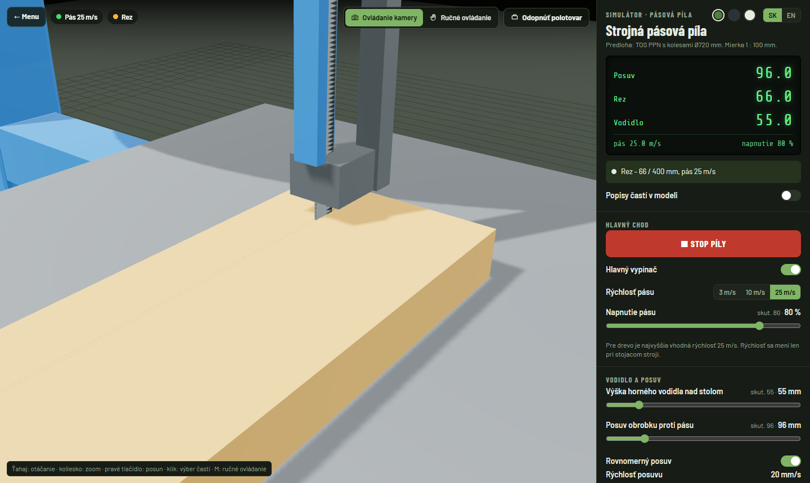</a>
      <h3>🪚 Strojná pásová píla</h3>
      <sub>predloha TOS PPN · kolesá Ø720 mm · drevo, hliník, oceľ</sub>
      <ul>
      <li>napínanie pásu, horné vodidlo s hviezdicovým kolieskom</li>
      <li>3 rýchlosti pásu podľa materiálu, rovnomerný posuv</li>
      <li>viditeľný rez, odrezok sa po dorezaní oddelí</li>
      </ul>
    </td>
  </tr>
  <tr>
    <td width="50%" valign="top">
      <a href="https://real-machine-tools.marcel-bucala.workers.dev/#obrazacka">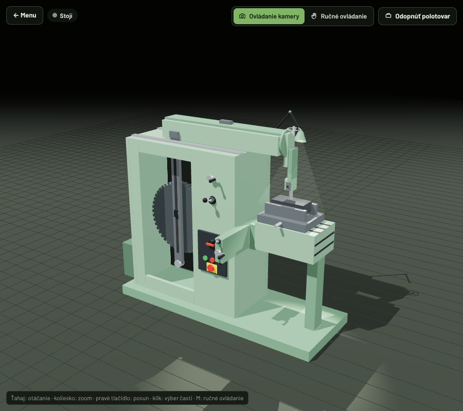</a>
      <h3>🪚 Priečna obrážačka</h3>
      <sub>predloha kulisová obrážačka TOS · v menu skrytá, otvára sa priamo odkazom <code>#obrazacka</code></sub>
      <ul>
      <li>kulisový mechanizmus viditeľný cez odkrytý bok stojana: koleso s čapom, kulisa, kameň; dĺžka zdvihu 20 – 500 mm mení polomer čapu</li>
      <li>rýchly spätný chod – pracovný zdvih trvá ~230° otáčky kolesa, spätný ~130°; 6 stupňov 10 – 56 zdvihov/min, rezná rýchlosť v paneli</li>
      <li>nôž v sklopnej doske reže len pri pracovnom zdvihu, pri spätnom sa nadvihne</li>
      <li>západkový posuv stola o krok na začiatku každého zdvihu, prísuv noža kolieskom na hlave</li>
      <li>4 nože (ubierací, hladiaci, drážkovacie 6 a 10 mm) s najväčším záberom – pri preťažení sa stroj zastaví; náraz do čeľustí zveráka</li>
      <li>3 úlohy: rovina o 2 mm, drážka pre pero 10 × 5, osadenie 30 × 10</li>
      </ul>
    </td>
    <td width="50%" valign="top">
      <a href="https://real-machine-tools.marcel-bucala.workers.dev/#horizontalka">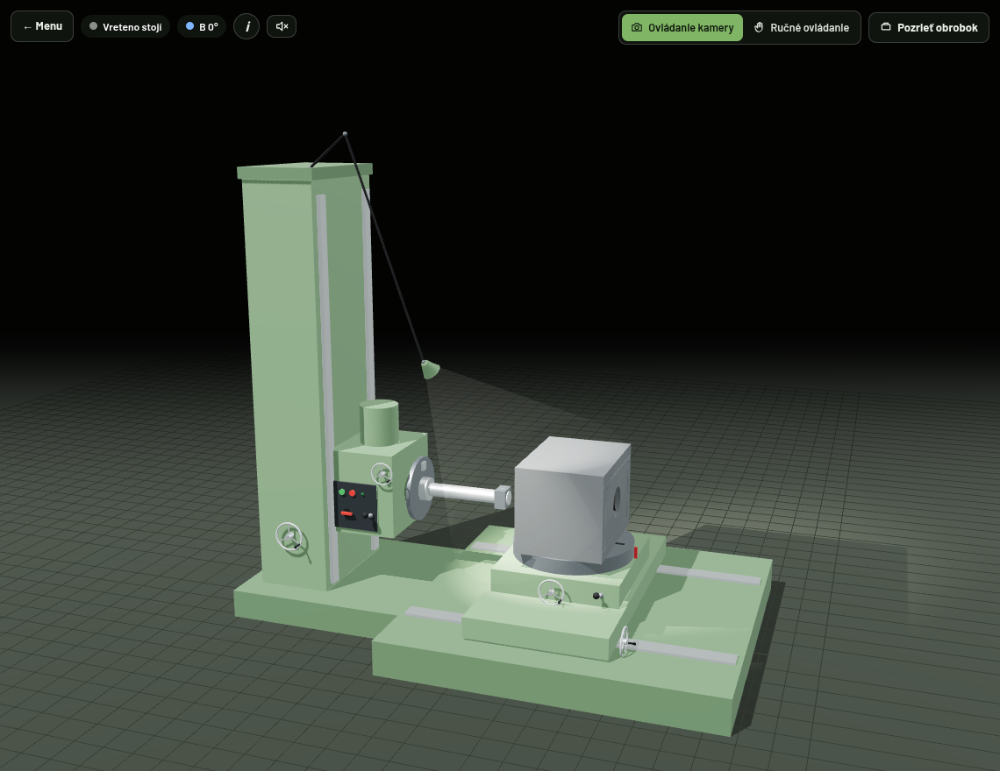</a>
      <h3>🔩 Horizontálna vŕtačka a frézka</h3>
      <sub>predloha TOS Varnsdorf rad W · <code>#horizontalka</code></sub>
      <ul>
      <li>vreteník na stojane (Y), vysúvacie vreteno W s posuvom, sane Z, stôl X a otočný stôl B s aretáciou po 90°</li>
      <li>vyvrtávanie predliatych otvorov mikrometrickou hlavou po 0,005 mm, priehyb tyče podľa záberu a vyloženia</li>
      <li>úlohy Ø80 H7 a súosé otvory po otočení stola o 180° (<code>horizMath.js</code>)</li>
      </ul>
    </td>
  </tr>
  <tr>
    <td width="50%" valign="top">
      <a href="https://real-machine-tools.marcel-bucala.workers.dev/#odvalovacka">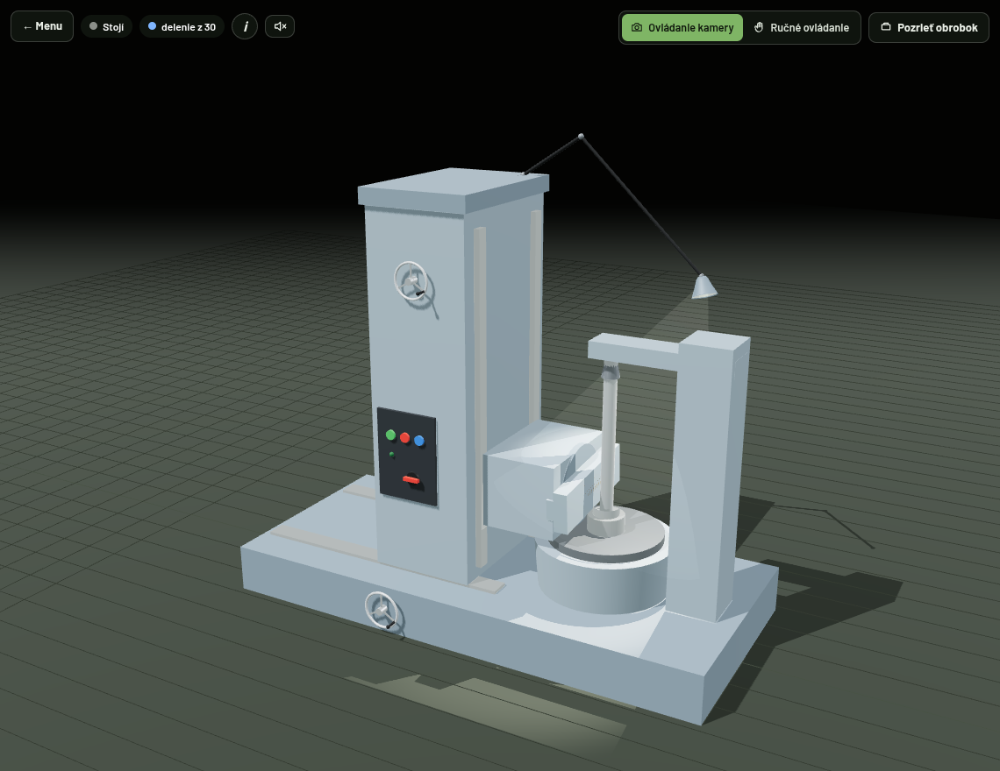</a>
      <h3>⚙️ Odvalovacia frézka na ozubenie</h3>
      <sub>predloha TOS Čelákovice · <code>#odvalovacka</code></sub>
      <ul>
      <li>odvalovanie jednochodou frézou m 2: stôl 1/z otáčky na otáčku frézy, výmenné kolesá delenia i = 24 / z</li>
      <li>sklon frézy na stúpací uhol, radiálny prísuv na 2,25 · m, zvislý posuv cez šírku kolesa</li>
      <li>kontrola rozmeru cez zuby Wk, úlohy z 30 a z 24 (<code>hobMath.js</code>)</li>
      </ul>
    </td>
    <td width="50%" valign="top">
      <a href="https://real-machine-tools.marcel-bucala.workers.dev/#zakruzovacka">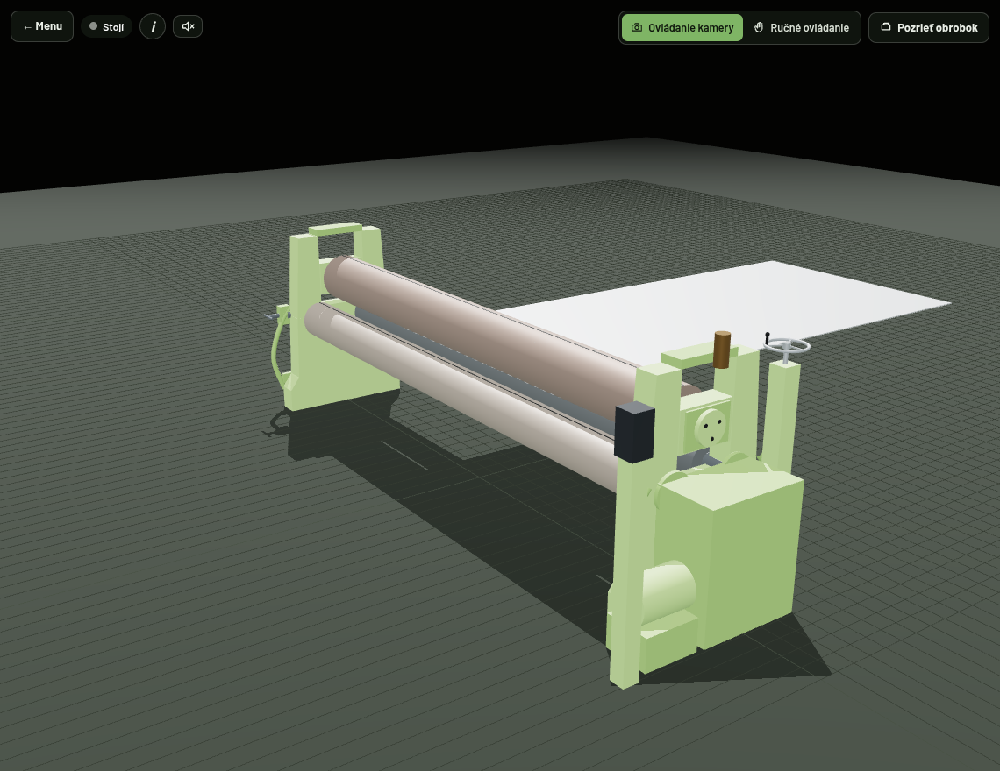</a>
      <h3>🌀 Zakružovačka plechu</h3>
      <sub>TOS XZC 3000/10 · trojvalcová pyramída · <code>#zakruzovacka</code></sub>
      <ul>
      <li>dva poháňané spodné valce, horný valec prisúva ručné koleso na stĺpiku; odpruženie podľa hrúbky</li>
      <li>konce zostanú rovné na polovicu rozostupu valcov – predohnú sa podložným plechom</li>
      <li>hotový plášť sa vysunie po vytiahnutí kolíka cez odklopné ložisko</li>
      <li>úlohy plášť Ø1000 zo 6 mm a oblúk R 800 z 10 mm (<code>plateMath.js</code>)</li>
      </ul>
    </td>
  </tr>
  <tr>
    <td width="50%" valign="top">
      <a href="https://real-machine-tools.marcel-bucala.workers.dev/#noznice">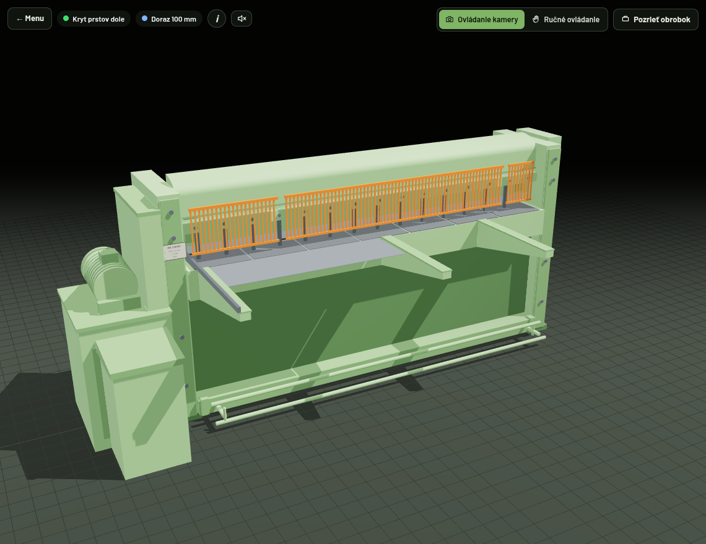</a>
      <h3>✂️ Tabuľové nožnice</h3>
      <sub>mechanické BS 2000/8 · <code>#noznice</code></sub>
      <ul>
      <li>zadný doraz, bočný uholník, vôľa nožov podľa hrúbky (ostrina), kapacita 8 mm</li>
      <li>prítlaky, šikmý horný nôž, hrebeňový kryt prstov blokujúci pedál, pedálová tyč po celej šírke, pásy padajú do koša</li>
      <li>úlohy 3 pásy 100 mm z 2 mm a prírezy 150 mm zo 6 mm (<code>shearMath.js</code>)</li>
      </ul>
    </td>
    <td width="50%" valign="top">
      <a href="https://real-machine-tools.marcel-bucala.workers.dev/#lis">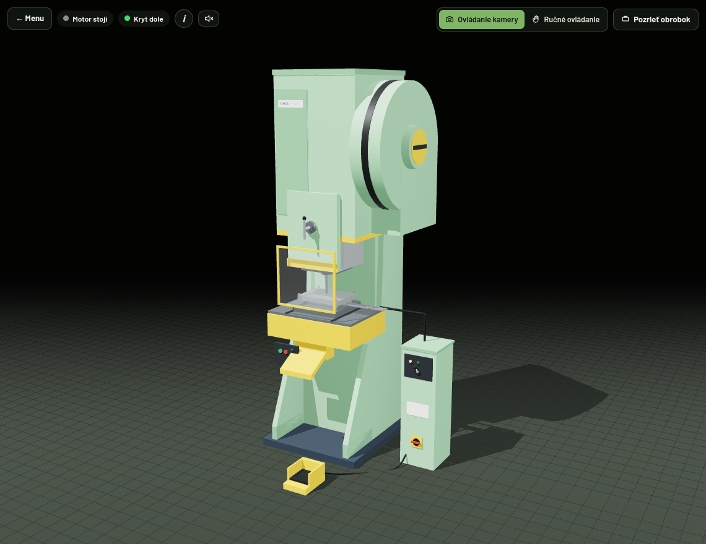</a>
      <h3>🔨 Výstredníkový lis</h3>
      <sub>TOMA LEN 40C · C-stojan 400 kN · <code>#lis</code></sub>
      <ul>
      <li>zotrvačník s jednootáčkovou spojkou, jednotlivý zdvih pedálom alebo trvalý chod, kryt nástroja</li>
      <li>sila strihu F = π · d · t · 0,8 · Rm, preťaženie zasekne lis v dolnej úvrati</li>
      <li>prestavenie baranidla: vzduch – vtlačené – prestrihnuté – zlomený razník</li>
      <li>úlohy 5 dier Ø20 v rozstupe 50 mm a podložky Ø50 zo 6 mm s mostíkom (<code>pressMath.js</code>)</li>
      </ul>
    </td>
  </tr>
  <tr>
    <td width="50%" valign="top">
      <a href="https://real-machine-tools.marcel-bucala.workers.dev/#radialka">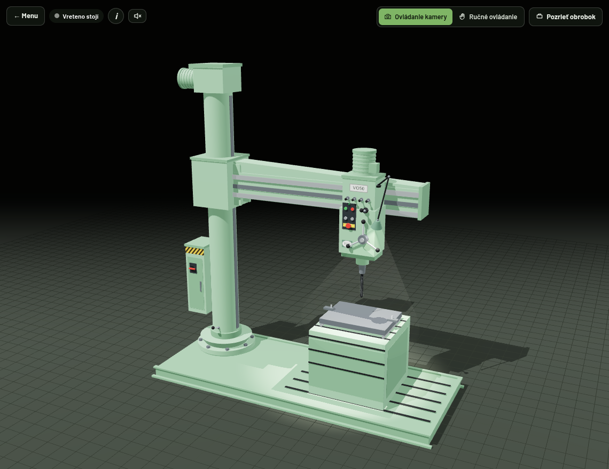</a>
      <h3>🧭 Radiálna vŕtačka</h3>
      <sub>predloha TOS VO 50 · <code>#radialka</code></sub>
      <ul>
      <li>rameno sa otáča okolo stĺpa a zdvíha motorom, vreteník jazdí po ramene – obrobok stojí</li>
      <li>upínanie stĺpa a vreteníka (bez neho sa nevŕta), automatický posuv 0,1 – 0,4 mm/ot s hĺbkovým dorazom</li>
      <li>vrtáky Ø10 – Ø40, displej polohy vretena od stredu dosky; úlohy rozteč 300 × 200 a príruba 6 × Ø20 na Ø300 (<code>radialMath.js</code>)</li>
      </ul>
    </td>
    <td width="50%" valign="top">
      <a href="https://real-machine-tools.marcel-bucala.workers.dev/#gulato">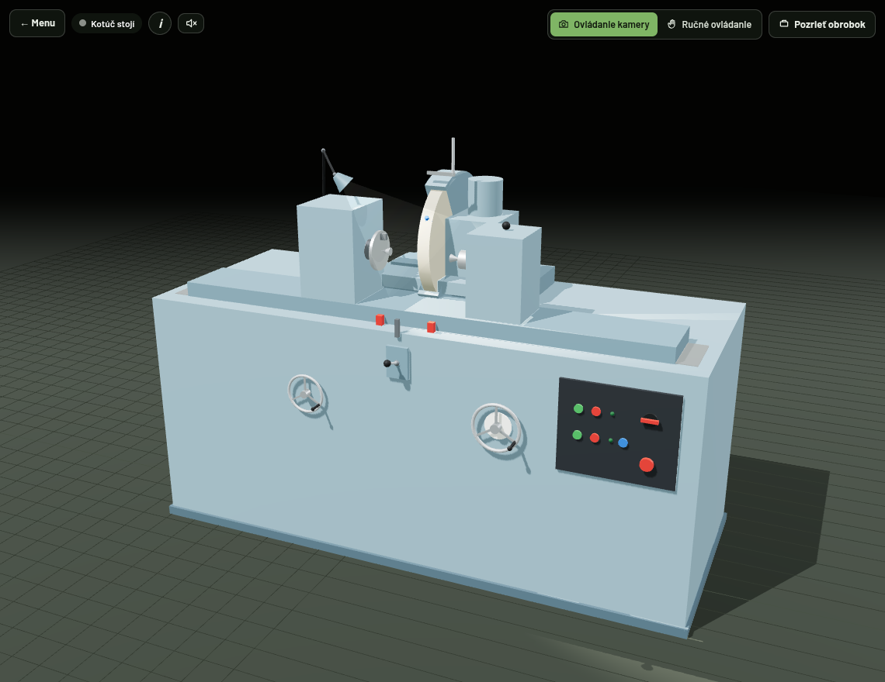</a>
      <h3>💎 Hrotová brúska na guľato</h3>
      <sub>predloha TOS BUA · <code>#gulato</code></sub>
      <ul>
      <li>hydraulický stôl s dorazmi obratu, prísuv kotúča po 0,005 mm, automatický prísuv na obrate s dorazom</li>
      <li>pružné odtláčanie kotúča – vyiskrovanie, prepal pri veľkom zábere alebo bez chladenia, iskry a emulzia</li>
      <li>meranie mikrometrom po 0,001 mm, úlohy Ø40 h6 a Ø25 h5 s kontrolou kužeľovitosti (<code>cylMath.js</code>)</li>
      </ul>
    </td>
  </tr>
  <tr>
    <td width="50%" valign="top">
      <a href="https://real-machine-tools.marcel-bucala.workers.dev/#zobrazacka">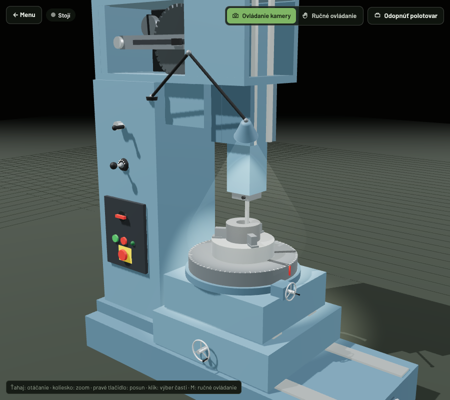</a>
      <h3>⬇️ Zvislá obrážačka</h3>
      <sub>predloha TOS ST 350 · drážkovačka s krížovým otočným stolom</sub>
      <ul>
      <li>zvislé smykadlo s kulisovým pohonom v hlave („labutí krk“), pracovný zdvih dole, zdvih 20 – 350 mm, 12 – 71 zdvihov/min</li>
      <li>krížový stôl X / Z, otočný stôl C (1 otáčka = 4°) s delením 2 – 8, trojčeľusťové skľučovadlo s otvorom pre výbeh noža</li>
      <li>náboj ako vnútorný a vonkajší polomer pre každý uhol; nôž sa zastaví pri prekročení prierezu triesky, náraz do skľučovadla</li>
      <li>západkový posuv v X, Z alebo C v hornej úvrati; stôl sa pri noži v obrobku do materiálu nepohne</li>
      <li>2 úlohy: drážka pre pero 12 × 3,3 v otvore Ø40, štvorhranný otvor 25 × 25 z Ø24 (<code>slotterMath.js</code>)</li>
      </ul>
    </td>
    <td width="50%" valign="top">
      <a href="https://real-machine-tools.marcel-bucala.workers.dev/#profilova">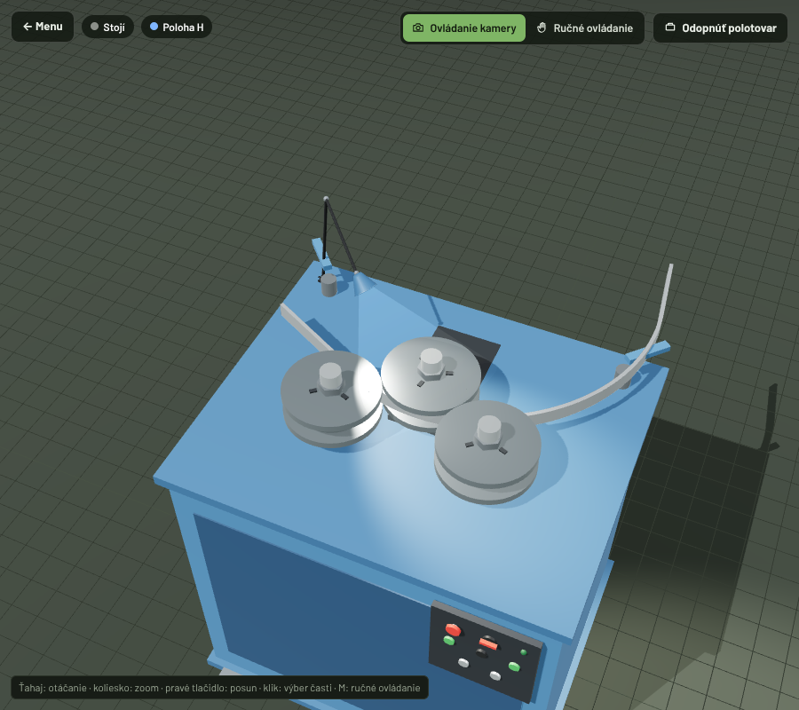</a>
      <h3>➰ Profilová ohýbačka</h3>
      <sub>predloha COMAC 3025 HV · tri poháňané valce v pyramíde</sub>
      <ul>
      <li>hydraulický prísuv stredného valca δ, polomer v zábere z kružnice cez tri dotyky</li>
      <li>pružno-plastický ohyb s odpružením podľa profilu (medza klzu S235, tvarový súčiniteľ); rovné konce dĺžky polovice rozpätia</li>
      <li>5 profilov: plochá tyč naplocho aj nastojato, rúra, jäkel, uholník; valce s nákružkami alebo drážkové pre rúru</li>
      <li>bočné vodiace kladky – bez nich sa profil nastojato a uholník skrúti, rúra na rovných valcoch sa sploští</li>
      <li>pracovná poloha H aj V (stroj sa sklopí), nožný pedál vpred / vzad, 3 úlohy: oblúk R 500, prstenec R 300 z rúry, oblúk R 800 nastojato (<code>benderMath.js</code>)</li>
      </ul>
    </td>
  </tr>
  <tr>
    <td width="50%" valign="top">
      <a href="https://real-machine-tools.marcel-bucala.workers.dev/#zvaranie">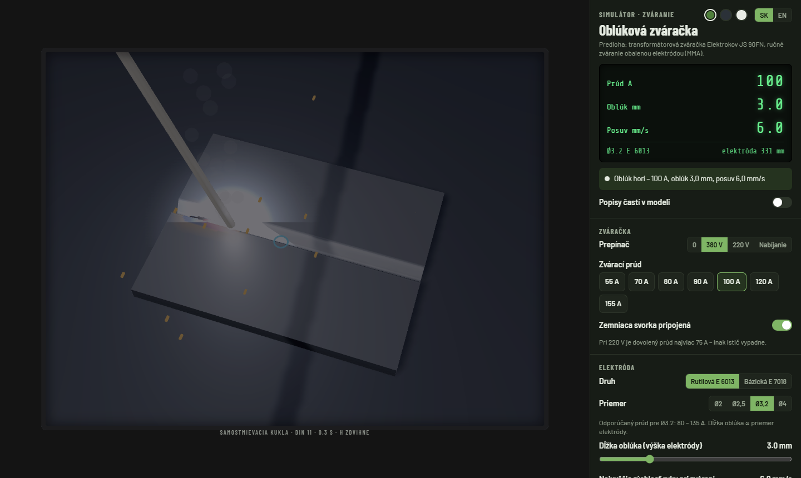</a>
      <h3>⚡ Oblúková zváračka</h3>
      <sub>predloha Elektrokov JS 90FN · ručné zváranie obalenou elektródou (MMA)</sub>
      <ul>
      <li><b>tvar a poloha polotovarov</b>: rovinné plechy (I, V, ½V, Y, U, J, presah, lem, návar), kolmé plechy (T-spoj, rohový vnútorný a vonkajší), kruhové (rúra – rúra, rúra na plech) a tvarové (jokel na plech, tvarový rez po krivke); zvarová príprava podľa hrúbky</li>
      <li>polohy PA – PG (1G – 4G/F) a rúrové PH, PJ, H-L045 (5G, 6G); kontrola smeru zvárania nahor / nadol</li>
      <li>prúd 55 – 155 A, prepínač 380 / 220 V (istič pri 220 V nad 75 A), rutilové a bázické elektródy Ø2 – Ø4</li>
      <li>húsenica podľa prúdu, rýchlosti a dĺžky oblúka; troska, popúšťacie farby, hodnotenie zvaru</li>
      <li>kukla (H): moderná samostmievacia (DIN 9 – 13, oneskorenie) alebo stará s pevným tmavým sklom</li>
      <li>režim <b>Zváranie</b> (M): pravé tlačidlo vedie elektródu, pravé + ľavé zvára, na dotyk dva prsty; v režime kamery pravé tlačidlo posúva pohľad</li>
      <li>navárať sa dá kdekoľvek na diel, ďalšie vrstvy sa ukladajú na predchádzajúce</li>
      <li>pri dohorenej elektróde vyskočí tlačidlo <b>Vymeň elektródu</b> (alebo E) – animácia: ohorok vypadne, nová elektróda sa zasunie do čeľustí</li>
      <li><b>rez zvarom (makrovýbrus)</b> kdekoľvek pozdĺž spoja: plechy, jednotlivé húsenice, hranica natavenia, tepelne ovplyvnená oblasť, póry, troskové vtrúseniny a neprievar; miesto rezu ukazuje červená rovina v scéne</li>
      <li><b>zvarová mierka</b> v reze: prevýšenie h a šírka b, pri kútovom zvare ramená z₁, z₂ a účinná hrúbka a</li>
      <li><b>viacvrstvové zvary</b>: každé zapálenie oblúka je nová húsenica, rez ukazuje koreň, výplň a kryciu vrstvu; zvar cez neotlčenú trosku zanechá vtrúseniny; rúra na <b>polohovadle</b> (1G) sa otáča pod horákom</li>
      </ul>
    </td>
    <td width="50%" valign="top">
      <a href="https://real-machine-tools.marcel-bucala.workers.dev/#mag">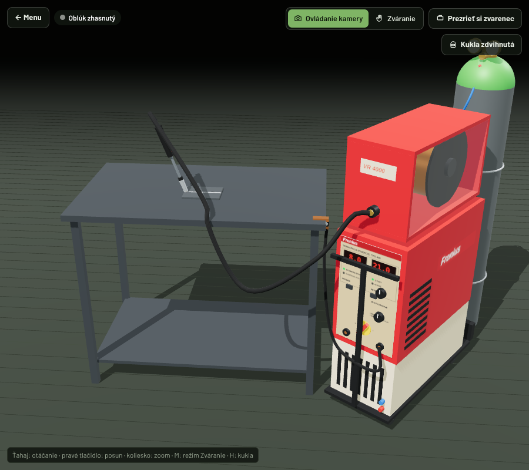</a>
      <h3>🔥 Zváranie MIG/MAG</h3>
      <sub>predloha Fronius TransPuls Synergic TPS 450 · podávač VR 4000 · chladenie FK</sub>
      <ul>
      <li>synergický program: drôt G3Si1 Ø0,8 / 1,0 / 1,2 a plyn M21 alebo CO₂, rýchlosť drôtu 1 – 22 m/min určí prúd (3 – 450 A) a napätie, korekcia dĺžky oblúka ±3 V</li>
      <li>štandardný a impulzný oblúk; skratový, prechodový a sprchový prenos s rôznym rozstrekom</li>
      <li>2-takt / 4-takt na horáku, hlavný vypínač, ovládanie priamo na paneli zdroja (displej A / V, LED režimov)</li>
      <li>plynová fľaša s ventilom a prietokomerom – pri slabej ochrane (zatvorený ventil, málo či veľa plynu, dlhý výlet drôtu) vznikajú póry</li>
      <li>výlet drôtu kolieskom pri zváraní; dlhší výlet zníži prúd</li>
      <li>úlohy: zvar V 8 mm PA, kútový zvar PB, tenký plech 2 mm, rúra Ø60,3 × 4 v polohe PH, rúra Ø88,9 × 8 na polohovadle (3 vrstvy)</li>
      </ul>
    </td>
  </tr>
</table>

### 🏭 Presné obrábanie a elektroerózia (`#moderne`)

Samostatná kategória má moderný tmavosivý vstup a tri rodiny strojov. Simulátory zachovávajú spoločné ovládanie: kamera / ručne, zvuk predvolene vypnutý, prehliadka obrobku, živé HMI a export aktuálneho obrobku. Každá značka má vlastný akcent: Hermle červený, Röders vínovočervený, OSCARMAX žltý s modrými detailmi.

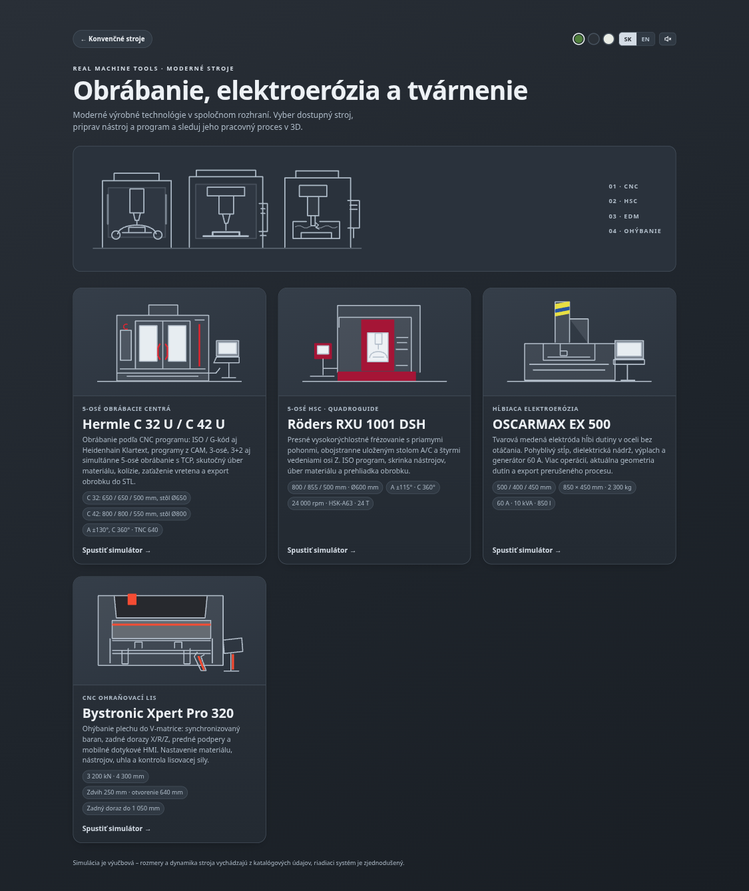

| Stroj | Technológia | Dráhy X / Y / Z | Stôl | Spustenie |
| --- | --- | --- | --- | --- |
| Hermle C 32 U / C 42 U | 5-osé CNC | 650 / 650 / 500; 800 / 800 / 550 mm | Ø650 / Ø800 mm | [Hermle](https://real-machine-tools.marcel-bucala.workers.dev/#hermle) |
| Röders RXU 1001 DSH | 5-osé HSC · QUADROGUIDE | 800 / 855 / 500 mm | Ø600 mm, A ±115° | [Röders](https://real-machine-tools.marcel-bucala.workers.dev/#roeders) |
| OSCARMAX EX 500 | Hĺbiaca EDM, pohyblivý stĺp | 500 / 400 / 450 mm | 850 × 450 mm | [OSCARMAX](https://real-machine-tools.marcel-bucala.workers.dev/#oscarmax) |

Katalóg Röders označuje dodaný stroj **RXU 1001 DSH**, preto používa toto meno aj simulátor. EX 500 je hĺbiaca EDM, nezamieňa sa s EDM vŕtačkami EXD z pôvodného katalógu. [Zdroje, presné údaje a zjednodušenia modelov →](docs/precision-machines.md)

**Hermle C 32 U / C 42 U** (`#hermle`) – 5-osé obrábacie centrum s otočno-sklopným stolom A/C, s voliteľným príslušenstvom, ktoré je pri otvorení modelu vypnuté:

| Hermle C 32 U | Hermle C 42 U |
| --- | --- |
| 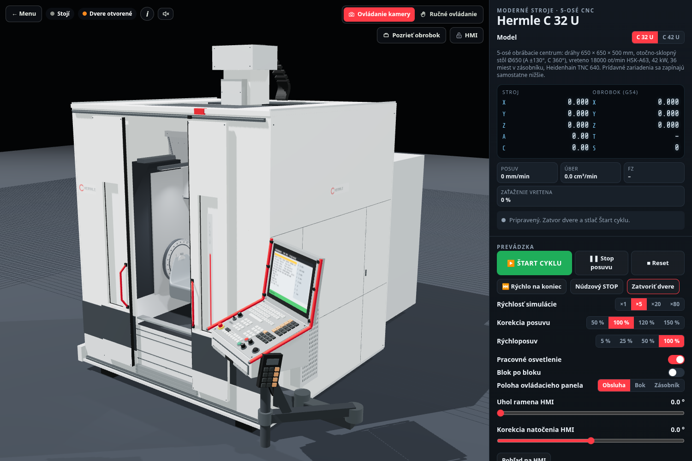 | 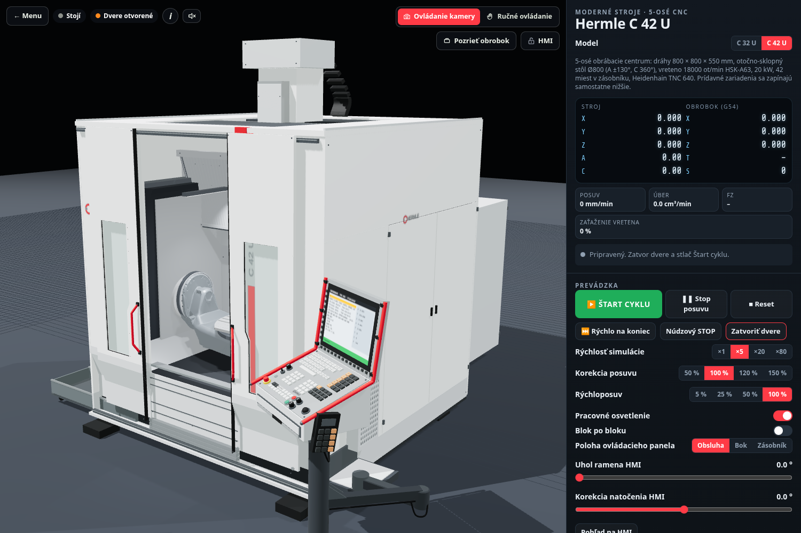 |

[Odkryté lôžko a stôl A/C](docs/img/hermle-bed.png) · [Detail karusela a bočného pohonu](docs/img/hermle-carousel.png) · [Čelo a sklá dverí](docs/img/hermle-front.png) · [Servisné dvere](docs/img/hermle-service.png) · [Katalógová zostava](docs/img/hermle-equipment.png) · [HMI cez celé okno](docs/img/hermle-hmi.png)

- **Modely podľa katalógov.** C 32 U: 650 / 650 / 500 mm, stôl Ø650 × 540 so 7 rovnobežnými T-drážkami, 36 miest, HSK-A63 18 000 ot/min, 42 kW / 148 Nm. C 42 U: 800 / 800 / 550 mm, stôl Torque Ø800 × 630 s 9 T-drážkami, 42 miest, HSK-A63 18 000 ot/min, 20 kW / 180 Nm. C 42 používa tandemový pohon A 25 ot/min a C 65 ot/min podľa doloženého obrázka. Oba majú A ±130°, TNC 640 a základný rýchloposuv 45 / 45 / 40 m/min.
- **Nové referenčné detaily.** Kolíska používa optimalizovaný tvar z dodaného STL, stôl C zostáva samostatný. Čelné a bočné plechy majú hlboké spodné zalomenia so spojenými rohmi; spodné zástery dverí sa pohybujú spolu s nimi. Červený modelový pás je pri pravom vonkajšom okraji a pokračuje cez šikmý plech. Šesť bočných/zadných servisných krídel sa otvára kliknutím v ručnom režime a blokuje spustenie pri otvorení. Ľavý bok má vysoký vystupujúci chladiaci kryt s tvarovanými okrajmi, sivou plochou a čiernym pásom. HMI má dve samostatné červené bočné trubky s čiernymi zátkami, bez prednej priečky, a podlhovastý závesný ovládač s klávesmi a špirálovým káblom.
- **Detail geometrie.** Samostatné rozmery kabín, plechové posuvné krídla s úzkym zasklením a tesnením, vodiace lišty a rolničky, červené madlá, servisné škáry a zámky, perforovaný výmenník, kryt pohonu Z a článkový káblový reťazec. Priečnik má krátke lichobežníkové lamelové kryty, ktoré sa skladajú podľa polohy X. Vnútri je tvarované minerálne lôžko, nerezové žľaby a prepážky, odliatok kolísky A/C s úzkymi stúpajúcimi ramenami, odkrytými kruhovými prírubami a skrutkami a stôl so sploštenými okrajmi. HMI má rovnaké fyzické rozmery v oboch modeloch; nezväčšuje sa spolu s C 42.
- **HMI panel.** Jediný pevný nosník má čap zasunutý pod pravý okraj stroja a pri koncovom stĺpiku šikmo stúpa. Nemá pohyblivý lakeť. Polohy *Obsluha / Bok / Zásobník* a posuvník *Poloha ramena HMI* 0–100 % premiestnia panel po kruhovom oblúku mimo kabíny; zároveň sa natočí k operátorovi. Percentá označujú postup medzi krajnými polohami, nie uhol fyzického čapu. *Korekcia natočenia HMI* pridáva nezávislé natočenie o 360°. V ručnom režime potiahni panel; **Shift + potiahnutie** mení iba korekciu natočenia. Pult má sklon 20°, vystúpené klávesy, STOP, regulátory, trackball a ručný ovládač s káblom. *Pohľad na HMI* ukáže konzolu aj celý spodný nosník.
- **Zásuvka na triesky.** Je odsadená dozadu pri ľavom spodku stroja, nie pred čelnými dverami. Podľa vybraného pôdorysu C 42 má odstup 720 mm od čela, zasunutá presahuje bok o 680 mm a vysúva sa o ďalších 1700 mm. Šírka v smere hĺbky stroja je 400 mm. Má otvorenú vaňu, ohnuté okraje, madlo a kolieska. Nižšia zadná nádrž lícuje s jej vonkajším okrajom, má delené zapustené veko, spodný lem a pevné čerpadlo. Dopravník sa napája na rovnaký otvor; pri jeho výbere sa základná zásuvková zostava skryje.
- **Ručné ovládanie Hermle.** Prepínač *Ručné ovládanie* alebo kláves **M** zamkne kameru a modro zvýrazní aktívne prvky. Dvere otvoríš/zatvoríš kliknutím na madlo alebo ťahaním do strany, bez vyskakovacieho popisu; návod nájdeš v pomocníkovi „i“. Na pulte fungujú zelený Štart, červený Stop posuvu, hríbový núdzový STOP, Reset (R), osvetlenie (L), blok po bloku (SBL), chladenie (KSS) a regulátory posuvu a rýchloposuvu (ťahanie alebo koliesko myši). Štart rešpektuje otvorené dvere a zaistený núdzový STOP; po núdzovom zastavení uvoľni hríbový STOP a stlač Reset. Ťahanie neaktívnej plochy/rámu HMI ďalej premiestňuje panel, Shift mení jeho natočenie. Kamera sa obnoví klávesom **Esc** alebo prepnutím režimu. Ostatné klávesy 3D klávesnice slúžia ako vizuálna predloha; program sa upravuje v editore v pravom paneli.
- **Zámok polohy HMI.** Tlačidlo *HMI* so sivou ikonou zámku pod prepínačom kamera / ručne zmrazí aktuálnu polohu ramena aj natočenie panela voči stroju. Predvoľby polohy a oba slidery zosivejú; ťahanie panela ani Shift + ťahanie ho nepresunie. Tlačidlá, regulátory a dvojklik na displej fungujú ďalej. Opätovným kliknutím polohu odistíš.
- **Odopnutie a prehliadka obrobku.** Pri zastavenom stroji použi *Pozrieť obrobok*. Ak sú dvere zatvorené, najprv sa úplne otvoria; potom sa uvoľní upínač a diel sa animáciou vyberie a priblíži. Ťahaním otáčaš iba obrobok, kolieskom meníš priblíženie. *Upnúť späť* vráti rovnaký obrobený diel, kameru, pôvodný stav dverí aj režim ovládania. Počas prehliadky je štart blokovaný a nastavenia stroja sú nedostupné, aby sa diel neprepísal novým polotovarom. Prehliadka používa spoločný mechanizmus so sústruhom.
- **HMI cez celé okno.** V ručnom režime dvojklikni priamo na displej 3D HMI (alebo použi tlačidlo *HMI cez celé okno*). Hore je živý obraz rovnakého displeja, dole rozloženie klávesov a aktívnych ovládačov podľa modelu. Posuv a rýchloposuv sa dajú korigovať posuvníkom aj číslom; hodnoty sa hneď prenesú do 3D regulátorov aj vykonávaného programu. Štart, Stop posuvu, núdzový STOP, Reset a prepínače používajú tie isté akcie a blokovania ako 3D panel. Režim sa zavrie cez **Esc** alebo *Späť k stroju*, pričom zostane zapnuté ručné ovládanie. Na menších obrazovkách majú ovládače väčšie dotykové plochy. Tento pohľad nemení stav behu programu iba svojím otvorením alebo zatvorením.
- **Zásobník a nástroje.** Karusel je uložený na rebrovanom bubne s výrezmi. Červené obvodové vidlice držia skutočne osadené nástroje; prázdne miesta nevytvárajú fiktívne nástroje. Bočný pastorok a pohon sú pod červeným krytom, nad prstencom je dlhá tvarovaná základňa s dvojicou vedení, skrutkou a ložiskovými blokmi. Zostava zostáva vo vnútri lôžka; pick-up bod nadväzuje na súradnice výmeny v CNC jadre. Výmena má fázy odloženia, indexovania a upnutia. Vreteno, zásobník a náhľady používajú tie isté rozmery nástroja v mm.
- **Osvetlenie pracovného priestoru.** Kabína tieni vonkajším svetlám aj nepriamemu svetlu a odleskom prostredia. Pri vypnutej pracovnej lampe je uzavretý priestor výrazne tmavší; dva široké bočné zdroje pri rozptylných lištách a lokálny odraz svetla od stien po zapnutí osvetlia aj boky obrobku. Usporiadanie vychádza z pohľadov pracovného priestoru a ergonómie v dodaných katalógoch Hermle; PDF neuvádza svetelný tok ani fotometrické údaje, preto je rozptyl modelový. Otvorené dvere prepúšťajú viac okolitého svetla. Pri skrytej kabíne sa útlm vypne, takže zostáva dobre čitateľný odkrytý model aj prehliadka vybratého obrobku.
- **Katalógové zostavy.** Základ s nízkou výsuvnou zásuvkou na triesky (kliknutím v ručnom režime); dopravník s vozíkom; dopravník + ICS 40; dopravník + ICS 80; dopravník + ICS 80 + dochladzovanie. Zostavy sa nahrádzajú, aby nevznikali neplatné kombinácie. Dopravník má zakrytovanú šikmú vetvu, motor pri základni a presahujúci výsyp nad otvoreným výklopným vozíkom. ICS má šikmú filtračnú hlavu, rolku a odlišné zostavy čerpadiel ICS 40/80; dochladzovač má otvárateľné servisné dvere. Kliknutím na vaňu pri zastavení vyklopíš vozík. Dopravník sa počas cyklu pohybuje, filtrácia a chladenie externých jednotiek sú znázornené vizuálne.
- **Rozmerový layout.** C 32 má šírku 2270 mm a hĺbku vrátane servisnej časti 3680 mm; C 42 má 2450 × 4000 mm. Výška kabíny je 2660 / 2650 mm, horného pohonu 3190 / 3290 mm. Otvor dverí je 758 / 940 mm a nakladacia výška vybraných stolov 950 mm. Dopravník s vozíkom je vľavo vpredu, ICS a dochladzovanie vzadu vľavo, predvolene vypnuté. Tvar neokótovaných odliatkov, držiakov a vnútorných prevodov je rekonštrukcia z obrázkov, nie výrobný CAD. Podrobné zdroje a hranice presnosti sú v [poznámkach k modelom](docs/precision-machines.md).
- **Kamera a rozhranie.** Ťahanie otáča kameru, koliesko približuje a odďaľuje, Shift/pravé tlačidlo posúva cieľ. Hermle má rozsah vzdialenosti kamery 4–180 scénových jednotiek (1 jednotka = 100 mm), takže sa dá zobraziť celá zostava. Pohľady *Zhora*, *Zásobník*, *Pohľad na vybavenie* a *Pohľad na HMI* vrátia kameru do pripravenej polohy. Na desktope zostáva scéna vo výške okna, samostatne sa posúva iba pravý panel. Dotykové gestá a koliesko nad scénou neposúvajú stránku; na mobile zostáva rozhranie zvislo posúvateľné mimo scény.
- **CNC program.** Interpreter ISO / Fanuc a Heidenhain Klartext (`src/machines/cnc/gcode.js`):
  - ISO: G0–G3, G43, G43.4 (TCP), G68.2 + G53.1, cykly G81–G83, G93;
  - Heidenhain: BLK FORM, TOOL CALL, L / CC / C / CR, M128, PLANE SPATIAL, CYCL DEF 200.
- **PowerMill a ďalšie CAM.** Načítanie `.nc` / `.h` z kompatibilného postprocesora (PowerMill, Fusion 360, Mastercam, hyperMILL …), kontrola programu a simulácia. Karta *PowerMill / CAM* vysvetľuje nastavenie A/C, mm, G54 a exportuje komentáre s geometriou osadených nástrojov. Natívne projekty a databázy sa neimportujú. [Postup a formát metadát →](docs/cam/powermill-exchange.md)
- **Skrinka a knižnica nástrojov.** Bočný panel obsahuje iba prehľad osadených nástrojov a výber zo skrinky pre konkrétne T. Samostatné okno *Vybrať nástroj zo skrinky* obsahuje iba uložené nástroje, vyhľadávanie a miesta T; podporuje kliknutie aj drag & drop. Presunutie iba pripraví výber, tlačidlo *Osadiť na T…* ho použije. Import/export, nové nástroje a editor sú iba v oddelenej *Správe skrinky*. Nový alebo upravený nástroj treba pred osadením uložiť; neuložené údaje sa do stroja neprenesú. Skrinka sa uchováva v prehliadači a umožňuje import/export JSON a CSV (mm). Uloženie v skrinke nemení stroj; nástroj sa samostatne osadí na vybrané T v 36/42-miestnom zásobníku. Osadenie obnoví simuláciu od polotovaru a počas chodu či prehliadky obrobku je zablokované.
- **Detekcia nástrojov z NC.** Rozpoznáva odkazy T a explicitné rozmery v komentároch vrátane viacriadkových hlavičiek CAM. Zobrazí chýbajúce údaje a rozpory, vyžaduje ich kontrolu v editore a nič automaticky neprepíše. Registre `H` a `D` nie sú geometria nástroja. [Podporované polia, jednotky a zálohovanie →](docs/cam/powermill-exchange.md)
- **Kinematika a úber.**
  - 5-osá kinematika stola A/C, inverzná úloha (`kin.js`).
  - Skutočný úber materiálu vo voxelovom poli so znamienkovou vzdialenosťou a sieťou surface nets (`voxel.js`), vrátane naklonených a podrezaných plôch.
  - Export obrobku do STL.
- **Kontroly a alarmy** (`sim.js`):
  - koncové spínače;
  - rýchloposuv do materiálu, rez so stojacim vretenom;
  - kolízia drieku alebo držiaka, náraz do stola alebo upínača;
  - preťaženie vretena;
  - bezpečnostný zámok dverí.
- **Prevádzka.** Blok po bloku, korekcie posuvu a rýchloposuvu, rýchlosť simulácie, odhad času.
- **Ukážky.** Štyri ukážkové programy: 3-osý, 3+2 (G68.2), simultánny 5-osý s TCP a Heidenhain s PLANE SPATIAL (`programs.js`).

**Röders RXU 1001 DSH** (`#roeders`)

[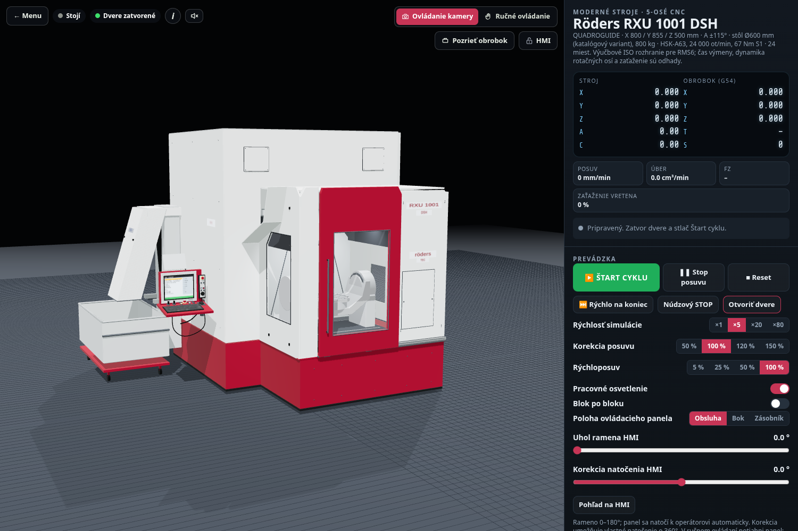](https://real-machine-tools.marcel-bucala.workers.dev/#roeders)

[Pôdorys](docs/img/roeders-layout.png) · [HMI s ručným ovládačom](docs/img/roeders-rms.png) · [Bočné a zadné vybavenie](docs/img/roeders-equipment.png)

- Samostatný model podľa fotografie a pôdorysu: stupňovitá vínová základňa, odsadené servisné bloky a voľný zadný výrez podľa strany 57, červené čelné dvere **posuvné doprava**, priehľadné ľavé okno a červený RMS panel na držiaku pri ľavom boku.
- Voliteľné vonkajšie jednotky podľa pôdorysu: chladenie 1050 × 750 mm a pásový filter 1523 × 1380 mm; predvolene vypnuté. V základnej zostave je vysoká šikmá výsypka KNOLL s otvoreným ústím nad vozíkom.
- Obojstranne uložený stôl A/C, štyri vedenia smykadla Z, kryty vedení, káblový reťazec, vreteno HSK-A63 a 24-miestny rotačný zásobník s animovanou výmenou.
- CNC jadro zdieľané s Hermle: ISO programy, 3+2 a TCP, skutočný úber, blokovanie dverí, koncové spínače, osvetlenie, ručné tlačidlá a regulátory, fullscreen HMI a prehliadka obrobku.
- Nástroje sa vyberajú z rovnakej skrinky. Štandardné vreteno povoľuje Ø35 mm; väčší nástroj sa neosadí. Dodaná ukážka používa Ø10 mm. Natívne RMS6 sa neemuluje; simulácia používa výučbové ISO rozhranie.

**OSCARMAX EX 500** (`#oscarmax`)

[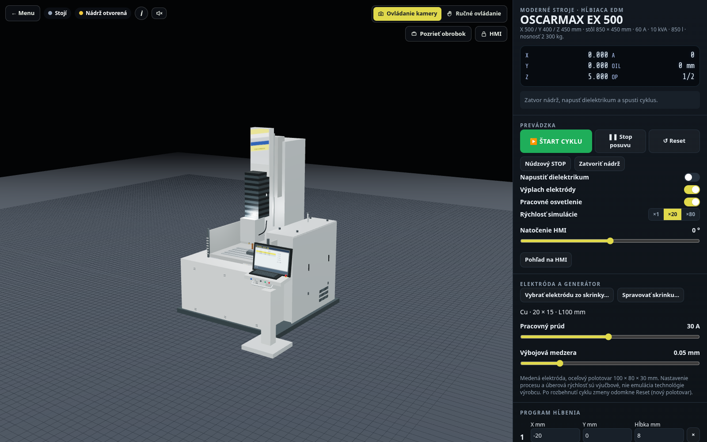](https://real-machine-tools.marcel-bucala.workers.dev/#oscarmax)

- Samostatná strieborná konštrukcia s modro-žltými pásmi, PC monitorom a klávesnicou, nádržou so zostupnými dverami, UV snímačom, hasiacim zariadením, tryskami a zadnou skriňou generátora.
- **Pohyblivý stĺp** nesie elektródu v X/Y; stôl 850 × 450 mm a obrobok zostávajú na mieste. Elektróda sa pri hĺbení netočí.
- Postup: zavri nádrž → napusť dielektrikum → zapni výplach → spusti cyklus. Hladina musí byť najmenej 40 mm nad obrobkom. Dvere, nízka hladina, vypnutý výplach a STOP zastavia proces.
- Skrinka medených elektród: jednoduchý výber uloženého hranola/valca; samostatná správa umožňuje pridať alebo upraviť elektródu a importovať/exportovať JSON. Uloženie nemení elektródu v stroji.
- Program hĺbenia obsahuje polohy X/Y a hĺbku. Medzi dutinami prebehne odtiahnutie, presun a nový prísuv. Geometria odoberá materiál podľa tvaru elektródy a medzery; po Stop zostáva zachovaný aktuálny rozpracovaný stav.
- Ručné fyzické tlačidlá, dvojklik na monitor pre živé HMI, zámok natočenia panela, prehliadka s vypustením nádrže a odtiahnutím elektródy, STL/STEP a PNG. Výučbový proces nepoužíva obrábacie M3/M5 ani postprocesor frézky.

### 🎓 Výučba

| | |
| --- | --- |
| **Úlohy s kontrolou** | každý stroj má úlohy podľa výkresu (napr. osadenie Ø40 × 50, zápich, závit M30 × 1,5, drážka 20 × 5, dve diery Ø10 naskrz, ohyb 90°, prebrúsenie o 0,1 mm, tupý zvar V); požiadavky sa kontrolujú priebežne z modelu, vyhodnotenie dá percentá a známku, počíta sa čas aj varovania |
| **Výkresy s kótami** | každá úloha má náčrt s kótovacími a pomocnými čiarami, šípkami a toleranciami (`src/ui/sketch.jsx`); texty kót sa neprekrývajú s čiarami ani navzájom – overené automatickou kontrolou v prehliadači |
| **Protokol z cvičenia** | tlačidlo *Vyexportovať protokol* stiahne HTML protokol (tlač alebo PDF): zadanie, výkres, nastavenie stroja a polotovaru, údaje stroja, požiadavky s predpísanou a dosiahnutou hodnotou a odchýlkou, snímka dosiahnutého tvaru, hodnotenie, meno žiaka a odkaz na úlohu, napr. `…/#sustruh/uloha=zavit` (`src/ui/protocol.js`) |
| **Kontrola BOZP** | pri úlohe sa stroj spustí až po potvrdení kontrolného zoznamu (kľúč zo skľučovadla, okuliare, upnutie, kukla …) |
| **Meranie** | sústruh: posuvné meradlo s krúžkom na obrobku a tabuľka osadení a závitu; fréza: hĺbkomer; vŕtačka: zoznam dier s rozostupom; brúska: úbytok a rovinnosť |
| **Rezné podmienky** | kalkulačka n = 1000 · vc / (π · D) podľa materiálu a nástroja (HSS / SK), najbližší stupeň prevodovky jedným klikom |
| **Uloženie a export** | rozpracovaný obrobok sa uloží v prehliadači a dá sa znova upnúť; export obrobku do STL a STP/STEP (AP214) v mm a snímka scény do PNG |
| **Zvuk** | motor podľa otáčok, rez, iskrenie brúsky, bzučanie transformátora a praskanie oblúka – syntetizované v prehliadači, prepínač reproduktora je v spoločnej lište každej scény aj vo fullscreen HMI. Každé nové načítanie aplikácie začína bez zvuku, aj keď bol v predchádzajúcej relácii zapnutý |

Na slabšom hardvéri sa kvalita zníži automaticky (rozlíšenie, potom tiene lámp); parameter `?hq` v adrese to vypne.

### ✋ Ručné ovládanie

Kláves <kbd>M</kbd> alebo prepínač vpravo hore zamkne pohľad a ovládacie prvky sa zvýraznia namodro. Ťahaním sa točia ručné kolesá a kľuky a prestavujú páky, tlačidlá, vypínače a núdzový STOP sa stláčajú myšou. Pracovné lampy (sústruh, fréza, brúska) majú skutočné bodové svetlo s tieňmi.

## Ako to funguje

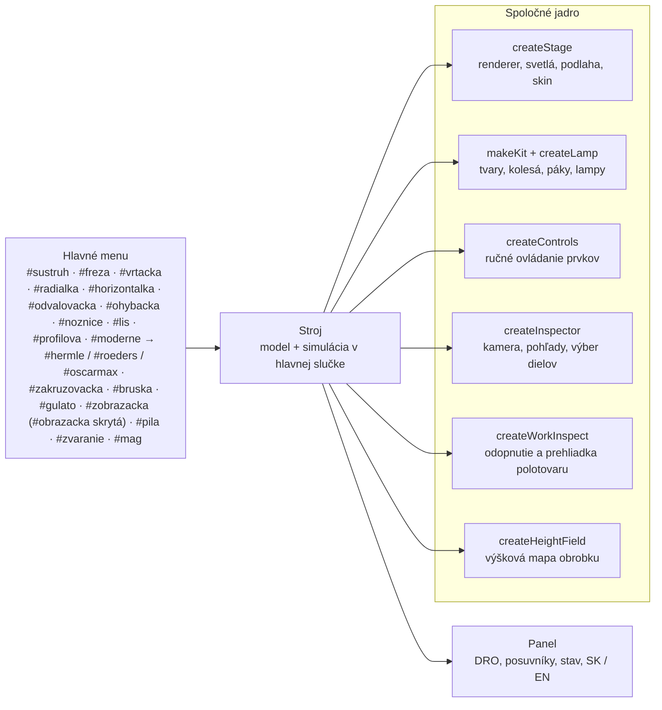

| Čo sa simuluje | Ako |
| --- | --- |
| Odoberanie materiálu | sústruh: profil polomeru (340 úsekov) a tvar ostria zvoleného noža → `LatheGeometry`; fréza a brúska: výšková mapa s rezaním po celej dráhe medzi snímkami |
| Kolízie | nástroj voči obrobku pri stojacom vretene, bok noža voči materiálu, zverák, podložky, stôl, koník, magnetická doska, horné vodidlo píly |
| Ručné ovládanie | pohyb myši sa premieta na dotyčnicu k obvodu kolesa v mieste uchopenia, páky majú aretované polohy |
| Jazyk | každý text má slovenskú aj anglickú podobu, `L(sk, en)` |
| Mierka | 1 jednotka scény = 100 mm |

<details>
<summary><b>Ďalšie snímky</b></summary>

| | |
| --- | --- |
| 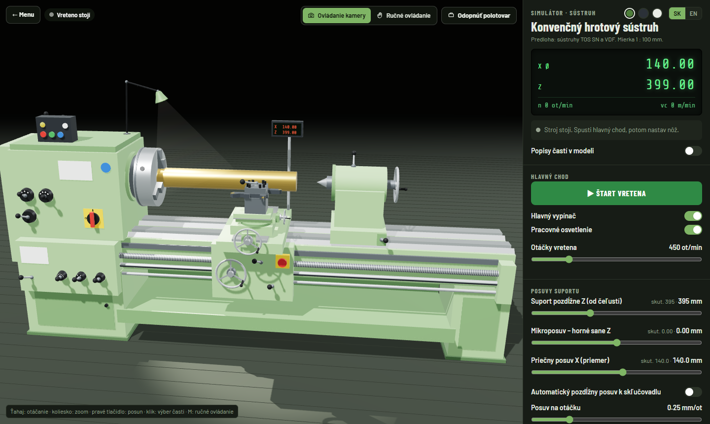 | 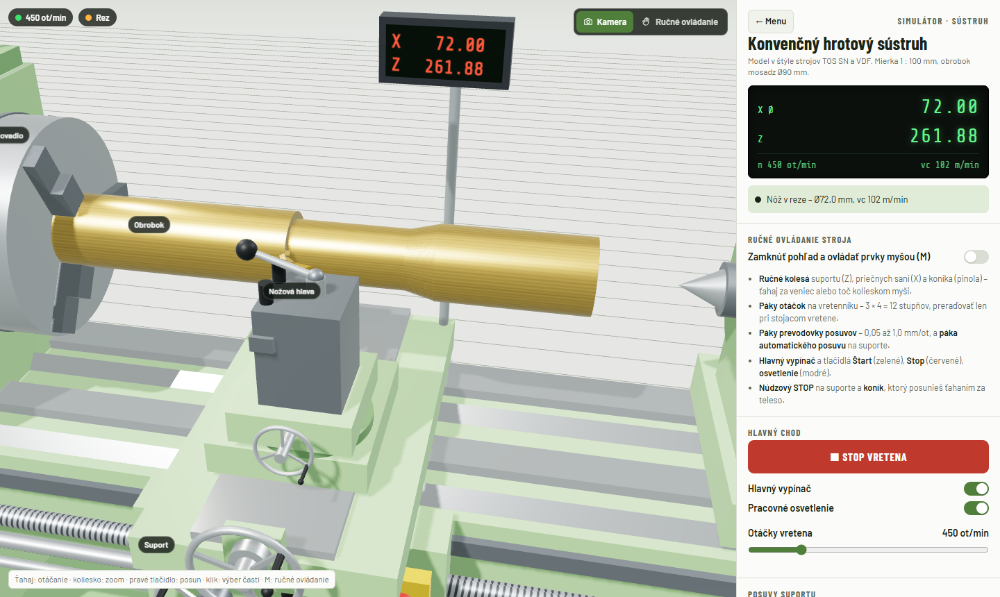 |
| 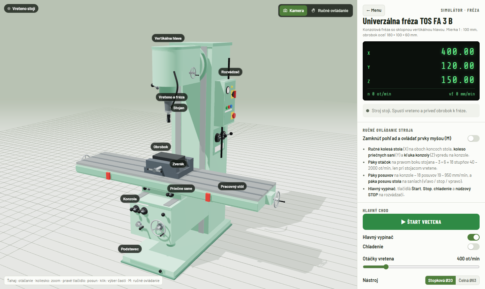 | 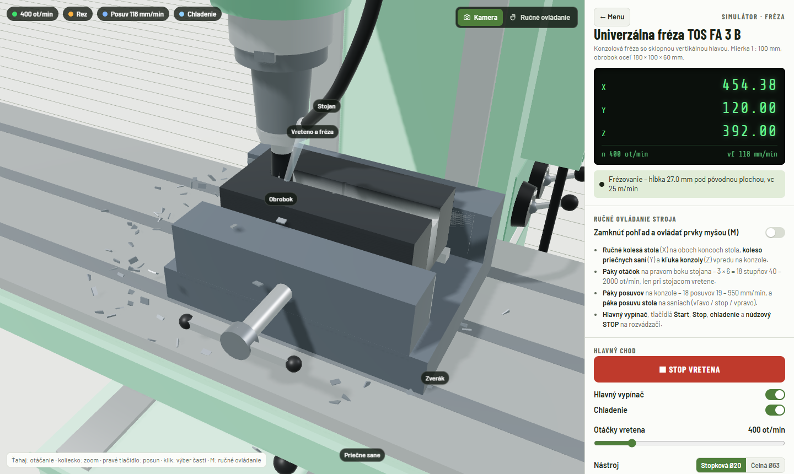 |
| 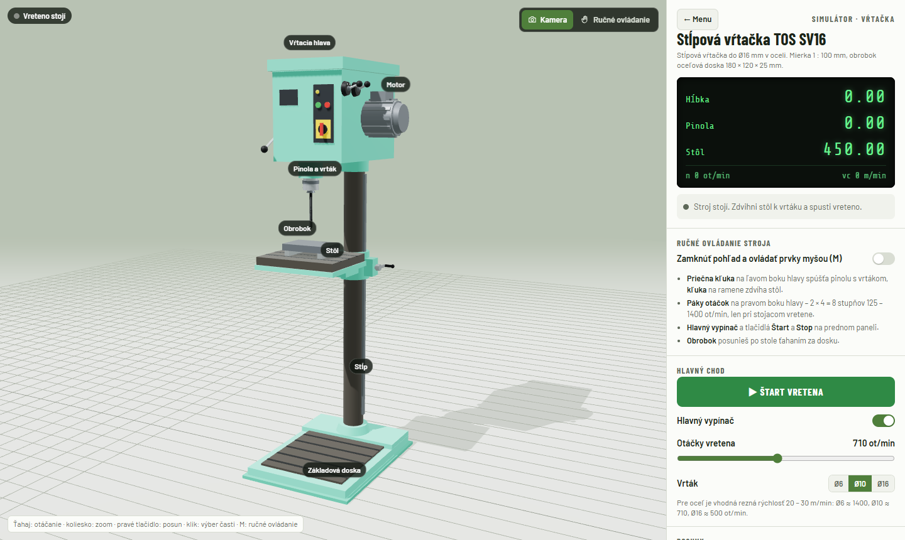 | 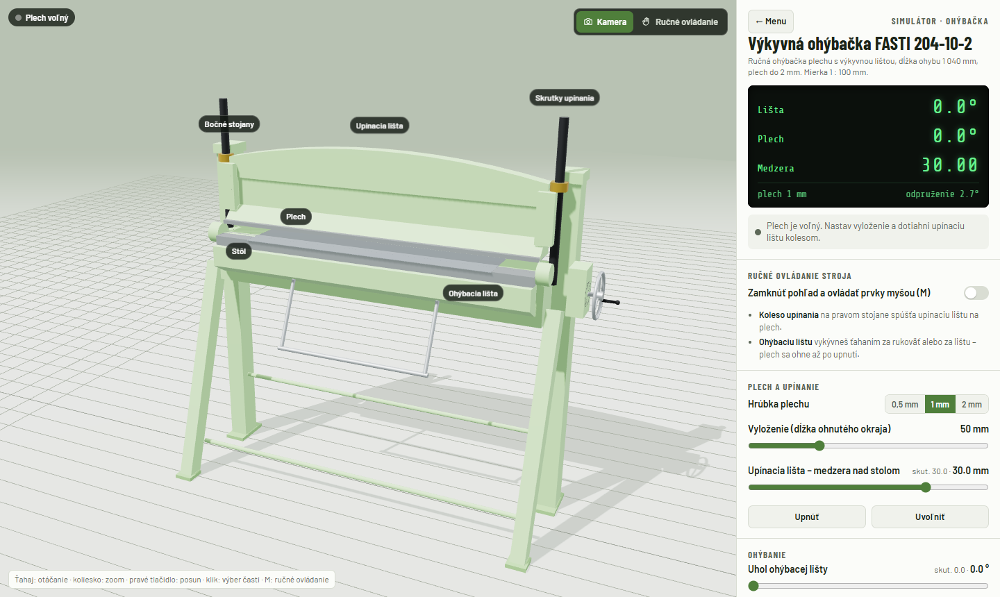 |
| 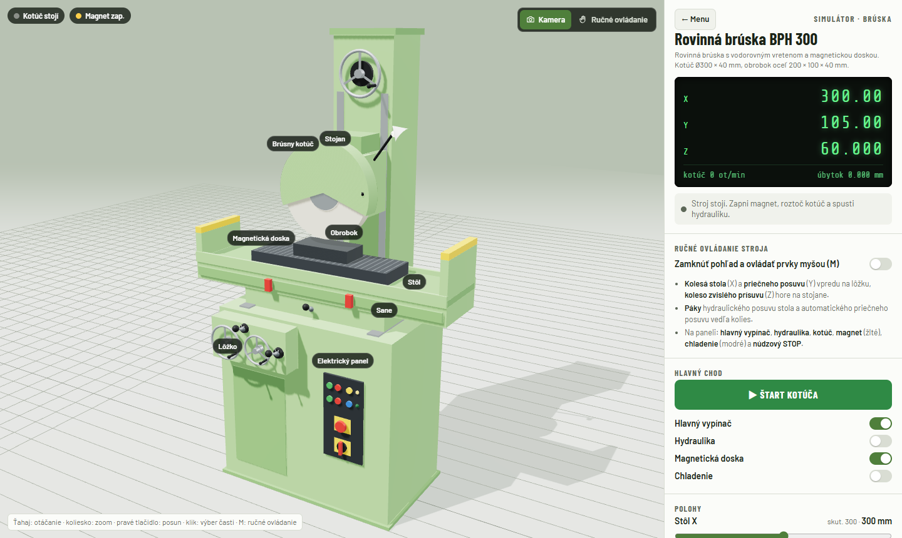 | 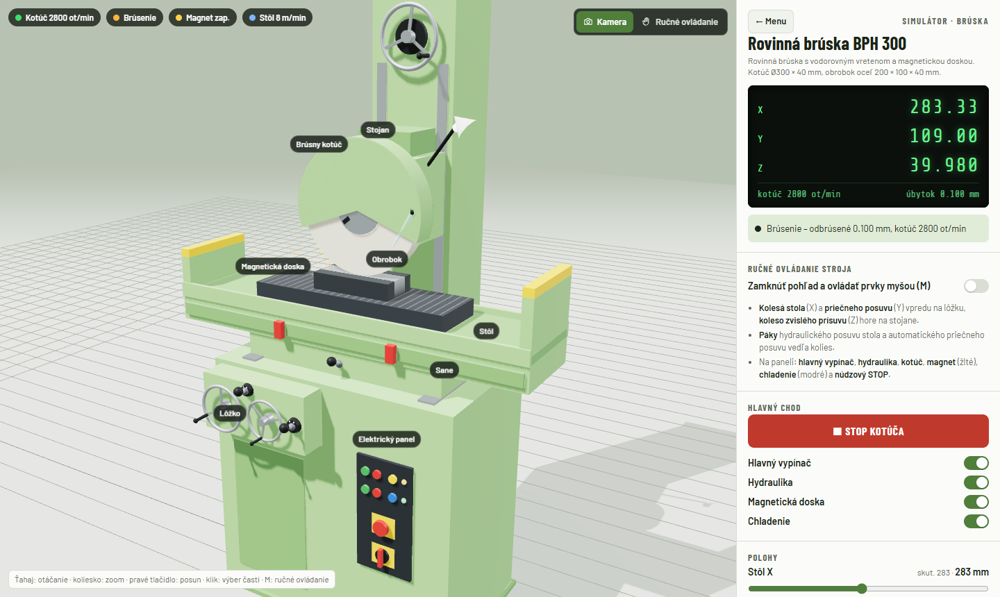 |
| 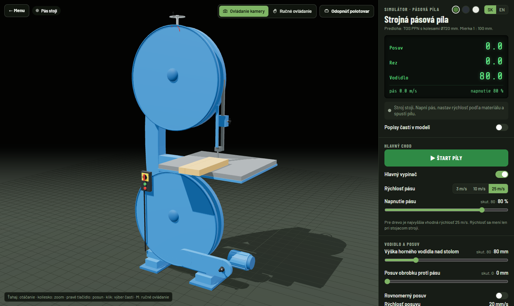 | 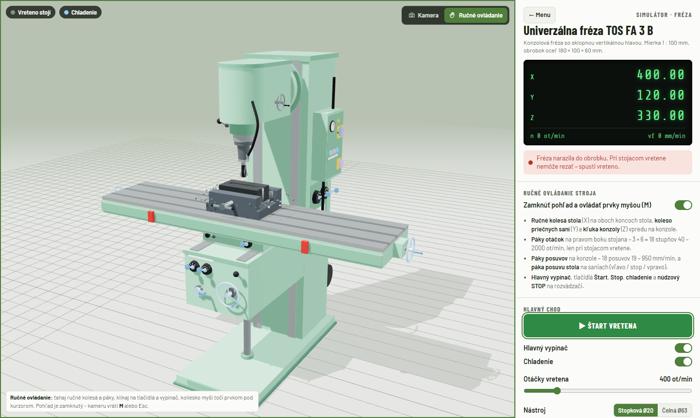 |
| 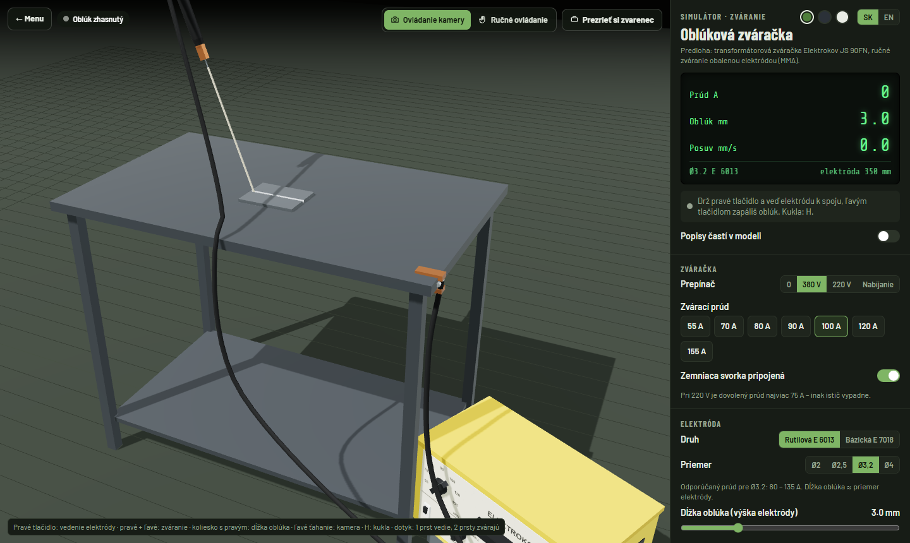 | 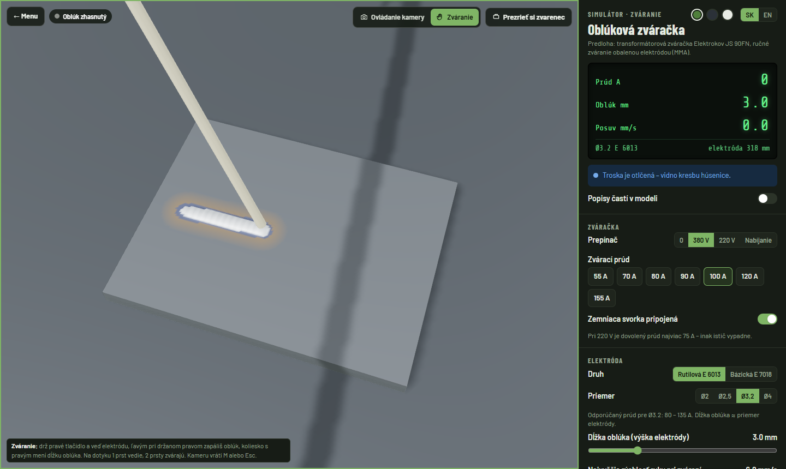 |

</details>

## Súbory

| Cesta | Obsah |
| --- | --- |
| [`index.html`](index.html), [`src/main.jsx`](src/main.jsx) | vstup aplikácie pre Vite |
| [`src/App.jsx`](src/App.jsx) | hlavné menu, smerovanie podľa `#hash`, zachytenie chýb, upozornenie bez WebGL |
| [`src/core/`](src/core) | spoločné 3D jadro: scéna a vykresľovanie (`stage.js`), súprava tvarov a lampa (`kit.js`), ručné ovládanie (`controls.js`), výber dielov a pohľady (`inspector.js`), odopnutie polotovaru, výšková mapa a jej rozbor (`hfMath.js`), častice, zvuk (`sound.js`), export STL a STEP (`step.js`), jazyk |
| [`src/ui/`](src/ui) | spoločné prvky panelu (`common.jsx`), úlohy, BOZP, kalkulačka, uloženie a export (`tools.jsx`), ilustrácie strojov v menu (`art.jsx`) |
| [`src/machines/`](src/machines) | jeden súbor na stroj – model, simulácia, panel a úlohy; načítava sa až pri otvorení stroja. Výpočty bez three.js: `latheMath.js` (profil, závit, úlohy sústruhu), `shaperMath.js` (kulisa, nože a úlohy obrážačky), `slotterMath.js` (náboj r(θ), rez zvislou obrážačkou, drážka a štvorhran), `benderMath.js` (pružno-plastický ohyb, odpruženie, tri valce), `radialMath.js`, `cylMath.js`, `horizMath.js`, `plateMath.js`, `hobMath.js`, `shearMath.js`, `pressMath.js` (radiálna vŕtačka, brúska na guľato, horizontálka, zakružovačka, odvalovacia frézka, nožnice, výstredníkový lis), `millIndex.js` (deliaci prístroj, tyč r(x, θ), mnohohrany), `shopMath.js` (úlohy vŕtačky, ohýbačky, píly, zvárania), `migMath.js` (synergia MIG/MAG, prenos kovu, plynová ochrana), `weldShape.js` (tvar polotovarov, krivka spoja, rúra na valci, hodnotenie húsenice); `fronius.js` model zdroja TPS 450 s podávačom a fľašou |
| [`src/app.css`](src/app.css) | farebné tokeny troch vzhľadov a štýly rozhrania (Tailwind cez PostCSS) |
| [`static/`](static) | súbory kopírované do buildu bez zmeny: ikony, manifest, úvodná obrazovka, [`_headers`](static/_headers) s CSP a cache |
| [`sw-template.js`](sw-template.js) | service worker pre offline režim – build doplní zoznam všetkých súborov a vytvorí `public/sw.js` |
| [`public/`](public) | **zostavená aplikácia** (`npm run build`) – commituje sa, z nej nasadzuje Cloudflare |
| [`tests/`](tests) | jednotkové testy (Vitest): prevodovky, nože, závit a profil sústruhu, kontroly všetkých úloh, rezné podmienky, zvarová príprava, tvary polotovarov a hodnotenie po krivke, synergia MIG/MAG, výšková mapa |
| [`src/index.js`](src/index.js) | export `App` a jednotlivých simulátorov na použitie v inej React aplikácii (vyžaduje `three@0.186`) |
| [`wrangler.jsonc`](wrangler.jsonc) | nasadenie na Cloudflare Workers so statickými súbormi z `public/` |
| [`docs/AUDIT.md`](docs/AUDIT.md) | audit aplikácie – zistenia, opravy a ďalšie návrhy |


### Stiahnutie modelu stroja

Tlačidlo **Stiahnuť model** na konci menu každého simulátora otvorí výber **OBJ**, **STEP/STP** alebo **STL**. Exportuje aktuálne polohy dielov a viditeľné príslušenstvo bez obrobku, podlahy, svetiel a neviditeľných ovládacích zón. Pri skrytej kabíne sa exportuje zobrazená vnútorná zostava. Hermle C 32 / C 42, varianty sústruhu TOS a zváracie pracoviská majú rozlíšené názvy súborov.

Technické údaje a vysvetlenia nastavení sú dostupné cez **i** pri názve stroja alebo príslušnej sekcie menu. Okno sa zatvára krížikom, klávesom Esc alebo kliknutím mimo neho; po zatvorení sa ovládanie klávesnicou vráti na pôvodné tlačidlo. Aktuálne hodnoty, stav procesu a chybové hlásenia zostávajú priamo pri ovládaní.

Všetky formáty používajú milimetre, os Y nahor a počiatok v strede spodnej plochy zostavy. OBJ zachováva pomenované diely bez textúr; STL je binárna trojuholníková sieť. STEP AP214 obsahuje ploškové telesá a otvorené povrchy podľa geometrie simulátora, bez parametrickej histórie. Výpočet beží lokálne v samostatnom workeri, dá sa zrušiť a nemení živý model. Počas prehliadky odopnutého obrobku sa najprv treba vrátiť k stroju.

### Prehliadka a CAD export aktuálneho obrobku

Všetkých 19 simulátorov má tlačidlo **Pozrieť obrobok**. Prehliadka umožňuje diel vybrať, otáčať a priblížiť; **Upnúť späť** obnoví jeho uloženie a režim ovládania. Pri strojoch, ktoré vyžadujú zastavenie alebo odsunutie nástroja, sa najprv zobrazí príslušný pokyn. Pri zakružovačke sa pred vybratím otvorí odklopné ložisko. Nožnice ukážu posledný odstrihnutý pás, ak je dostupný, inak plech na stole. Nastavenia sú počas prehliadky zablokované. Zakružovačka používa spoločnú podlahu s mriežkou ako ostatné stroje; samostatná svetlá podkladová doska je odstránená. Tlačidlá chodu vpred/vzad a Stop používajú rovnaké plné zelené a červené tlačidlá ako ostatné pohony.

**Stiahnuť STP** exportuje geometrický stav obrobku v okamihu exportu po zastavení, vrátane dovtedy vykonaných operácií; obrábanie sa nemusí dokončiť. Export neobnovuje polotovar ani neresetuje program. Hermle, Röders a OSCARMAX pred exportom dokončia aktualizáciu geometrie z aktuálnych voxelov. Otvory vŕtačiek, radiálnej vŕtačky a lisu sa pri exporte odčítajú z materiálu; horizontálka rekonštruuje aj rozdielne priemery po hĺbke rozpracovaného otvoru.

STEP AP214 používa rovinné plochy podľa rozlíšenia geometrie simulátora. Uzavreté diely sa zapisujú ako telesá; neuzavretá geometria zostane plošným modelom. Ide o aktuálny tvar simulácie v mm, nie o parametrický výrobný CAD s históriou operácií. Snímky sa overujú načítaním v OpenCascade; export nezávisí od servera. Boolean operácie pre otvory sa načítajú až pri exporte.

## Vývoj

Potrebný je Node.js 22.12 alebo novší. Závislosti sa nainštalujú raz:

```bash
npm install
```

Vývojový server s okamžitým obnovením stránky:

```bash
npm run dev
```

Pred commitom: lint, testy, build a kontrola, že commitnutý `public/` zodpovedá zdrojom (to isté robí CI pri každom pull requeste):

```bash
npm run check
```

Ak kontrola hlási rozdiel v `public/`, stačí spustiť `npm run build` a výsledok commitnúť.

## Nasadenie

Nasadenie je automatické: po každom zlúčení do `main` workflow [CI](.github/workflows/ci.yml) najprv spustí lint, testy a build a ak prejdú, nasadí `public/` na Cloudflare Workers (`npx wrangler deploy`). Ručne sa dá spustiť v záložke **Actions → CI → Run workflow** na vetve `main`.

Workflow potrebuje dve tajomstvá repozitára (**Settings → Secrets and variables → Actions**):

| Tajomstvo | Kde ho získať |
| --- | --- |
| `CLOUDFLARE_API_TOKEN` | Cloudflare → **My Profile → API Tokens → Create Token** → šablóna **Edit Cloudflare Workers** |
| `CLOUDFLARE_ACCOUNT_ID` | Cloudflare → **Workers & Pages** → pravý panel **Account ID** |

Bez nich sa krok nasadenia len preskočí s upozornením. Ručné nasadenie z počítača funguje aj naďalej – `public/` je v repozitári už zostavený:

```bash
npx wrangler deploy
```

Živá verzia: **https://real-machine-tools.marcel-bucala.workers.dev**
