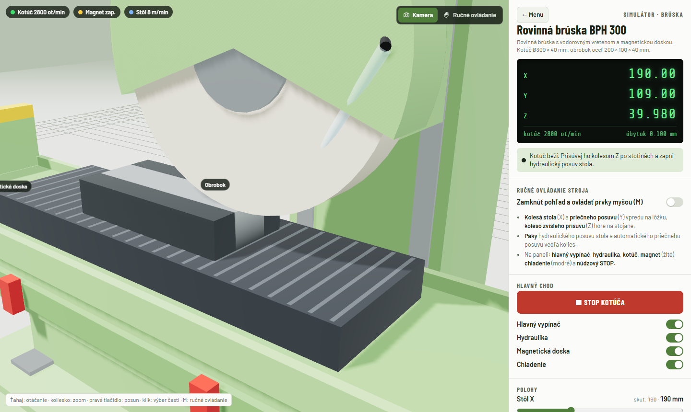
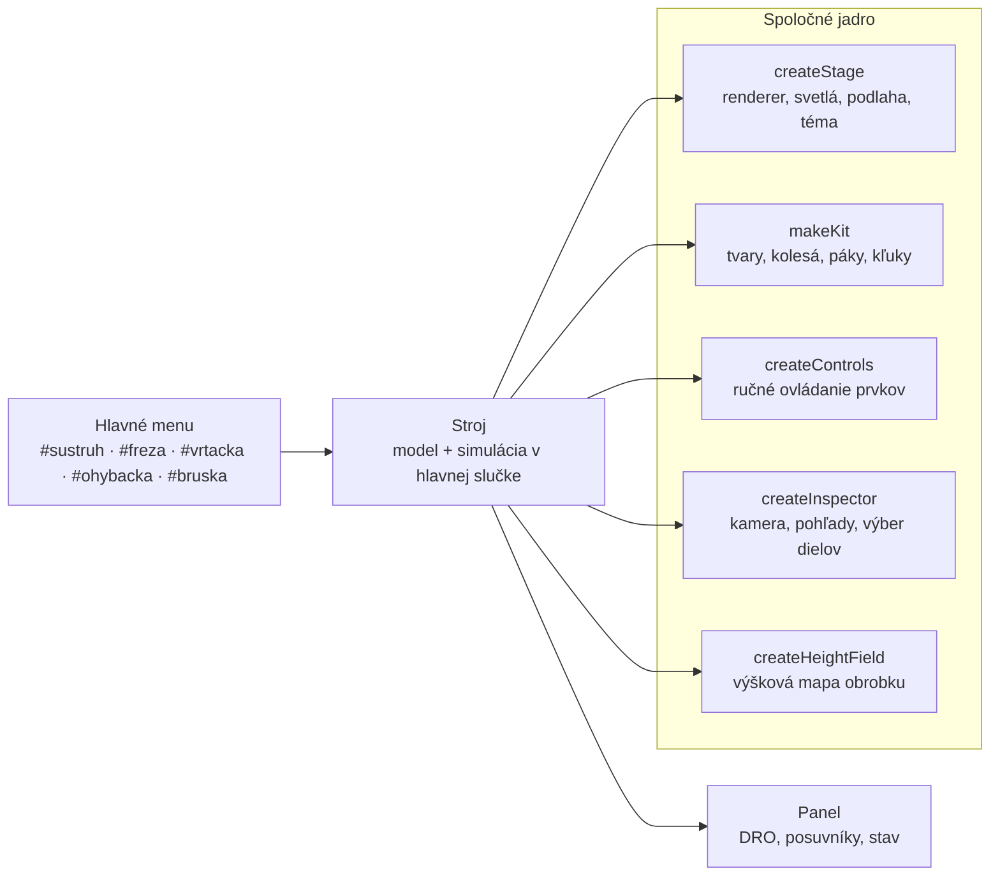
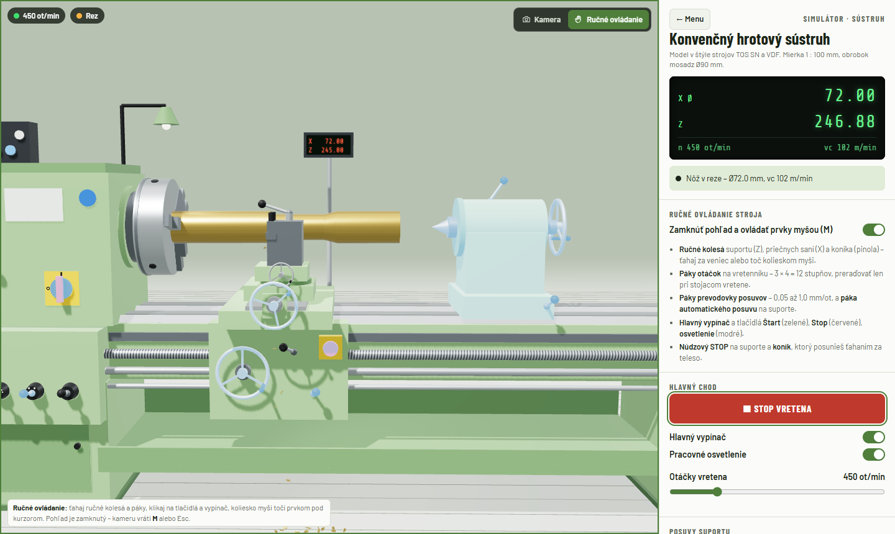
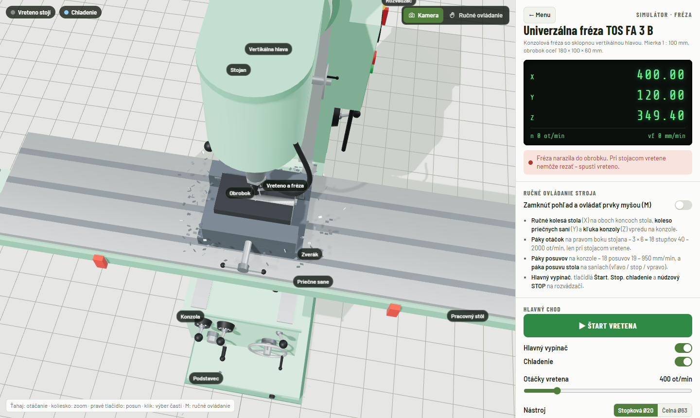

<div align="center">

# Real machine tools

**Interaktívne 3D simulátory konvenčných obrábacích a tvárniacich strojov priamo v prehliadači.**

[](https://real-machine-tools.marcel-bucala.workers.dev)


[](LICENSE)

<a href="https://real-machine-tools.marcel-bucala.workers.dev"></a>

</div>

Každý stroj je poskladaný z 3D tvarov priamo v kóde, bez externých modelov. Dá sa otáčať a približovať, jednotlivé časti sa po kliknutí zvýraznia a zobrazí sa ich popis. V stroji sa naozaj obrába: nôž odoberá materiál, fréza vyrezáva drážky, vrták vŕta diery, plech sa ohýba a brúsny kotúč odoberá stotiny milimetra. Kontroly kolízií zabránia nezmyselným pohybom.

## Stroje

<table>
  <tr>
    <td width="50%" valign="top">
      <a href="https://real-machine-tools.marcel-bucala.workers.dev/#sustruh"></a>
      <h3>🛠️ Konvenčný hrotový sústruh</h3>
      <sub>štýl TOS SN / VDF · mosadzná tyč Ø90 mm</sub>
      <ul>
        <li>priečny a pozdĺžny posuv, automatický posuv v mm/ot</li>
        <li>koník s pinolou a otočným hrotom, odpichnutie</li>
        <li>12 otáčok, prevodovka posuvov Norton, DRO na ramene</li>
      </ul>
    </td>
    <td width="50%" valign="top">
      <a href="https://real-machine-tools.marcel-bucala.workers.dev/#freza"></a>
      <h3>⚙️ Univerzálna fréza TOS FA 3 B</h3>
      <sub>konzolová fréza so sklopnou vertikálnou hlavou · oceľ 180 × 100 × 60 mm</sub>
      <ul>
        <li>stopková fréza Ø20 a čelná fréza Ø63, chladenie, triesky</li>
        <li>stôl X, sane Y, konzola Z; automatický posuv stola</li>
        <li>kolízie so zverákom, podložkami a stolom</li>
      </ul>
    </td>
  </tr>
  <tr>
    <td width="50%" valign="top">
      <a href="https://real-machine-tools.marcel-bucala.workers.dev/#vrtacka"></a>
      <h3>🔩 Stĺpová vŕtačka TOS SV16</h3>
      <sub>vŕtanie do Ø16 mm · oceľová doska na podložkách</sub>
      <ul>
        <li>priečna kľuka pinoly (100 mm), zdvíhací stôl na stĺpe</li>
        <li>vrtáky Ø6 / Ø10 / Ø16, diery naslepo aj naskrz</li>
        <li>posuv obmedzený na 0,12 mm/ot, ochrana podložiek a stola</li>
      </ul>
    </td>
    <td width="50%" valign="top">
      <a href="https://real-machine-tools.marcel-bucala.workers.dev/#ohybacka"></a>
      <h3>📐 Výkyvná ohýbačka FASTI 204-10-2</h3>
      <sub>ručná ohýbačka plechu · dĺžka ohybu 1 040 mm, do 2 mm</sub>
      <ul>
        <li>upínacia lišta na kolese cez dve zdvíhacie skrutky</li>
        <li>vykývnutie ohýbacej lišty až do 130°</li>
        <li>odpruženie plechu podľa hrúbky, ohyb len po upnutí</li>
      </ul>
    </td>
  </tr>
  <tr>
    <td width="50%" valign="top">
      <a href="https://real-machine-tools.marcel-bucala.workers.dev/#bruska"></a>
      <h3>✨ Rovinná brúska BPH 300</h3>
      <sub>kotúč Ø300 × 40 mm · magnetická doska · oceľ 200 × 100 × 40 mm</sub>
      <ul>
        <li>hydraulický pohyb stola tam a späť medzi narážkami</li>
        <li>priečny posuv na konci zdvihu, prísuv po 0,005 mm</li>
        <li>iskry, kontrola magnetu a prísuvu (max. 0,1 mm na prechod)</li>
      </ul>
    </td>
    <td width="50%" valign="top">
      
      <h3>✋ Ručné ovládanie</h3>
      <sub>kláves <kbd>M</kbd> alebo prepínač vpravo hore</sub>
      <ul>
        <li>pohľad sa zamkne, ovládacie prvky sa zvýraznia namodro</li>
        <li>ťahaním sa točia ručné kolesá a kľuky, prestavujú páky</li>
        <li>tlačidlá, vypínače a núdzový STOP sa stláčajú myšou</li>
      </ul>
    </td>
  </tr>
</table>

## Ako to funguje



| Čo sa simuluje | Ako |
| --- | --- |
| Odoberanie materiálu | sústruh: profil polomeru (340 úsekov) → `LatheGeometry`; fréza a brúska: výšková mapa s rezaním po celej dráhe medzi snímkami |
| Kolízie | nástroj voči obrobku pri stojacom vretene, voči zveráku, podložkám, stolu, koníku, magnetickej doske |
| Ručné ovládanie | pohyb myši sa premieta na dotyčnicu k obvodu kolesa v mieste uchopenia, páky majú aretované polohy |
| Mierka | 1 jednotka scény = 100 mm |

<details>
<summary><b>Ďalšie snímky</b></summary>

| | |
| --- | --- |
|  |  |
|  |  |
|  |  |
|  |  |

</details>

## Súbory

| Cesta | Obsah |
| --- | --- |
| [`public/index.html`](public/index.html) | celá aplikácia v jednom súbore (React, three.js r128, Tailwind a Babel z CDN) |
| [`src/machines.jsx`](src/machines.jsx) | ten istý kód ako ES modul – `export default App` a jednotlivé simulátory, vyžaduje `three@0.128` |
| [`wrangler.jsonc`](wrangler.jsonc) | nasadenie na Cloudflare Workers so statickými súbormi z `public/` |
| [`docs/img`](docs/img) | snímky obrazovky pre toto README |

## Spustenie

```bash
npx serve public
```

## Nasadenie

```bash
npx wrangler deploy
```

Živá verzia: **https://real-machine-tools.marcel-bucala.workers.dev**
