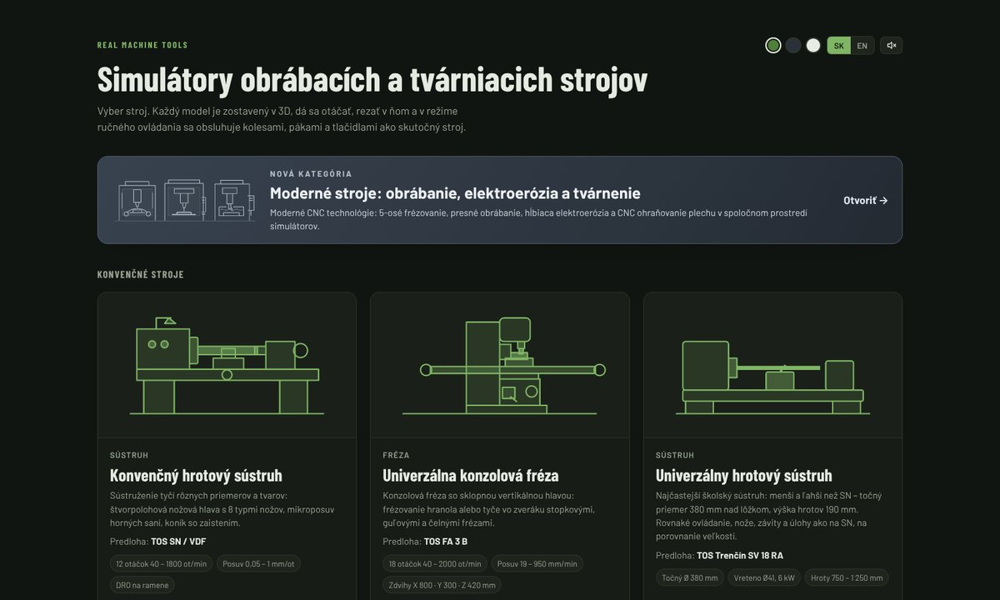
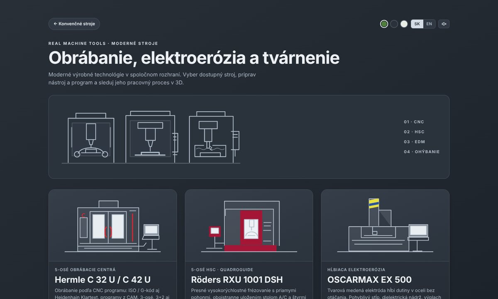

<div align="center">

# Real machine tools

**Interaktívne 3D simulátory obrábacích, tvárniacich, zváracích a moderných CNC strojov priamo v prehliadači.**

[](https://real-machine-tools.marcel-bucala.workers.dev)
[](docs/machines/README.md)


[](LICENSE)

**SK / EN** · počítač aj dotykové zariadenia · 32 strojov v 7 kategóriách



</div>

---

## ✨ Čo aplikácia ponúka

| | |
| --- | --- |
| 🧭 **3D scéna** | Otáčanie, približovanie, pripravené pohľady, názvy a opisy častí stroja. |
| 🖐️ **Ručné ovládanie** | Kolesá, páky, tlačidlá, pedále a dvere sa ovládajú priamo v modeli ako na skutočnom stroji. |
| 🔪 **Skutočný proces** | Úber materiálu, vŕtanie, brúsenie, ohýbanie, strihanie, kovanie, zváranie, elektroerózia a rezanie laserom. |
| 🖥️ **Živé HMI** | Moderné stroje majú dotykové HMI na celú obrazovku, pohľad do pracovného priestoru a split-screen. |
| 🎓 **Výučba** | Úlohy s výkresom, sprievodca krok za krokom, meranie, hodnotenie, BOZP a protokol na tlač. |
| 📦 **Exporty** | Model stroja (OBJ / STL / STEP), obrobok (STL / STEP), snímky a protokoly. |
| 📴 **Offline** | Inštalácia ako PWA; otvorené stroje fungujú aj bez pripojenia. |

## 🏭 Kategórie strojov

Kliknutím na kategóriu otvoríš [dokumentáciu strojov](docs/machines/README.md) s podrobným opisom, parametrami, zoznamom častí a snímkami každého stroja.

<table>
<tr>
<td width="33%" valign="top">
<a href="docs/machines/README.md#sustruzenie"></a>
<b><a href="docs/machines/README.md#sustruzenie">🔩 Sústruženie</a></b> · 3 stroje<br>
<sub>Hrotové sústruhy TOS SN a SV 18 RA, karuselový sústruh SK 12 – suporty, koník, závity a lunety.</sub>
</td>
<td width="33%" valign="top">
<a href="docs/machines/README.md#frezovanie"></a>
<b><a href="docs/machines/README.md#frezovanie">⚙️ Frézovanie a vŕtanie</a></b> · 7 strojov<br>
<sub>Konzolové a nástrojárske frézky, odvalovanie ozubenia, stĺpová, radiálna a horizontálna vŕtačka.</sub>
</td>
<td width="33%" valign="top">
<a href="docs/machines/README.md#brusenie"></a>
<b><a href="docs/machines/README.md#brusenie">💎 Brúsenie</a></b> · 5 strojov<br>
<sub>Rovinná, hrotová, bezhrotová a nástrojárske brúsky vrátane ostrenia nožov.</sub>
</td>
</tr>
<tr>
<td width="33%" valign="top">
<a href="docs/machines/README.md#obrazanie"></a>
<b><a href="docs/machines/README.md#obrazanie">🪚 Obrážanie a delenie</a></b> · 4 stroje<br>
<sub>Zvislé obrážačky na drážky a tvary, pásové píly na delenie tyčí a profilov.</sub>
</td>
<td width="33%" valign="top">
<a href="docs/machines/README.md#tvarnenie"></a>
<b><a href="docs/machines/README.md#tvarnenie">🛠️ Tvárnenie a kovanie</a></b> · 6 strojov<br>
<sub>Ohýbačka, tabuľové nožnice, výstredníkový lis, zakružovačky profilov a plechu, kovací buchar.</sub>
</td>
<td width="33%" valign="top">
<a href="docs/machines/README.md#zvaranie"></a>
<b><a href="docs/machines/README.md#zvaranie">🔥 Zváranie</a></b> · 2 stroje<br>
<sub>Ručné oblúkové zváranie obalenou elektródou a MIG/MAG Fronius s hodnotením húsenice.</sub>
</td>
</tr>
<tr>
<td colspan="3" valign="top">
<a href="docs/machines/README.md#moderne"></a>
<b><a href="docs/machines/README.md#moderne">🚀 Moderné CNC stroje</a></b> · 5 strojov<br>
<sub>Hermle C 32 U / C 42 U a Röders RXU 1001 (5-osé CNC, ISO a Heidenhain), OSCARMAX EX 500 (hĺbiaca elektroerózia), Amada BREVIS 1212 AJ (vláknový laser) a Bystronic Xpert Pro 320 (CNC ohraňovací lis) – živé HMI, pracovný priestor a split-screen.</sub>
</td>
</tr>
</table>

## 🚀 Rýchly štart

1. Otvor **[aplikáciu](https://real-machine-tools.marcel-bucala.workers.dev)** a vyber stroj.
2. Ťahaním otáčaj pohľad, kolieskom približuj; **Názvy častí** zobrazia popisy v scéne.
3. Prepni na **Ručné ovládanie** (kláves **M**) a obsluhuj stroj kolesami, pákami a tlačidlami.
4. Vyber **úlohu**, nechaj sa viesť sprievodcom a na konci exportuj protokol alebo obrobok.

Učiteľ môže poslať odkaz priamo na stroj alebo úlohu, napr. [`#hermle/uloha=kapsa`](https://real-machine-tools.marcel-bucala.workers.dev/#hermle/uloha=kapsa).

<details>
<summary><b>🎮 Ovládanie</b></summary>

| Režim / prvok | Použitie |
| --- | --- |
| Kamera | Ťahanie otáča pohľad, koliesko približuje; pravé tlačidlo alebo Shift posúva. Na dotyku jedno- a dvojprstové gestá. |
| Ručné ovládanie | Prepínač **Ručne** alebo kláves **M** zamkne kameru a sprístupní prvky stroja. |
| Esc | Zatvorí aktívne okno; mimo okien vráti ručný režim na kameru. |
| Pohľady | Celok, pracovný priestor, nástroj, panel a ďalšie podľa stroja. |
| Pozrieť obrobok | Vyberie obrobok zo stroja na prehliadku (otáčanie, priblíženie) a vráti ho späť. |
| Ikony **i** | Návody, podporované kódy, technické údaje a obmedzenia sekcie. |

Zvuk sa zapína ikonou reproduktora. Vzhľad (tri témy) a jazyk sa prepínajú v menu. Knižnice a uložené obrobky sú v lokálnom úložisku prehliadača.

</details>

<details>
<summary><b>🖥️ HMI moderných strojov</b></summary>

HMI sa otvára tlačidlom **HMI** alebo dvojklikom na displej v ručnom režime. Lišta HMI obsahuje:

- **Priestor (▣)** – samostatné okno so živým pohľadom do pracovného priestoru,
- **Split (◫)** – živý proces vedľa ovládateľného HMI (na šírku vľavo, na výšku hore),
- **zvuk** a **zatvorenie** (alebo Esc).

| Stroj | HMI a proces |
| --- | --- |
| Hermle, Röders | NC editor (ISO/Fanuc, Heidenhain Klartext), 3+2 a 5-osé pohyby, voxelový úber, nástroje, kolízie. Výmena dát s CAM: [PowerMill](docs/cam/powermill-exchange.md). |
| OSCARMAX EX 500 | Hĺbenie Cu a grafitovými elektródami, operácie alebo G-kód, výplach, iskrenie, hrubovanie E1 a dokončenie E2. |
| Amada BREVIS 1212 AJ | Dotykové AMNC 3i (PROGRAM, CONDITION, MANUAL, SETUP, MAINT), rezné podmienky, rezacia paleta, kaskádové dvere a pedál. |
| Bystronic Xpert Pro | Záložky Diel, Nástroje, Ohýbanie, Stroj, Diagnostika; sila, odpruženie, program krabičky s otáčaním plechu. |

</details>

<details>
<summary><b>📦 Exporty</b></summary>

| Výstup | Obsah |
| --- | --- |
| **Model stroja: OBJ / STL / STEP** | Tlačidlo **Stiahnuť model** v päte menu – aktuálna poloha a viditeľné diely, bez obrobku a podlahy. |
| **Obrobok: STL / STEP** | Aktuálny stav vrátane prerušeného úberu alebo čiastočného ohybu. |
| **PNG** | Snímka scény na strojoch s príslušným tlačidlom. |
| **HTML / JSON** | Protokoly, knižnice nástrojov a elektród, nastavenia a diagnostika. |

CAD rozmery sú v milimetroch; STEP je plošková geometria bez parametrickej histórie.

</details>

## 📚 Dokumentácia

| | |
| --- | --- |
| 📘 [**Dokumentácia strojov**](docs/machines/README.md) | Všetky stroje s obrázkami, parametrami, opisom a zoznamom častí. |
| 📐 [Podklady presných modelov](docs/precision-machines.md) | Rozmery, fotografie, rekonštrukcie a obmedzenia moderných strojov. |
| 🔁 [Výmena dát s PowerMill](docs/cam/powermill-exchange.md) | Postup CAM → NC program pre Hermle a Röders. |
| 📝 [História zmien](CHANGELOG.md) | Zmeny po dňoch. |
| 🔍 Audity | [Aplikácia](docs/AUDIT.md) · [Moderné stroje (11/2026)](docs/AUDIT-2026-11.md) · [Klasické stroje (11/2026)](docs/AUDIT-2026-11-klasicke-stroje.md) |

> Simulátory sú výučbové. Modely kombinujú procedurálnu geometriu, katalógové rozmery a rekonštrukciu fotografií (mierka **1 jednotka = 100 mm**). Odhady času, sily, odpruženia a úberu nenahrádzajú technologický predpis.

## 🧑‍💻 Vývoj

<details>
<summary><b>Spustenie projektu</b></summary>

Potrebný je **Node.js ≥ 22.12**, npm a prehliadač s WebGL2.

```bash
npm ci
```

```bash
npm run dev
```

Prístup z iného zariadenia v sieti:

```bash
npm run dev -- --host 0.0.0.0
```

Produkčné zostavenie a náhľad:

```bash
npm run build
```

```bash
npm run preview -- --host 0.0.0.0
```

**`public/` je zostavený výstup, ktorý sa commituje.** Zdrojové zmeny patria do `src/`, statické vstupy do `static/`; build aktualizuje `public/` vrátane service workera.

</details>

<details>
<summary><b>Kontroly a testy</b></summary>

Súhrnná kontrola zhodná s CI (lint, Prettier, Vitest, build a kontrola `public/`):

```bash
npm run check
```

Test v prehliadači (Playwright) otvorí menu a všetky stroje nad zostaveným `public/`, prejde CNC program na Hermle, ohyb na Bystronic a štart elektroerózie:

```bash
npx playwright install chromium
```

```bash
npm run test:e2e
```

V CI beží test v prehliadači **len na vyžiadanie** (~25 min): **Actions → CI → Run workflow** so zaškrtnutou voľbou „Spustiť aj test v prehliadači“, alebo štítok `e2e` na pull requeste.

Výkon na slabšom počítači: `?perf` v adrese (napr. [`?perf#hermle`](https://real-machine-tools.marcel-bucala.workers.dev/?perf#hermle)) zobrazí FPS a 12-sekundový test. Diagnostika: `?debug`, `?hq` (bez znižovania kvality), `?noopt` (bez zlučovania sietí).

</details>

<details>
<summary><b>Štruktúra repozitára</b></summary>

| Cesta | Úloha |
| --- | --- |
| [`src/App.jsx`](src/App.jsx) | Menu strojov, hash smerovanie a lazy načítanie simulátorov. |
| [`src/core/`](src/core) | Scéna, kamera, fyzické ovládanie, prehliadka obrobku, zvuk, exporty, živý pracovný pohľad. |
| [`src/machines/`](src/machines) | Simulátory, matematické modely, procesy a ovládacie panely. |
| [`src/machines/cnc/`](src/machines/cnc) | CNC jadro: NC interpreter, kinematika, voxelový obrobok, nástroje, Hermle. |
| [`src/machines/precision/`](src/machines/precision) | Röders, OSCARMAX, Amada, Bystronic a ich procesy. |
| [`src/ui/`](src/ui) | Spoločné ovládanie, HMI, split-screen, knižnice, výkresy a protokoly. |
| [`tests/`](tests) · [`tests-e2e/`](tests-e2e) | Vitest a test v prehliadači. |
| [`docs/`](docs) | Dokumentácia strojov, podklady modelov, CAM a audity. |
| [`public/`](public) | Commitovaný produkčný výstup Vite. |
| [`.github/workflows/ci.yml`](.github/workflows/ci.yml) | Kontroly, build, test v prehliadači na vyžiadanie a nasadenie. |

Technológie: React 19, three.js r186, Tailwind CSS 3, Vite 8, Vitest, Playwright a Cloudflare Workers.

</details>

<details>
<summary><b>Nasadenie</b></summary>

Po pushi do `main` workflow **CI** vykoná kontroly a nasadí aplikáciu na Cloudflare Workers. Potrebné tajomstvá repozitára: `CLOUDFLARE_API_TOKEN` a `CLOUDFLARE_ACCOUNT_ID` (bez nich sa krok preskočí s upozornením). Lokálne:

```bash
npm run deploy
```

Živá aplikácia: **https://real-machine-tools.marcel-bucala.workers.dev**

</details>

## ™️ Ochranné známky

Názvy, logá a označenia strojov (Hermle, Röders, OSCARMAX, Amada, Bystronic, ShuangliCNC, Heidenhain, Siemens, Fronius, TOS, Šmeral, Pilous a ďalšie) sú ochranné známky ich vlastníkov a slúžia len na identifikáciu predlohy. Projekt nie je spojený s výrobcami ani nimi podporovaný. 3D modely sú výučbové rekonštrukcie podľa verejných katalógov a fotografií. Licencia [MIT](LICENSE) sa vzťahuje len na zdrojový kód projektu.
