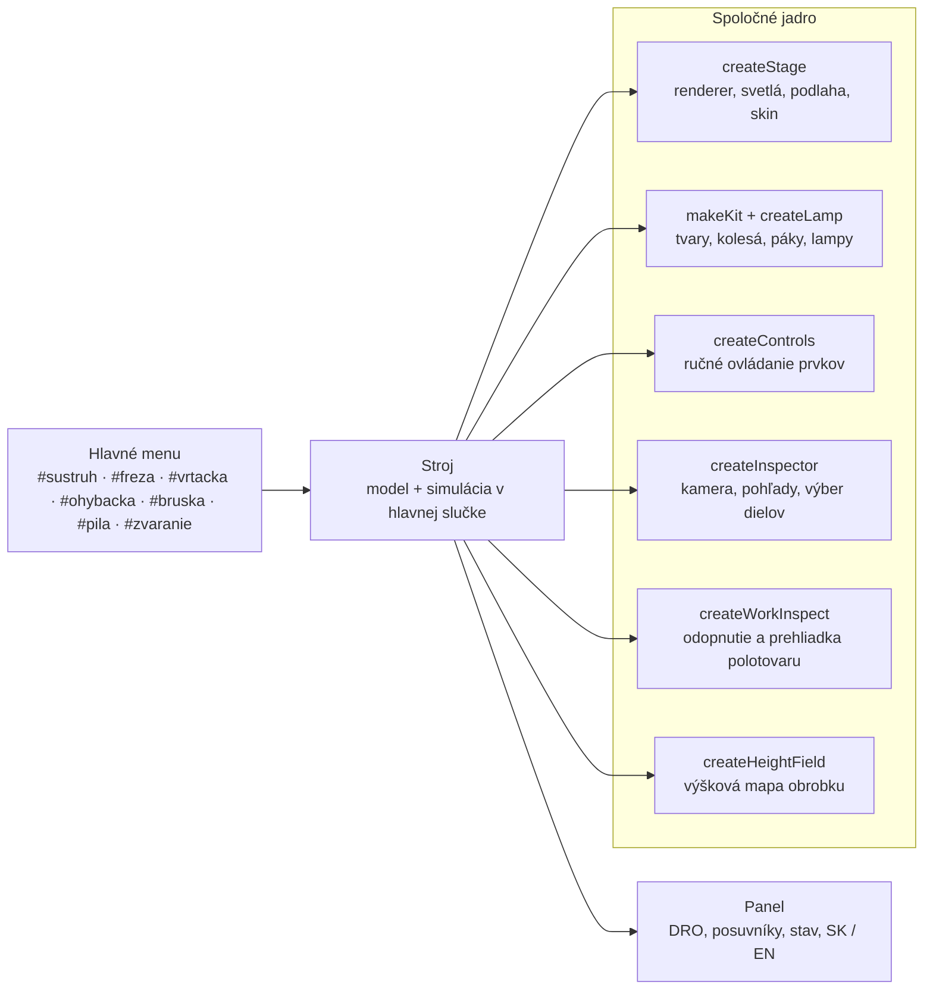

<div align="center">

# Real machine tools

**Interaktívne 3D simulátory konvenčných obrábacích a tvárniacich strojov priamo v prehliadači.**

[](https://real-machine-tools.marcel-bucala.workers.dev)


[](LICENSE)

<a href="https://real-machine-tools.marcel-bucala.workers.dev"></a>

</div>

Každý stroj je poskladaný z 3D tvarov priamo v kóde, bez externých modelov. Dá sa otáčať a približovať, jednotlivé časti sa po kliknutí zvýraznia a zobrazí sa ich popis. V stroji sa naozaj obrába: nôž odoberá materiál podľa svojho tvaru, fréza vyrezáva drážky, vrták vŕta diery, plech sa ohýba, brúsny kotúč odoberá stotiny milimetra a pásová píla reže dosku. Kontroly kolízií zabránia nezmyselným pohybom.

**Spoločné pre všetky stroje:** slovenčina aj angličtina (prepínač SK / EN), tri vzhľady (zelený, tmavý, svetlý), voľba rozmeru a tvaru polotovaru, tlačidlo **Odopnúť polotovar** – kus sa vyberie zo stroja, dá sa otáčať a po „Upnúť späť“ sa vráti na pôvodné miesto.

## Stroje

<table>
  <tr>
    <td width="50%" valign="top">
      <a href="https://real-machine-tools.marcel-bucala.workers.dev/#sustruh"></a>
      <h3>🛠️ Konvenčný hrotový sústruh</h3>
      <sub>predloha TOS SN / VDF · tyč kruhová alebo šesťhran, mosadz / oceľ / hliník</sub>
      <ul>
        <li>štvorpolohová nožová hlava, 8 typov nožov v pravom aj ľavom prevedení, animovaná výmena</li>
        <li>horné sane s mikroposuvom, páky odistenia hlavy, pinoly a koníka</li>
        <li>12 otáčok, prevodovka posuvov Norton, DRO na ramene, pracovná lampa</li>
      </ul>
    </td>
    <td width="50%" valign="top">
      <a href="https://real-machine-tools.marcel-bucala.workers.dev/#freza"></a>
      <h3>⚙️ Univerzálna konzolová fréza</h3>
      <sub>predloha TOS FA 3 B · hranol alebo tyč vo zveráku</sub>
      <ul>
        <li>stopkové frézy Ø6 – Ø25, guľové Ø6 – Ø16, čelné Ø50 – Ø100</li>
        <li>stôl X, sane Y, konzola Z; automatický posuv stola, chladenie</li>
        <li>zverák sa prispôsobí šírke obrobku, kolízie s čeľusťami a podložkami</li>
      </ul>
    </td>
  </tr>
  <tr>
    <td width="50%" valign="top">
      <a href="https://real-machine-tools.marcel-bucala.workers.dev/#vrtacka"></a>
      <h3>🔩 Stĺpová vŕtačka</h3>
      <sub>predloha TOS SV16 · oceľová doska na podložkách</sub>
      <ul>
        <li>priečna kľuka pinoly (100 mm), zdvíhací stôl na stĺpe</li>
        <li>vrtáky Ø3 – Ø16, diery naslepo aj naskrz</li>
        <li>posuv obmedzený na 0,12 mm/ot, ochrana podložiek a stola</li>
      </ul>
    </td>
    <td width="50%" valign="top">
      <a href="https://real-machine-tools.marcel-bucala.workers.dev/#ohybacka"></a>
      <h3>📐 Výkyvná ohýbačka plechu</h3>
      <sub>predloha FASTI 204-10-2 · dĺžka ohybu 1 040 mm, do 2 mm</sub>
      <ul>
        <li>upínacia lišta na kolese cez dve zdvíhacie skrutky</li>
        <li>vykývnutie ohýbacej lišty až do 130°</li>
        <li>odpruženie plechu podľa hrúbky, ohyb len po upnutí</li>
      </ul>
    </td>
  </tr>
  <tr>
    <td width="50%" valign="top">
      <a href="https://real-machine-tools.marcel-bucala.workers.dev/#bruska"></a>
      <h3>✨ Rovinná brúska</h3>
      <sub>predloha BPH 300 · kotúč Ø300 × 40 mm · magnetická doska</sub>
      <ul>
        <li>hydraulický pohyb stola tam a späť, priečny posuv na konci zdvihu</li>
        <li>prísuv po 0,005 mm, iskry, kvapky a hmla emulzie</li>
        <li>kontrola magnetu a prísuvu (max. 0,1 mm na prechod)</li>
      </ul>
    </td>
    <td width="50%" valign="top">
      <a href="https://real-machine-tools.marcel-bucala.workers.dev/#pila"></a>
      <h3>🪚 Strojná pásová píla</h3>
      <sub>predloha TOS PPN · kolesá Ø720 mm · drevo, hliník, oceľ</sub>
      <ul>
        <li>napínanie pásu, horné vodidlo s hviezdicovým kolieskom</li>
        <li>3 rýchlosti pásu podľa materiálu, rovnomerný posuv</li>
        <li>viditeľný rez, odrezok sa po dorezaní oddelí</li>
      </ul>
    </td>
  </tr>
</table>

<table>
  <tr>
    <td width="50%" valign="top">
      <a href="https://real-machine-tools.marcel-bucala.workers.dev/#zvaranie"></a>
    </td>
    <td width="50%" valign="top">
      <h3>⚡ Oblúková zváračka</h3>
      <sub>predloha Elektrokov JS 90FN · ručné zváranie obalenou elektródou (MMA)</sub>
      <ul>
        <li>10 druhov zvarov (I, V, ½V, Y, U, J, kútový, presahový, lemový, návar) so zvarovou prípravou podľa hrúbky</li>
        <li>polohy PA – PG (1G – 4G/F), kontrola smeru pri PF a PG</li>
        <li>prúd 55 – 155 A, prepínač 380 / 220 V (istič pri 220 V nad 75 A), rutilové a bázické elektródy Ø2 – Ø4</li>
        <li>húsenica podľa prúdu, rýchlosti a dĺžky oblúka; troska, popúšťacie farby, hodnotenie zvaru</li>
        <li>kukla (H): moderná samostmievacia (DIN 9 – 13, oneskorenie) alebo stará s pevným tmavým sklom</li>
        <li>režim <b>Zváranie</b> (M): pravé tlačidlo vedie elektródu, pravé + ľavé zvára, na dotyk dva prsty; v režime kamery pravé tlačidlo posúva pohľad</li>
        <li>navárať sa dá kdekoľvek na diel, ďalšie vrstvy sa ukladajú na predchádzajúce</li>
      </ul>
    </td>
  </tr>
</table>

**Pripravujeme:** rúrové polohy PH, PJ a H-L045 (5G, 6G).

### ✋ Ručné ovládanie

Kláves <kbd>M</kbd> alebo prepínač vpravo hore zamkne pohľad a ovládacie prvky sa zvýraznia namodro. Ťahaním sa točia ručné kolesá a kľuky a prestavujú páky, tlačidlá, vypínače a núdzový STOP sa stláčajú myšou. Pracovné lampy (sústruh, fréza, brúska) majú skutočné bodové svetlo s tieňmi.

## Ako to funguje



| Čo sa simuluje | Ako |
| --- | --- |
| Odoberanie materiálu | sústruh: profil polomeru (340 úsekov) a tvar ostria zvoleného noža → `LatheGeometry`; fréza a brúska: výšková mapa s rezaním po celej dráhe medzi snímkami |
| Kolízie | nástroj voči obrobku pri stojacom vretene, bok noža voči materiálu, zverák, podložky, stôl, koník, magnetická doska, horné vodidlo píly |
| Ručné ovládanie | pohyb myši sa premieta na dotyčnicu k obvodu kolesa v mieste uchopenia, páky majú aretované polohy |
| Jazyk | každý text má slovenskú aj anglickú podobu, `L(sk, en)` |
| Mierka | 1 jednotka scény = 100 mm |

<details>
<summary><b>Ďalšie snímky</b></summary>

| | |
| --- | --- |
|  |  |
|  |  |
|  |  |
|  |  |
|  |  |
|  |  |

</details>

## Súbory

| Cesta | Obsah |
| --- | --- |
| [`public/index.html`](public/index.html) | celá aplikácia v jednom súbore (React, three.js r128, Tailwind a Babel z CDN) |
| [`src/machines.jsx`](src/machines.jsx) | zdrojový kód ako ES modul – `export default App` a jednotlivé simulátory, vyžaduje `three@0.128`; zmeny sa robia tu |
| [`tools/sync-index.mjs`](tools/sync-index.mjs) | prenesie `src/machines.jsx` do `public/index.html`, s `--check` len overí zhodu |
| [`wrangler.jsonc`](wrangler.jsonc) | nasadenie na Cloudflare Workers so statickými súbormi z `public/` |
| [`docs/img`](docs/img) | snímky obrazovky pre toto README |
| [`docs/AUDIT.md`](docs/AUDIT.md) | audit aplikácie – zistenia, návrhy opráv a vylepšení |

## Spustenie

```bash
npx serve public
```

Kód sa upravuje v `src/machines.jsx`, potom sa prenesie do `public/index.html`:

```bash
node tools/sync-index.mjs
```

Pred commitom sa dá overiť, že oba súbory sú zhodné:

```bash
node tools/sync-index.mjs --check
```

## Nasadenie

```bash
npx wrangler deploy
```

Živá verzia: **https://real-machine-tools.marcel-bucala.workers.dev**
