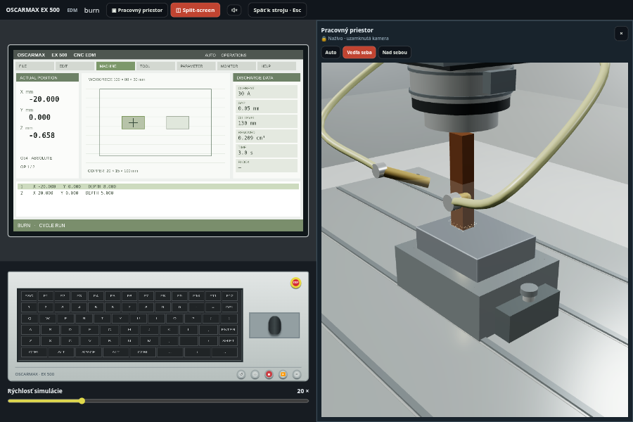

# Real machine tools

Interaktívne 3D simulátory obrábacích strojov, CNC, hĺbiacej elektroerózie a tvárnenia plechu v prehliadači. Rozhranie je v slovenčine a angličtine; aplikácia funguje na počítači aj dotykovom zariadení.

**[Spustiť aplikáciu](https://real-machine-tools.marcel-bucala.workers.dev)** · **[Moderné stroje](https://real-machine-tools.marcel-bucala.workers.dev/#moderne)** · [Podklady presných modelov](docs/precision-machines.md) · [Licencia MIT](LICENSE)


## Čo aplikácia obsahuje

- Otočnú a približovaciu kameru, pripravené pohľady, výber a opis dielov.
- Ručné ovládanie kolies, pák, tlačidiel, dverí a panelov priamo v 3D, podľa vybavenia stroja.
- Úber materiálu, vŕtanie, ohýbanie, brúsenie alebo zváranie podľa zvoleného procesu.
- Výučbové úlohy, výkresy, meranie a protokoly na podporovaných konvenčných strojoch.
- Živé HMI moderných strojov, samostatný pracovný pohľad a split-screen s ovládaním aj procesom naraz.
- Prehliadku obrobku mimo stroja a export aktuálnej geometrie; samostatne aj export celého stroja.
- Prepínanie SK / EN, tri vzhľady a syntetizovaný zvuk. Každé nové načítanie začína so zvukom vypnutým.
- Offline režim a inštaláciu ako PWA po načítaní a uložení súborov do vyrovnávacej pamäte.

Rozmery majú v modeloch spoločnú mierku **1 jednotka scény = 100 mm**. Modely kombinujú procedurálnu geometriu, katalógové rozmery a rekonštrukciu fotografií; niektoré časti používajú spracované referenčné CAD alebo sieťové podklady. Zdroje a odhady sú uvedené v [dokumentácii modelov](docs/precision-machines.md) a pod ikonami **i** pri príslušných sekciách.

## Dostupné stroje

### Konvenčné stroje a zváranie

| Stroj | Predloha / proces | Spustiť |
| --- | --- | --- |
| Hrotový sústruh | TOS SN / VDF, varianty SN 32 / 40 / 50 / 55; sústruženie, závity, lunety | [Sústruh](https://real-machine-tools.marcel-bucala.workers.dev/#sustruh) |
| Univerzálna fréza | TOS FA 3 B; frézy, zverák, deliaci prístroj | [Fréza](https://real-machine-tools.marcel-bucala.workers.dev/#freza) |
| Stĺpová vŕtačka | TOS SV16; slepé a priechodné otvory | [Vŕtačka](https://real-machine-tools.marcel-bucala.workers.dev/#vrtacka) |
| Radiálna vŕtačka | TOS VO 50; otočné rameno a automatický posuv | [Radiálna vŕtačka](https://real-machine-tools.marcel-bucala.workers.dev/#radialka) |
| Horizontálna vyvrtávačka | TOS Varnsdorf W; os W, otočný stôl a vyvrtávanie | [Horizontálka](https://real-machine-tools.marcel-bucala.workers.dev/#horizontalka) |
| Odvalovacia frézka | Výroba čelných ozubených kolies | [Odvalovacia frézka](https://real-machine-tools.marcel-bucala.workers.dev/#odvalovacka) |
| Výkyvná ohýbačka | FASTI 204-10-2; upnutie, ohyb, odpruženie | [Ohýbačka](https://real-machine-tools.marcel-bucala.workers.dev/#ohybacka) |
| Tabuľové nožnice | BS 2000/8; zadný doraz a strihanie | [Nožnice](https://real-machine-tools.marcel-bucala.workers.dev/#noznice) |
| Výstredníkový lis | TOMA LEN 40C; dierovanie a vystrihovanie | [Lis](https://real-machine-tools.marcel-bucala.workers.dev/#lis) |
| Zakružovačka profilov | COMAC 3025 HV; tri valce, profily a rúry | [Profily](https://real-machine-tools.marcel-bucala.workers.dev/#profilova) |
| Zakružovačka plechu | TOS XZC 3000/10; predohnutie a vysunutie plášťa | [Plech](https://real-machine-tools.marcel-bucala.workers.dev/#zakruzovacka) |
| Rovinná brúska | BPH 300; magnetická doska, prísuv, chladenie | [Rovinná brúska](https://real-machine-tools.marcel-bucala.workers.dev/#bruska) |
| Brúska na guľato | Hrotové brúsenie vonkajších priemerov | [Brúska na guľato](https://real-machine-tools.marcel-bucala.workers.dev/#gulato) |
| Zvislá obrážačka | Drážky a vnútorné tvary v náboji | [Zvislá obrážačka](https://real-machine-tools.marcel-bucala.workers.dev/#zobrazacka) |
| Pásová píla | TOS PPN; rezanie a oddelenie odrezku | [Píla](https://real-machine-tools.marcel-bucala.workers.dev/#pila) |
| Ručné oblúkové zváranie | Elektróda, príprava spoja a hodnotenie húsenice | [MMA](https://real-machine-tools.marcel-bucala.workers.dev/#zvaranie) |
| MIG/MAG | Fronius TransPuls Synergic TPS 450; drôt, plyn a synergia | [MIG/MAG](https://real-machine-tools.marcel-bucala.workers.dev/#mag) |

Vodorovná obrážačka zostáva v zdrojoch, ale je skrytá z hlavného výberu.

### Moderné stroje

| Stroj | Parametre a funkcie | Spustiť |
| --- | --- | --- |
| **Hermle C 32 U / C 42 U** | X/Y/Z 650/650/500 alebo 800/800/550 mm, stôl Ø650/Ø800, A/C, ISO a Heidenhain Klartext | [Hermle](https://real-machine-tools.marcel-bucala.workers.dev/#hermle) |
| **Röders RXU 1001 DSH** | X/Y/Z 800/855/500 mm, stôl Ø600, A ±115°, 24 000 ot/min, 24 nástrojov, RMS terminál | [Röders](https://real-machine-tools.marcel-bucala.workers.dev/#roeders) |
| **OSCARMAX EX 500** | Hĺbiaca EDM, dráhy 500/400/450 mm, stôl 850 × 450 mm, generátor 60 A, Cu a grafit, operácie alebo G-kód | [OSCARMAX](https://real-machine-tools.marcel-bucala.workers.dev/#oscarmax) |
| **Bystronic Xpert Pro 320/4300** | Štandardná výška; 3 200 kN, dĺžka ohybu 4 300 mm, zdvih 250 mm, otvorenie bez nástrojov 640 mm | [Bystronic](https://real-machine-tools.marcel-bucala.workers.dev/#bystronic) |

**ShuangliCNC ZJA13-2013F · Siemens Edition** je na žiadosť používateľa skrytý. Geometria, proces, konfigurácia a testy zostávajú zachované; `#shuangli` otvorí menu moderných strojov. Údaje referenčného Zonjet ZJA13-1610 nie sú garantovanou špecifikáciou verzie 2013F.

## Ovládanie

| Režim / prvok | Použitie |
| --- | --- |
| Kamera | Ťahanie otáča pohľad, koliesko približuje; pravé tlačidlo alebo Shift posúva pohľad. Na dotyku sa používajú jedno- a dvojprstové gestá. |
| Ručné ovládanie | Prepínač **Ručne** alebo kláves **M** zamkne kameru a sprístupní prvky stroja. Kolesá a páky sa ťahajú, tlačidlá a pedále sa stláčajú. |
| Esc | Zatvorí aktívne okno; mimo okien vráti ručný režim na kameru. |
| Predvolené pohľady | Celok, pracovný priestor, nástroj, panel a ďalšie pohľady podľa stroja. |
| Výber dielu | Kliknutie na stroj alebo položku v zozname zvýrazní diel a zobrazí jeho opis. |
| Prehliadka obrobku | **Pozrieť obrobok** odopne rovnaký kus; po prehliadke sa vráti na pôvodné miesto. Potrebné odtiahnutie nástroja alebo otvorenie nádrže závisí od stroja. |
| Informácie | Ikony **i** obsahujú návody, podporované kódy, technické údaje a obmedzenia danej sekcie. |

Zvuk sa zapína ikonou reproduktora. Moderné stroje majú vlastné farebné akcenty; dostupné vzhľady sa prepínajú v menu. Vybrané knižnice, nastavenia a uložené obrobky používajú lokálne úložisko prehliadača; nejde o spoločné cloudové úložisko.

Tlačidlo **Názvy častí** pri názve každého stroja zapína popisy v 3D scéne. Zapnutý stav je farebne zvýraznený; kliknutie na popis vyberie príslušnú časť.

## HMI a živý pracovný priestor

HMI sa otvára tlačidlom **HMI cez celé okno** alebo ovládaním displeja v ručnom režime podľa stroja. Röders a OSCARMAX zdieľajú medzi monitorom v 3D a fullscreen rovnaký živý canvas. Hermle a Shuangli tiež zrkadlia svoj displej; Bystronic má interaktívne obrazovky prepojené s rovnakým kontrolérom a údajmi v 3D termináli.

V hornej lište fullscreen HMI sú:

- **Priestor (▣):** samostatné okno so živou scénou a pevnou kamerou. Zobrazuje iba obraz a krížik na zatvorenie.
- **Split (◫):** živý pracovný priestor je v orientácii na šírku vždy vľavo od ovládateľného HMI a v orientácii na výšku vždy hore. Rozloženie sa automaticky prispôsobí otočeniu displeja. Aj tento pohľad má iba krížik na zatvorenie.

Lišta HMI zostáva v jednom riadku. Na úzkom displeji sú tlačidlá pracovného priestoru a splitu ikonové; ich úplné názvy zostávajú dostupné pre čítačky obrazovky. Displej HMI sa škáluje podľa šírky aj výšky svojho panela a neprekrýva ovládacie prvky.

Pracovný pohľad používa tú istú simuláciu a vlastnú kameru. Priebežne zobrazuje pohyb osí, nástroj, aktuálny úber a efekty; neslúži ako uložená snímka. Ťahanie v tomto pohľade nemení hlavnú kameru. Otvorenie ani zatvorenie pohľadu nemení rozpracovaný cyklus. Dosiahnutá snímková frekvencia závisí od zariadenia.

### CNC: Hermle a Röders

- Editor a načítanie NC programu, kontrola blokov, štart, hold, reset a režim po blokoch.
- ISO/Fanuc a podporovaná podmnožina Heidenhain Klartext; prehľad je priamo v informačnom okne sekcie Program/CAM.
- Súvislé 3-osé, polohované 3+2 a podporované simultánne 5-osé pohyby, rotačný stôl A/C, TCP, nástroje a výmeny.
- Úber materiálu z aktuálneho voxelového poľa, kontrola podporovaných kolízií, zaťaženie a export rozpracovaného obrobku.
- Knižnica nástrojov, HMI, osvetlenie, dvere a servisné blokovania. Hermle má voliteľný dopravník triesok, filtráciu a dochladzovač.

Pre výmenu dát s PowerMill pozri [postup CAM](docs/cam/powermill-exchange.md). Podporovaný NC jazyk je výučbovou podmnožinou; neimplementuje celý firmvér TNC ani RMS6.

### OSCARMAX: hĺbiaca elektroerózia

Elektróda sa netočí. Tvarová Cu alebo grafitová elektróda vytvára dutinu v upnutom oceľovom polotovare **100 × 80 × 30 mm**. Nádrž, dielektrikum, výplach, upnutie a STOP tvoria podmienky štartu. Hold zachová dutinu aj miesto v cykle.

Skrinka obsahuje medené elektródy a grafitové hranoly **8 × 8, 12 × 12, 20 × 15 a 30 × 20 mm**, všetky L100 mm. Grafitové položky sa doplnia aj do staršej uloženej skrinky. Možno spravovať vlastné elektródy a importovať/exportovať JSON s materiálom a rozmermi.

Riadenie má dva režimy:

1. **Operácie:** súradnice X/Y a hĺbka každej dutiny.
2. **G-kód / ISO:** editor, NC/TAP/TXT/ISO súbor do 256 kB, ukážka a kontrola s číslom chybného riadku.

NC podporuje `G0`, `G1`, `G21`, `G90`, `G91`, `G54`, `G94`, `F`, `M3/M5`, `M8/M9`, `M2/M30`. G54 Z0 je horná plocha obrobku, záporné Z zadáva hĺbku. Pred XY a na konci programu sa používa bezpečný zdvih `G0 Z5`. M8 pri novom štarte zapne výplach a koncové M9 ho po dokončení vypne. F v mm/min obmedzuje výučbový servo-prísuv. Nepodporované kódy, oblúky a nebezpečné presuny sa odmietajú.

```gcode
G21 G90 G94 G54
M3 M8
G0 Z5
G0 X-20 Y0
G1 Z-5 F3
G0 Z5
M5 M9
M30
```

Výučbový model generátora: úber je úmerný prúdu (meď ≈ 7, grafit ≈ 10 mm³/(A·min)), rýchlosť hĺbenia je úber delený plochou čela elektródy, takže veľká elektróda hĺbi pomalšie. Prúd určuje aj výbojovú medzeru (bočný a čelný presah dutiny) a drsnosť dna Ra / VDI 3400; panel ich zobrazuje pri nastavení prúdu. Koeficienty sú orientačné tabuľkové hodnoty, nie údaje OSCARMAX.

Operácia si môže zvoliť elektródu **E1** (hrubovacia) alebo **E2** (dokončovacia) a vlastný prúd; pri zmene elektródy sa vloží výmena (~15 s). Servo prechádza prázdnym priestorom rýchlo a rýchlosť hĺbenia počíta z plochy čela, ktorá je v zábere – dokončenie po hrubovaní tak neodoberá znova celú hĺbku.

Iskrenie schematicky zvýrazňuje aktívnu výbojovú zónu. Je viazané na prebiehajúce hĺbenie a vypne sa pri holde, STOP, otvorení nádrže alebo strate výplachu; dá sa vypnúť aj samostatne. Úberová rýchlosť, opotrebenie a svetelný efekt sú výučbové odhady.

### Bystronic: ohýbanie plechu

Vybraná verzia je **Xpert Pro 320/4300 v štandardnej výške** podľa technického listu výrobcu (Bystronic Xpert Pro, technické údaje, s. 4 – dokument je dostupný u výrobcu, v repozitári sa nešíri).

- Jeden ohyb vo vzduchu so segmentovaným 85° horným nástrojom a skutočným V-výrezom matrice.
- Materiál, prírez, hrúbka, vnútorný uhol, zadný doraz X, výška R a otvorenie V.
- Odhad sily, limit 3 200 kN, kontrola ramena, matrice a vyloženia rámu; približné odpruženie.
- Funkčné záložky **Diel, Nástroje, Ohýbanie, Stroj, Diagnostika**, uložené nastavenia dielov a histórie udalostí.
- Fyzické pedále a tlačidlá, mobilný terminál a samostatný STOP panel. Uvoľnenie STOP samo nespustí pohyb.
- Zachovanie čiastočného ohybu pri prerušení, prehliadka a export plechu po zdvihnutí barana.



## Výučba a rozsah simulácie

Konvenčné aj moderné stroje ponúkajú úlohy s kótovaným náčrtom, priebežné meranie, hodnotenie, kontrolné zoznamy BOZP a HTML protokol vhodný na tlač/PDF. Učiteľ môže poslať odkaz na konkrétnu úlohu, napr. `#hermle/uloha=kapsa`.

| Stroj | Úlohy |
| --- | --- |
| Hermle C 32 / C 42, Röders RXU | kapsa 40 × 30 × 5 ±0,1 mm (doplniť program), oprava chybného zápichu G0, 3+2 šikmá plocha 30° (G68.2) |
| OSCARMAX EX 500 | dutina 20,3 × 15,3 × 6,00 mm (prúd podľa medzery, hĺbka zmenšená o čelnú medzeru), dokončenie Ra ≤ 1,6 µm, hrubovanie E1 a dokončenie E2 |
| Bystronic Xpert Pro 320 | uholník 90° (V = 6 – 10 × t), ohyb 6 mm × 3 m do 50 % sily lisu |

Rozmery CNC a EDM obrobku sa merajú priamo z voxelového poľa vzdialeností (`src/machines/cnc/measure.js`).

Geometria obrobkov používa podľa procesu profil polomeru, výškové pole, voxelové pole, prierez plechu alebo samostatný matematický model. Voxelový CNC/EDM obrobok sa mení priebežne a sieť sa aktualizuje po častiach. Kontroly kolízií a blokovania pokrývajú implementované situácie, nie všeobecnú analýzu ľubovoľnej výrobnej zostavy.

Simulátory sú určené na výučbu a vizualizáciu. Odhady času, sily, odpruženia, úberu a opotrebenia nenahrádzajú technologický predpis. Výstupný model nie je originálny parametrický výrobný CAD výrobcu.

## Exporty

| Výstup | Obsah |
| --- | --- |
| **Model stroja: OBJ / STL / STEP** | Tlačidlo **Stiahnuť model** v päte menu. Aktuálna poloha a viditeľné diely, bez obrobku, podlahy, svetiel a efektov. OBJ zachová názvy častí; textúry sa neexportujú. |
| **Obrobok: STL / STEP** | Aktuálny geometrický stav vrátane prerušeného úberu alebo čiastočného ohybu, podľa dostupných tlačidiel stroja. Export neobnovuje čistý polotovar. |
| **PNG** | Snímka scény na strojoch s príslušným tlačidlom. |
| **HTML / JSON** | Výučbové protokoly, knižnice nástrojov a elektród, nastavenia a diagnostika podľa stroja. |

CAD rozmery sú v milimetroch. STEP/STP používa ploškovú reprezentáciu geometrie, bez parametrickej histórie. Pri detailnom stroji môže byť súbor veľký; export modelu beží vo workeri a možno ho zrušiť. Geometria a rozlíšenie obrobku zostávajú obmedzené modelom simulácie.

## Spustenie projektu

Potrebný je **Node.js ≥22.12**, npm a prehliadač s WebGL2. Závislosti sú uzamknuté v `package-lock.json`.

```bash
npm ci
npm run dev
```

Vite vypíše lokálnu adresu. Pre prístup z iného zariadenia v sieti:

```bash
npm run dev -- --host 0.0.0.0
```

Produkčné zostavenie a jeho lokálny náhľad:

```bash
npm run build
npm run preview -- --host 0.0.0.0
```

**`public/` je zostavený výstup, ktorý sa v tomto repozitári commituje.** Zdrojové zmeny patria do `src/`; statické vstupy do `static/`. Build aktualizuje `public/` vrátane service workera. Pri prvej návšteve sa uloží len menu; každý otvorený stroj sa uloží pri prvom otvorení a tlačidlo v menu uloží všetky stroje pre offline použitie.

## Kontroly a testy

```bash
npm run lint
npm run format:check
npm test
npm run build
```

Kód formátuje Prettier (`npm run format`, šírka riadku 120). Hromadné formátovanie je v `.git-blame-ignore-revs` – `git config blame.ignoreRevsFile .git-blame-ignore-revs` ho vynechá z `git blame`.

Test v prehliadači otvorí menu a všetky stroje nad zostaveným `public/` (s rovnakou CSP ako na serveri), prejde celý CNC program na Hermle vrátane zámku dverí, ohyb na Bystronic a štart elektroerózie. Zlyhá pri chybe v konzole, výnimke alebo porušení CSP:

```bash
npx playwright install chromium
```

```bash
npm run test:e2e
```

Súhrnná kontrola zhodná s CI navyše overí, že pracovná verzia `public/` zodpovedá repozitáru:

```bash
npm run check
```

Po zmene zdrojov preto najprv zostav aplikáciu a zahrň nový `public/` do commitu. Testy Vitest pokrývajú výpočty strojov, NC, úber materiálu, kolízie a blokovania, knižnice, exporty aj vybrané geometrické vzťahy. Zmeny scény a HMI treba overiť aj v prehliadači na počítači a v mobilnom rozložení; porovnať snímky a vyskúšať reálny proces, nielen načítanie stránky.

Na slabšom hardvéri scéna priebežne znižuje kvalitu vykresľovania. Diagnostické parametre `?debug` a `?hq` sú určené na kontrolu scény; `?hq` vypne automatické znižovanie kvality, `?noopt` vypne zlučovanie sietí moderných strojov (porovnanie vzhľadu a výkonu).

### Test výkonu na školskom počítači

V ľubovoľnom stroji otvor Pomocník „i“ → **Meranie výkonu (FPS)** alebo pridaj do adresy `?perf`, napr. `https://real-machine-tools.marcel-bucala.workers.dev/?perf#hermle`. Panel ukazuje živé FPS, počet vykreslení a trojuholníkov; **Spustiť test (12 s)** otáča kamerou ako pri ťahaní myšou a vypíše priemerné a najnižšie FPS, 95. percentil času snímku, GPU a prehliadač. **Kopírovať výsledok** ho vloží do schránky – stačí ho poslať. Orientačne: nad 45 FPS plynulé, 25 – 45 použiteľné, pod 25 trhané. Pokles výkonu pri split-screen ovplyvňuje počet vykreslených snímok.

## Štruktúra repozitára

| Cesta | Úloha |
| --- | --- |
| [`src/App.jsx`](src/App.jsx) | Výber strojov, hash smerovanie, skryté položky a lazy načítanie simulátorov. |
| [`src/core/`](src/core) | Scéna, kamera, fyzické ovládanie, prehliadka obrobku, zvuk a exporty. `workAreaFeed.js` vytvára samostatnú živú kameru, `sceneOptimize.js` zlučuje statické siete moderných strojov. |
| [`src/machines/`](src/machines) | Jednotlivé simulátory, matematické modely, proces a ovládací panel. |
| [`src/machines/cnc/`](src/machines/cnc) | CNC jadro: panel `CncCore.jsx`, 3D scéna a beh programu `cncScene.js`, úlohy `cncTasks.js`, meranie obrobku, kinematika, nástroje, voxelový obrobok, model Hermle a príslušenstvo. |
| [`src/machines/precision/`](src/machines/precision) | Röders, OSCARMAX, Bystronic, zachovaný Shuangli, procesy a podklady geometrie. |
| [`src/ui/`](src/ui) | Spoločné ovládanie, HMI, živý split-screen, knižnice, výkresy a protokoly. |
| [`tests/`](tests) | Automatické testy Vitest. |
| [`tests-e2e/`](tests-e2e) | Test v prehliadači (Playwright) nad zostaveným `public/`. |
| [`docs/`](docs) | Podklady modelov, CAM postup, snímky a audit. |
| [`static/`](static) | Manifest PWA, ikony, HTTP hlavičky a ďalšie statické vstupy. |
| [`sw-template.js`](sw-template.js) | Šablóna service workera doplnená pri zostavení. |
| [`public/`](public) | Commitovaný produkčný výstup Vite. |
| [`wrangler.jsonc`](wrangler.jsonc) | Cloudflare Workers Static Assets z `public/`. |
| [`.github/workflows/ci.yml`](.github/workflows/ci.yml) | Lint, formátovanie, testy, build, kontrola výstupu, test v prehliadači a nasadenie. |

Technológie: React 19, three.js r186, Tailwind CSS 3, Vite 8, Vitest a Cloudflare Workers. Presné verzie sú v [package.json](package.json) a lockfile. Vybrané staršie simulátory majú aj exporty v [`src/index.js`](src/index.js); kompletným vstupom aplikácie je `App`.

## Nasadenie

Po pushi do `main` workflow **CI** vykoná kontroly a následne nasadí statickú aplikáciu na Cloudflare. Dá sa spustiť aj cez **Actions → CI → Run workflow**. Deployment potrebuje repozitárové tajomstvá:

| Tajomstvo | Použitie |
| --- | --- |
| `CLOUDFLARE_API_TOKEN` | Token s oprávnením nasadiť príslušný Worker. |
| `CLOUDFLARE_ACCOUNT_ID` | Cloudflare účet, do ktorého sa nasadzuje. |

Ak tajomstvá chýbajú, krok nasadenia sa preskočí s upozornením. Pri lokálne nastavenom prístupe možno zostaviť a nasadiť:

```bash
npm run deploy
```

Samotné `npx wrangler deploy` používa už vytvorený `public/`. Úspešný build sám osebe nepotvrdzuje nasadenie; v CI treba skontrolovať aj krok **Nasadenie (wrangler deploy)**.

Živá aplikácia: **https://real-machine-tools.marcel-bucala.workers.dev**

## Podklady a ďalšia dokumentácia

- [Rozmery, fotografie, rekonštrukcie a obmedzenia presných strojov](docs/precision-machines.md)
- [Výmena dát s PowerMill](docs/cam/powermill-exchange.md)
- [História zmien](CHANGELOG.md)
- [Audit aplikácie](docs/AUDIT.md)
- [Audit 2. kolo – moderné stroje (november 2026)](docs/AUDIT-2026-11.md)
- [Používateľov STEP podklad krytovania Röders](docs/references/roeders-cover-user.STEP)

Zdrojový kód projektu je pod [licenciou MIT](LICENSE).

## Ochranné známky

Názvy, logá a označenia strojov (Hermle, Röders, OSCARMAX, Bystronic, ShuangliCNC, Heidenhain, Siemens, Fronius, TOS a ďalšie) sú ochranné známky ich vlastníkov a slúžia len na identifikáciu predlohy. Projekt nie je spojený s výrobcami ani nimi podporovaný. 3D modely sú výučbové rekonštrukcie podľa verejných katalógov a fotografií, nie výrobná dokumentácia. Licencia MIT sa vzťahuje len na zdrojový kód projektu, nie na značky a dokumenty výrobcov.
