# Dokumentácia strojov

> Podrobný opis všetkých simulátorov **Real machine tools** – predloha, parametre, funkcie a opis jednotlivých častí stroja tak, ako ich zobrazuje aplikácia. Obrázky sú snímky živých 3D scén.

**[▶ Spustiť aplikáciu](https://real-machine-tools.marcel-bucala.workers.dev)** · [⬅ Späť na README](../../README.md) · [Podklady presných modelov](../precision-machines.md)

Celkom **32 strojov** v 7 kategóriách. Každá karta obsahuje odkaz priamo do simulátora; zoznam častí stroja sa rozbalí kliknutím.

## Obsah

- **[🔩 Sústruženie](#sustruzenie)** – [Sústruh](#sustruh), [Sústruh](#sv), [Karuselový sústruh](#karusel)
- **[⚙️ Frézovanie a vŕtanie](#frezovanie)** – [Fréza](#freza), [Univerzálna frézka](#fgu), [Nástrojárska frézka](#fnk), [Odvalovacia frézka](#odvalovacka), [Vŕtačka](#vrtacka), [Radiálna vŕtačka](#radialka), [Horizontálka](#horizontalka)
- **[💎 Brúsenie](#brusenie)** – [Brúska](#bruska), [Brúska na guľato](#gulato), [Bezhrotová brúska](#bezhrot), [Nástrojárska brúska](#bn), [Brúska nožov](#dvojkotuc)
- **[🪚 Obrážanie a delenie materiálu](#obrazanie)** – [Zvislá obrážačka](#hov), [Zvislá obrážačka](#zobrazacka), [Píla](#pila), [Pásová píla](#pasovka)
- **[🛠️ Tvárnenie a kovanie](#tvarnenie)** – [Ohýbačka](#ohybacka), [Tabuľové nožnice](#noznice), [Výstredníkový lis](#lis), [Profilová ohýbačka](#profilova), [Zakružovačka plechu](#zakruzovacka), [Kovací buchar](#buchar)
- **[🔥 Zváranie](#zvaranie)** – [Zváranie](#zvaranie), [Zváranie MIG/MAG](#mag)
- **[🚀 Moderné CNC stroje](#moderne)** – [5-osé obrábacie centrá](#hermle), [5-osé HSC · QUADROGUIDE](#roeders), [Hĺbiaca elektroerózia](#oscarmax), [Vláknový laser](#amada), [CNC ohraňovací lis](#bystronic)

## 🔩 Sústruženie

_Rotačné obrobky: hrotové a karuselové sústruhy so suportmi, koníkom a závitmi._

<table>
<tr>
<td align="center" width="33%"><a href="#sustruh">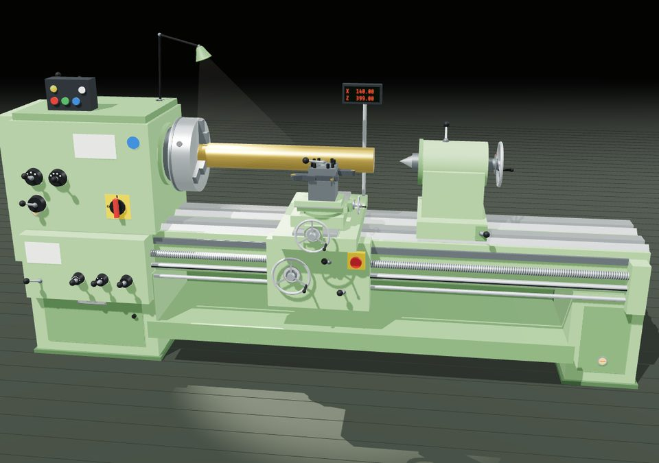 <b>Sústruh</b> TOS SN / VDF</a></td>
<td align="center" width="33%"><a href="#sv">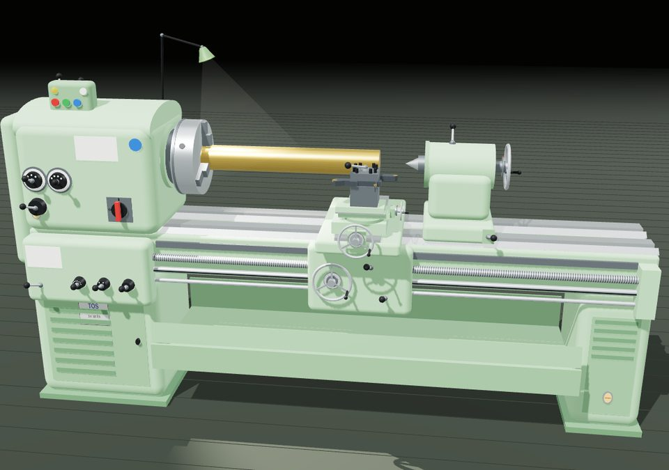 <b>Sústruh</b> TOS Trenčín SV 18 RA</a></td>
<td align="center" width="33%"><a href="#karusel">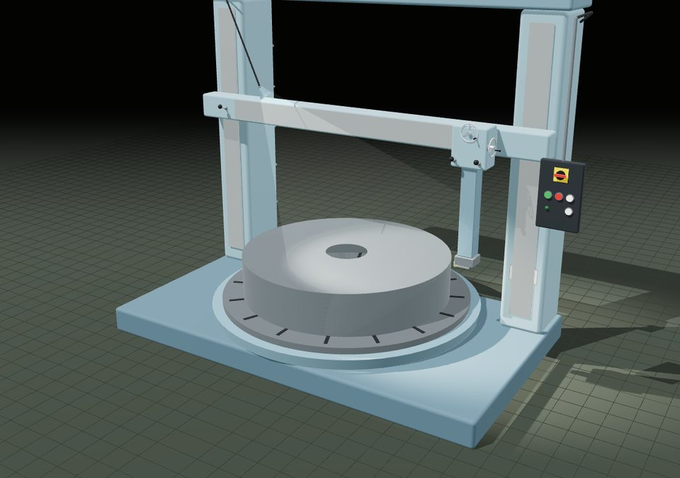 <b>Karuselový sústruh</b> TOS Hulín SK 12</a></td>
</tr>
</table>

### Sústruh – TOS SN / VDF

| | |
| --- | --- |
| **Stroj** | Konvenčný hrotový sústruh |
| **Predloha** | TOS SN / VDF |
| **Parametre** | 12 otáčok 40 – 1800 ot/min · Posuv 0,05 – 1 mm/ot · DRO na ramene |
| **Simulátor** | [▶ Otvoriť `#sustruh`](https://real-machine-tools.marcel-bucala.workers.dev/#sustruh) |

Sústruženie tyčí rôznych priemerov a tvarov: štvorpolohová nožová hlava s 8 typmi nožov, mikroposuv horných saní, koník so zaistením.

<b>Časti stroja (17)</b> – opis každej časti

- **Lôžko** – Masívny liatinový základ stroja. Kalené a brúsené vodiace plochy (prizmatická „V“ a plochá) vedú suport aj koník presne rovnobežne s osou vretena.
- **Vretenník** – Skriňa s hlavným vretenom v presných ložiskách a s prevodovkou otáčok. Pákami sa volia otáčky, hlavným vypínačom sa zapína pohon. Na vretene je upínač obrobku.
- **Trojčeľusťové skľučovadlo** – Samostrediace skľučovadlo. Kľúčom sa cez špirálu posúvajú všetky tri čeľuste naraz, takže valcový obrobok je upnutý súosovo s vretenom.
- **Obrobok** – Tyč zvoleného priemeru, tvaru a materiálu. Keď sa vreteno točí, nôž odoberá materiál podľa svojho tvaru. Pri stojacom vretene nôž do obrobku nevnikne.
- **Suport – pozdĺžne sane a zámková skriňa** – Pozdĺžne sane jazdia po lôžku (os Z). Zámková skriňa vpredu má ručné koleso s pastorkom na ozubenom hrebeni, páku matice vodiacej skrutky a zapínanie automatického posuvu.
- **Priečne sane, horné sane a nožová hlava** – Priečne sane sa posúvajú kolmo na os vretena (os X). Nesú horné sane s mikroposuvom v osi Z a štvorpolohovú nožovú hlavu so štyrmi nožmi, ktorá sa po uvoľnení páky pootočí na ďalší nôž.
- **Koník** – Posúva sa po lôžku po uvoľnení páky zaistenia. Ručným kolesom sa vysúva pinola s otočným hrotom, ktorý podopiera dlhé obrobky; pinola sa aretuje pákou hore.
- **Vodiaca skrutka a ťažná tyč** – Vodiaca skrutka (so závitom) poháňa suport pri rezaní závitov cez maticu. Ťažná tyč (s drážkou) prenáša pohyb pre bežné pozdĺžne a priečne posuvy.
- **Prevodovka posuvov (Norton)** – Volí sa ňou veľkosť posuvu v mm/ot a stúpanie závitu. Pohon dostáva od vretena cez výmenné kolesá pod ľavým krytom.
- **Ochranný kryt skľučovadla** – Obyčajný odklápací plechový kryt nad skľučovadlom. Mikrospínač na pánte nedovolí spustiť vreteno, kým je kryt otvorený, a pri otvorení za chodu vreteno zastaví.
- **Chladiaci systém** – Čerpadlo v nádrži pravého podstavca vedie reznú kvapalinu ohybnou článkovou hadicou (Loc-Line) priamo na nôž. Kvapalina chladí, maže a odplavuje triesky, steká do vane a späť do nádrže.
- **Zadný ochranný kryt** – Plechový štít po celej dĺžke za strojom zachytáva odlietavajúce triesky a emulziu, aby nezasiahli okolie.
- **Pevná luneta** – Prstenec upnutý na lôžku s tromi nastaviteľnými čeľusťami s kladkami podopiera dlhý hriadeľ. Suport ani koník cez ňu neprejdú.
- **Pohyblivá luneta** – Je upnutá na suporte a jej dve čeľuste podopierajú obrobok tesne pri noži – pri sústružení dlhých tenkých hriadeľov bráni prehýbaniu a chveniu.
- **Kryt vodiacej skrutky a ťažnej tyče** – Teleskopický kryt zakrýva rotujúce tyče, aby sa na ne nenavinul odev alebo handra.
- **Nožná brzda** – Pedál po celej dĺžke stroja – šliapnutím sa vreteno okamžite zabrzdí a vypne, obsluha má ruky voľné.
- **Podstavce a vaňa na triesky** – Podstavce nesú lôžko, v ľavom je hlavný elektromotor a rozvádzač. Vaňa medzi nimi zachytáva triesky a chladiacu kvapalinu.

[↑ 🔩 Sústruženie](#sustruzenie) · [↑ Obsah](#obsah)

### Sústruh – TOS Trenčín SV 18 RA

| | |
| --- | --- |
| **Stroj** | Univerzálny hrotový sústruh |
| **Predloha** | TOS Trenčín SV 18 RA |
| **Parametre** | Točný Ø 380 mm · Vreteno Ø41, 6 kW · Hroty 750 – 1 250 mm |
| **Simulátor** | [▶ Otvoriť `#sv`](https://real-machine-tools.marcel-bucala.workers.dev/#sv) |

Najčastejší školský sústruh: menší a ľahší než SN – točný priemer 380 mm nad lôžkom, výška hrotov 190 mm. Rovnaké ovládanie, nože, závity a úlohy ako na SN, na porovnanie veľkostí.

<b>Časti stroja (17)</b> – opis každej časti

- **Lôžko** – Masívny liatinový základ stroja. Kalené a brúsené vodiace plochy (prizmatická „V“ a plochá) vedú suport aj koník presne rovnobežne s osou vretena.
- **Vretenník** – Skriňa s hlavným vretenom v presných ložiskách a s prevodovkou otáčok. Pákami sa volia otáčky, hlavným vypínačom sa zapína pohon. Na vretene je upínač obrobku.
- **Trojčeľusťové skľučovadlo** – Samostrediace skľučovadlo. Kľúčom sa cez špirálu posúvajú všetky tri čeľuste naraz, takže valcový obrobok je upnutý súosovo s vretenom.
- **Obrobok** – Tyč zvoleného priemeru, tvaru a materiálu. Keď sa vreteno točí, nôž odoberá materiál podľa svojho tvaru. Pri stojacom vretene nôž do obrobku nevnikne.
- **Suport – pozdĺžne sane a zámková skriňa** – Pozdĺžne sane jazdia po lôžku (os Z). Zámková skriňa vpredu má ručné koleso s pastorkom na ozubenom hrebeni, páku matice vodiacej skrutky a zapínanie automatického posuvu.
- **Priečne sane, horné sane a nožová hlava** – Priečne sane sa posúvajú kolmo na os vretena (os X). Nesú horné sane s mikroposuvom v osi Z a štvorpolohovú nožovú hlavu so štyrmi nožmi, ktorá sa po uvoľnení páky pootočí na ďalší nôž.
- **Koník** – Posúva sa po lôžku po uvoľnení páky zaistenia. Ručným kolesom sa vysúva pinola s otočným hrotom, ktorý podopiera dlhé obrobky; pinola sa aretuje pákou hore.
- **Vodiaca skrutka a ťažná tyč** – Vodiaca skrutka (so závitom) poháňa suport pri rezaní závitov cez maticu. Ťažná tyč (s drážkou) prenáša pohyb pre bežné pozdĺžne a priečne posuvy.
- **Prevodovka posuvov (Norton)** – Volí sa ňou veľkosť posuvu v mm/ot a stúpanie závitu. Pohon dostáva od vretena cez výmenné kolesá pod ľavým krytom.
- **Ochranný kryt skľučovadla** – Obyčajný odklápací plechový kryt nad skľučovadlom. Mikrospínač na pánte nedovolí spustiť vreteno, kým je kryt otvorený, a pri otvorení za chodu vreteno zastaví.
- **Chladiaci systém** – Čerpadlo v nádrži pravého podstavca vedie reznú kvapalinu ohybnou článkovou hadicou (Loc-Line) priamo na nôž. Kvapalina chladí, maže a odplavuje triesky, steká do vane a späť do nádrže.
- **Zadný ochranný kryt** – Plechový štít po celej dĺžke za strojom zachytáva odlietavajúce triesky a emulziu, aby nezasiahli okolie.
- **Pevná luneta** – Prstenec upnutý na lôžku s tromi nastaviteľnými čeľusťami s kladkami podopiera dlhý hriadeľ. Suport ani koník cez ňu neprejdú.
- **Pohyblivá luneta** – Je upnutá na suporte a jej dve čeľuste podopierajú obrobok tesne pri noži – pri sústružení dlhých tenkých hriadeľov bráni prehýbaniu a chveniu.
- **Kryt vodiacej skrutky a ťažnej tyče** – Teleskopický kryt zakrýva rotujúce tyče, aby sa na ne nenavinul odev alebo handra.
- **Nožná brzda** – Pedál po celej dĺžke stroja – šliapnutím sa vreteno okamžite zabrzdí a vypne, obsluha má ruky voľné.
- **Podstavce a vaňa na triesky** – Podstavce nesú lôžko, v ľavom je hlavný elektromotor a rozvádzač. Vaňa medzi nimi zachytáva triesky a chladiacu kvapalinu.

[↑ 🔩 Sústruženie](#sustruzenie) · [↑ Obsah](#obsah)

### Karuselový sústruh – TOS Hulín SK 12

| | |
| --- | --- |
| **Stroj** | Karuselový sústruh |
| **Predloha** | TOS Hulín SK 12 |
| **Parametre** | Doska Ø1 200 mm · Točný Ø do 1 300 mm · Obrobok do 4 t |
| **Simulátor** | [▶ Otvoriť `#karusel`](https://real-machine-tools.marcel-bucala.workers.dev/#karusel) |

Veľké kotúče na otočnej upínacej doske: priečnik so zdvihom, suport so smykadlom, posuv v mm na otáčku, rezná rýchlosť podľa priemeru, čelo a osadenie.

<b>Časti stroja (5)</b> – opis každej časti

- **Dva stojany s priečnikom** – Portál z dvoch stojanov nesie priečnik, ktorý sa po uvoľnení zdvíha motorom. Pri reze musí byť priečnik upnutý.
- **Suport na priečniku so smykadlom** – Suport sa posúva po priečniku (radiálne, X), smykadlo s nožom zvisle (Z). Posuv sa zapína pákou – v mm na otáčku stola.
- **Otočná upínacia doska Ø1 200** – Doska sa otáča okolo zvislej osi; obrobok leží na nej a ťažké diely sa ľahko upínajú. Štyri čeľuste držia kotúč v otvore zvnútra.
- **Kotúč Ø1 000 × 200** – Oceľový kotúč Ø1 000 × 200 mm s otvorom Ø200.
- **Závesný ovládací panel** – Hlavný vypínač, štart a stop stola, zdvih priečnika.

[↑ 🔩 Sústruženie](#sustruzenie) · [↑ Obsah](#obsah)

---

## ⚙️ Frézovanie a vŕtanie

_Konzolové a nástrojárske frézky, odvalovanie ozubenia, stĺpová, radiálna a horizontálna vŕtačka._

<table>
<tr>
<td align="center" width="33%"><a href="#freza">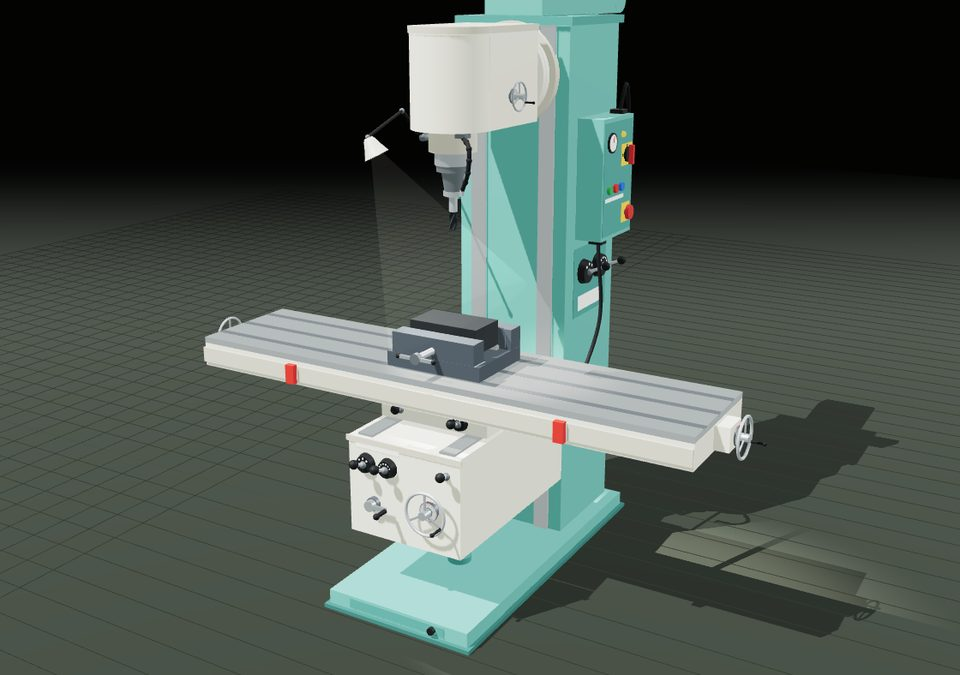 <b>Fréza</b> TOS FA 3 B</a></td>
<td align="center" width="33%"><a href="#fgu">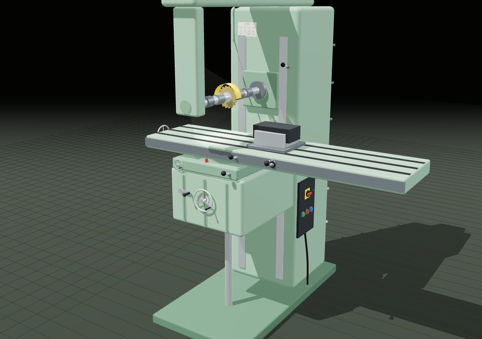 <b>Univerzálna frézka</b> TOS Olomouc FGU 32</a></td>
<td align="center" width="33%"><a href="#fnk">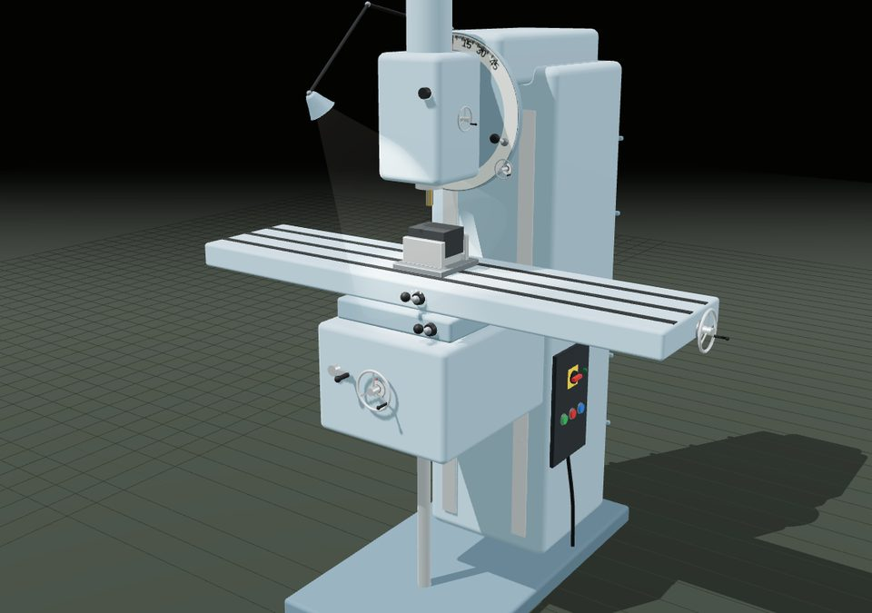 <b>Nástrojárska frézka</b> TOS Kuřim FNK 25</a></td>
</tr>
<tr>
<td align="center" width="33%"><a href="#odvalovacka">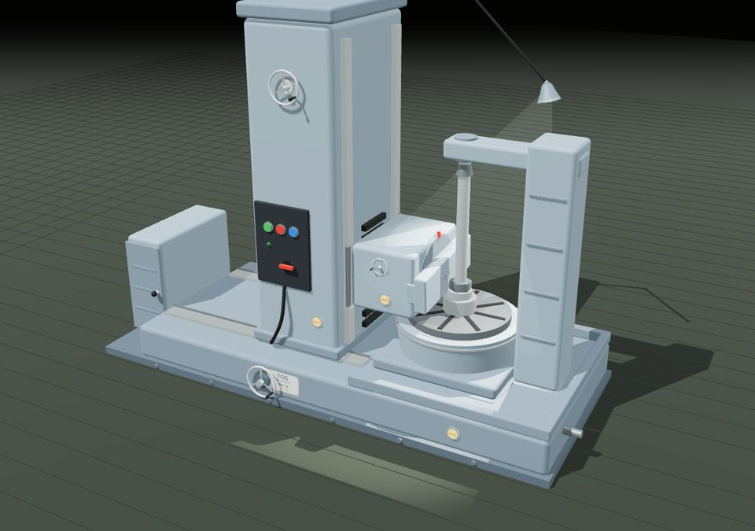 <b>Odvalovacia frézka</b> TOS Čelákovice OFA 32</a></td>
<td align="center" width="33%"><a href="#vrtacka">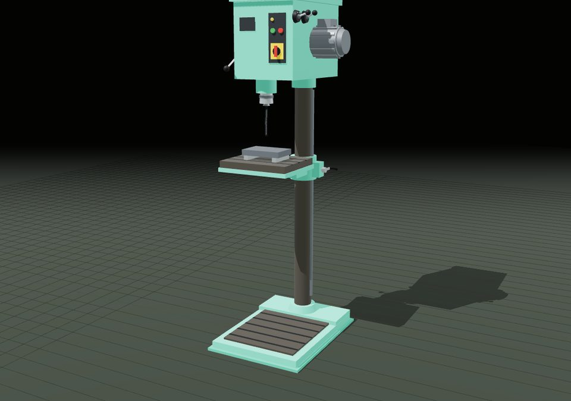 <b>Vŕtačka</b> TOS SV16</a></td>
<td align="center" width="33%"><a href="#radialka">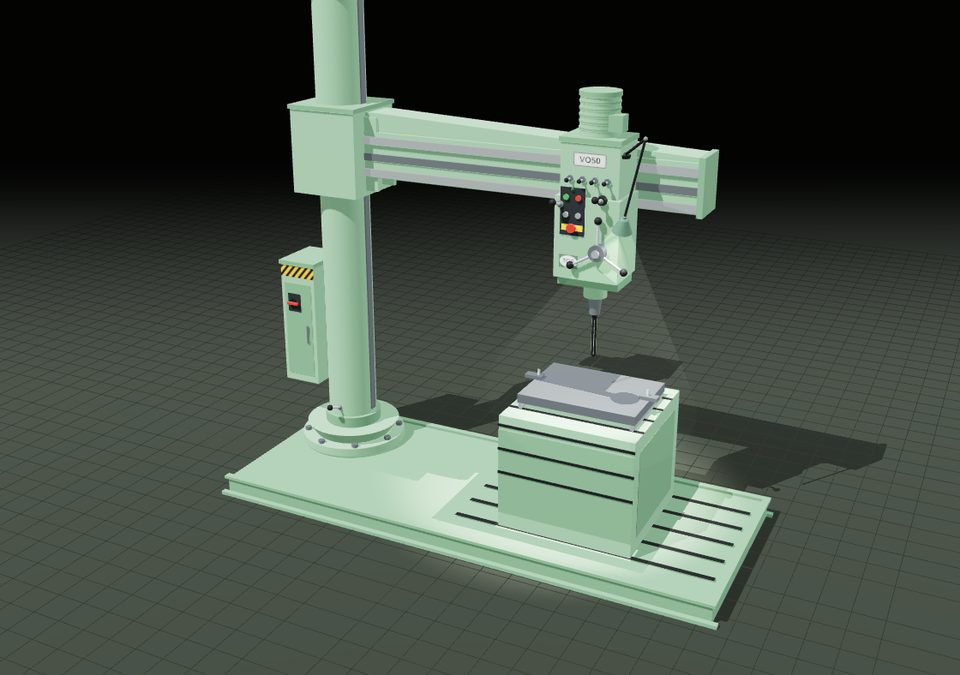 <b>Radiálna vŕtačka</b> TOS VO 50</a></td>
</tr>
<tr>
<td align="center" width="33%"><a href="#horizontalka">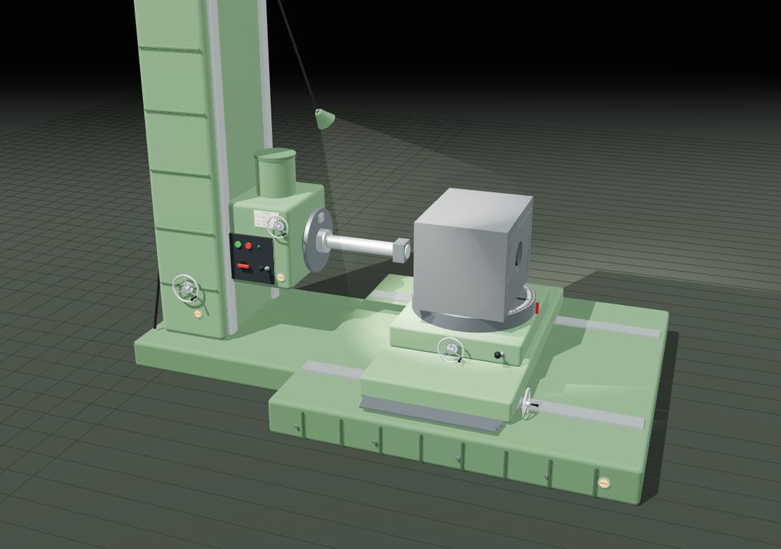 <b>Horizontálka</b> TOS Varnsdorf W 9</a></td>
</tr>
</table>

### Fréza – TOS FA 3 B

| | |
| --- | --- |
| **Stroj** | Univerzálna konzolová fréza |
| **Predloha** | TOS FA 3 B |
| **Parametre** | 18 otáčok 40 – 2000 ot/min · Posuv 19 – 950 mm/min · Zdvihy X 800 · Y 300 · Z 420 mm |
| **Simulátor** | [▶ Otvoriť `#freza`](https://real-machine-tools.marcel-bucala.workers.dev/#freza) |

Konzolová fréza so sklopnou vertikálnou hlavou: frézovanie hranola alebo tyče vo zveráku stopkovými, guľovými a čelnými frézami.

<b>Časti stroja (12)</b> – opis každej časti

- **Podstavec** – Liatinový podstavec nesie stojan a konzolu. V jeho dutine je nádrž chladiacej kvapaliny s čerpadlom a pod konzolou zdvíhacia skrutka.
- **Stojan** – Skriňový stojan s prevodovkou otáčok vretena. Na prednej strane má rybinové vedenie, po ktorom sa zvisle posúva konzola. Páky otáčok sú na pravom boku, lampa na ľavom.
- **Sklopná vertikálna hlava** – Frézovacia hlava s vretenom, ktorá sa dá natočiť okolo vodorovnej osi o ±45°. V modeli je nastavená zvisle. Ručné koliesko na boku vysúva pinolu.
- **Vreteno a nástroj** – Vreteno s kužeľom ISO 40 nesie frézu v klieštinovom upínači alebo na tŕni: stopkové frézy Ø6 – Ø25, guľové Ø6 – Ø16 a čelné frézy Ø50 – Ø100 s vymeniteľnými doštičkami.
- **Konzola** – Posúva sa po stojane zvisle (os Z) kľukou cez skrutku a kužeľové kolesá. Vpredu má ručné koleso priečneho posuvu, kľuku zdvihu a páky prevodovky posuvov.
- **Priečne sane** – Sane jazdia po konzole k stojanu a od neho (os Y). Nesú pracovný stôl a páku automatického posuvu stola.
- **Pracovný stôl** – Stôl 1300 × 300 mm s tromi T-drážkami sa posúva pozdĺžne (os X) ručnými kolesami na koncoch alebo automatickým posuvom. Červené narážky vpredu obmedzujú posuv.
- **Strojný zverák** – Zverák upnutý v T-drážkach drží obrobok medzi pevnou a posuvnou čeľusťou na rovnobežných podložkách. Fréza nesmie zasiahnuť čeľuste ani podložky.
- **Deliaci prístroj so skľučovadlom** – Vreteno so skľučovadlom poháňa závitovka s pomerom 40 : 1. Kľuka s kolíkom zapadá do dier deliaceho kotúča: jeden dielik je n = 40 / z otáčok kľuky. Pri frézovaní sa vreteno zaistí aretáciou.
- **Koník s hrotom** – Podopiera dlhú tyč na voľnom konci. Pri krátkom presahu sa odsunie, aby fréza mohla obrábať koniec tyče.
- **Obrobok** – Oceľový hranol alebo kruhová tyč zvoleného rozmeru s tmavou okujenou povrchou. Pri bežiacom vretene fréza odoberá materiál a obrobená plocha je lesklá. Pri stojacom vretene do neho fréza nevnikne.
- **Elektrický rozvádzač** – Na pravom boku stojana: ampérmeter, hlavný vypínač, tlačidlá Štart, Stop a chladenie a núdzový STOP. Pod ním sú páky otáčok vretena.

[↑ ⚙️ Frézovanie a vŕtanie](#frezovanie) · [↑ Obsah](#obsah)

### Univerzálna frézka – TOS Olomouc FGU 32

| | |
| --- | --- |
| **Stroj** | Univerzálna konzolová frézka |
| **Predloha** | TOS Olomouc FGU 32 |
| **Parametre** | Stôl 320 × 1 250 mm · 12 otáčok 31,5 – 1 400 · Natočenie stola ±45° |
| **Simulátor** | [▶ Otvoriť `#fgu`](https://real-machine-tools.marcel-bucala.workers.dev/#fgu) |

Vodorovné vreteno s tŕňom a podperou, kotúčová fréza, otočný stôl ±45° pre šikmé drážky, súsledné a nesúsledné frézovanie s vymedzením vôle.

<b>Časti stroja (7)</b> – opis každej časti

- **Stojan s prevodovkou** – Liatinový stojan nesie vreteno, previsnuté rameno a vedenie konzoly. Vnútri je 12-stupňová prevodovka otáčok 31,5 – 1 400 ot/min.
- **Previsnuté rameno s podperou tŕňa** – Rameno nad vretenom nesie podperu, ktorá drží koniec frézovacieho tŕňa – tŕň sa pri reze neprehne.
- **Kotúčová fréza na tŕni** – Fréza Ø100 × 10 mm na vodorovnom tŕni. Šírka frézy dáva šírku drážky; smer otáčania volí páka na stojane.
- **Konzola (os Z)** – Konzola sa zdvíha kľukou po vedení stojana – určuje hĺbku rezu. Na jej čele je koleso priečnych saní.
- **Otočný stôl (os X, natočenie ±45°)** – Univerzálna frézka má stôl na otočnej doske – po uvoľnení páky sa natočí až o 45° (šikmé a skrutkovicové drážky). Pozdĺžny posuv zapína páka vpredu.
- **Hranol vo zveráku** – Oceľový hranol 180 × 100 × 60 mm na podložkách vo zveráku; čeľuste sú 20 mm pod hornou plochou.
- **Ovládací panel** – Hlavný vypínač, štart a stop vretena, chladenie. Otáčky a posuvy sa volia pri stojacom vretene.

[↑ ⚙️ Frézovanie a vŕtanie](#frezovanie) · [↑ Obsah](#obsah)

### Nástrojárska frézka – TOS Kuřim FNK 25

| | |
| --- | --- |
| **Stroj** | Nástrojárska frézka s natáčacou hlavou |
| **Predloha** | TOS Kuřim FNK 25 |
| **Parametre** | Stôl 1 250 × 290 mm · X 800 / Y 370 / Z 450 · Hlava ±45° |
| **Simulátor** | [▶ Otvoriť `#fnk`](https://real-machine-tools.marcel-bucala.workers.dev/#fnk) |

Zvislá hlava natáčaná o ±45° podľa stupnice, pinola, stopkové frézy Ø12 / Ø16: úkosy čelom frézy a drážky, krížový stôl s posuvmi X a Y.

<b>Časti stroja (5)</b> – opis každej časti

- **Stojan s prevodovkou** – Tuhý liatinový stojan nesie výsuvné rameno s hlavou a vedenie konzoly. 14 otáčok 56 – 4 500 ot/min.
- **Natáčacia zvislá hlava s pinolou** – Hlava sa natáča okolo vodorovnej osi o ±45° podľa stupnice – stopková fréza tak čelom vyfrézuje úkos. Pinola vysúva nástroj pozdĺž jeho osi.
- **Konzola so stolom** – Konzola (Z) nesie priečne sane (Y) a stôl (X). Posuvy X a Y zapínajú páky na čele.
- **Hranol vo zveráku** – Oceľový hranol 100 × 80 × 60 mm, čeľuste 20 mm pod hornou plochou.
- **Ovládací panel** – Hlavný vypínač, štart a stop vretena, chladenie.

[↑ ⚙️ Frézovanie a vŕtanie](#frezovanie) · [↑ Obsah](#obsah)

### Odvalovacia frézka – TOS Čelákovice OFA 32

| | |
| --- | --- |
| **Stroj** | Odvalovacia frézka na ozubenie |
| **Predloha** | TOS Čelákovice OFA 32 |
| **Parametre** | Modul 2, z 20 – 40 · Fréza Ø70 jednochodá · Kontrola Wk ±0,05 |
| **Simulátor** | [▶ Otvoriť `#odvalovacka`](https://real-machine-tools.marcel-bucala.workers.dev/#odvalovacka) |

Výroba čelných ozubených kolies odvalovaním: výmenné kolesá delenia i = 24 / z, sklon frézy na stúpací uhol, radiálny prísuv na hĺbku 2,25 · m, zvislý posuv a kontrola rozmeru cez zuby Wk.

<b>Časti stroja (7)</b> – opis každej časti

- **Lôžko** – Lôžko nesie stôl s obrobkom a vedenia stojana, ktorý sa prisúva k obrobku na hĺbku zuba.
- **Stojan s frézovacou hlavou** – Hlava s frézou sa posúva po stojane zvisle (axiálny posuv cez šírku kolesa) a natáča sa o stúpací uhol frézy.
- **Odvalovacia fréza** – Jednochodá fréza Ø70 mm, modul 2. Jej zuby tvoria závitovku – pri odvalovaní so stolom vytvárajú evolventné boky zubov kolesa.
- **Skriňa výmenných kolies delenia** – Za dvierkami je kvadrant s výmennými kolesami a/b (príp. c/d), ktoré delia otáčku stola i = 24 / z. Kolesá sa menia pri stojacom stroji a otvorených dvierkach; s otvorenými dvierkami sa stroj nespustí.
- **Otočný stôl (os C) s tŕňom** – Stôl poháňa deliaca závitovka cez výmenné kolesá delenia i = 24 / z. Obrobok je na tŕni, zhora ho podopiera rameno protistojana.
- **Polotovar kolesa** – Oceľový polotovar s hlavovým priemerom da = m (z + 2), šírka 20 mm.
- **Ovládací panel** – Hlavný vypínač, chod frézy a stola, automatický posuv.

[↑ ⚙️ Frézovanie a vŕtanie](#frezovanie) · [↑ Obsah](#obsah)

### Vŕtačka – TOS SV16

| | |
| --- | --- |
| **Stroj** | Stĺpová vŕtačka |
| **Predloha** | TOS SV16 |
| **Parametre** | 8 otáčok 125 – 1400 ot/min · Zdvih pinoly 100 mm · Vŕtanie do Ø16 mm |
| **Simulátor** | [▶ Otvoriť `#vrtacka`](https://real-machine-tools.marcel-bucala.workers.dev/#vrtacka) |

Vŕtanie dier Ø3 – Ø16 mm do oceľovej dosky na podložkách: priečna kľuka pinoly, zdvíhací stôl, otvory naslepo aj naskrz.

<b>Časti stroja (7)</b> – opis každej časti

- **Základová doska** – Liatinová doska s T-drážkami nesie stĺp. Pri vysokých obrobkoch sa stôl odklopí a obrobok sa upne priamo na ňu.
- **Stĺp** – Brúsený oceľový stĺp s ozubeným hrebeňom. Po ňom sa kľukou posúva rameno stola nahor a nadol.
- **Vŕtacia hlava** – Skriňa s prevodovkou otáčok, ovládacím panelom a priečnou kľukou posuvu pinoly. Pákami na boku sa volí 8 otáčok 125 – 1400 ot/min.
- **Elektromotor** – Prírubový trojfázový motor s rebrovaním poháňa vreteno cez prevodovku v hlave.
- **Pinola, skľučovadlo a vrták** – Pinola sa vysúva priečnou kľukou až o 100 mm. V skľučovadle je špirálový vrták Ø3 – Ø16 mm (najväčší priemer pre SV16).
- **Stôl s ramenom** – Stôl s T-drážkami na ramene okolo stĺpa. Kľukou vpravo sa zdvíha cez hrebeň, páka vľavo ho aretuje.
- **Obrobok na podložkách** – Oceľová doska zvoleného rozmeru na dvoch podložkách. Medzi podložkami sa dá vŕtať naskrz; vrták nesmie zasiahnuť podložku ani stôl.

[↑ ⚙️ Frézovanie a vŕtanie](#frezovanie) · [↑ Obsah](#obsah)

### Radiálna vŕtačka – TOS VO 50

| | |
| --- | --- |
| **Stroj** | Radiálna vŕtačka |
| **Predloha** | TOS VO 50 |
| **Parametre** | Vŕtanie do Ø50 mm · Vyloženie 320 – 1240 mm · 12 otáčok 32 – 1400 ot/min |
| **Simulátor** | [▶ Otvoriť `#radialka`](https://real-machine-tools.marcel-bucala.workers.dev/#radialka) |

Vŕtanie veľkých dosiek a prírub bez posúvania obrobku: rameno sa otáča okolo stĺpa a zdvíha motorom, vreteník jazdí po ramene, upínanie stĺpa a vreteníka, automatický posuv s hĺbkovým dorazom.

<b>Časti stroja (8)</b> – opis každej časti

- **Základová doska** – Masívna liatinová doska s T-drážkami nesie stĺp a upínaciu kocku. Veľké obrobky sa upínajú priamo na ňu.
- **Stĺp s otočným plášťom** – Na pevnom vnútornom stĺpe sa otáča plášť s ramenom. Upínacia páka plášť zovrie – pri vŕtaní musí byť stĺp upnutý, inak sa rameno pootočí.
- **Rameno** – Rameno sa otáča okolo stĺpa a motorom sa zdvíha po ňom (tlačidlá ▲ ▼ na vreteníku, len pri uvoľnenom stĺpe). Na jeho prednej strane sú vedenia vreteníka.
- **Vreteník** – Vreteník s motorom a prevodovkou jazdí po ramene ručným kolesom. Má 12 otáčok 32 – 1400 ot/min, automatický posuv 0,1 – 0,4 mm/ot a vlastnú upínaciu páku.
- **Vreteno s vrtákom** – Pinola sa vysúva trojramennou kľukou alebo automatickým posuvom až o 300 mm. Vrták Ø10 – Ø50 je upnutý v Morseovom kuželi.
- **Upínacia kocka** – Liatinová kocka s T-drážkami na základovej doske. Obrobok leží na podložkách, aby sa dalo vŕtať naskrz.
- **Doska na podložkách** – Oceľová doska – pri vŕtaní stojí. Polohu diery určuje natočenie ramena a vyloženie vreteníka; displej ukazuje polohu vretena od stredu dosky.
- **Elektrický rozvádzač** – Rozvádzač so šrafovaným vrchom je na plášti stĺpa a otáča sa s ramenom. Hlavný vypínač je na dvierkach, ovládanie chodu a zdvihu ramena na vreteníku.

[↑ ⚙️ Frézovanie a vŕtanie](#frezovanie) · [↑ Obsah](#obsah)

### Horizontálka – TOS Varnsdorf W 9

| | |
| --- | --- |
| **Stroj** | Horizontálna vŕtačka a frézka |
| **Predloha** | TOS Varnsdorf W 9 |
| **Parametre** | Vreteno W 500 mm · Otočný stôl B · Otvor Ø80 H7 |
| **Simulátor** | [▶ Otvoriť `#horizontalka`](https://real-machine-tools.marcel-bucala.workers.dev/#horizontalka) |

Vyvrtávanie otvorov v skriňových odliatkoch: vreteník na stojane, vysúvacie vreteno W, krížový stôl a otočný stôl s aretáciou po 90°, mikrometrická vyvrtávacia hlava a priehyb tyče podľa vyloženia.

<b>Časti stroja (6)</b> – opis každej časti

- **Stojan s lôžkom** – Pevný stojan nesie vreteník, ktorý sa po ňom posúva zvisle (os Y). Protiváha vo vnútri vyrovnáva hmotnosť vreteníka.
- **Vreteník s planžetou** – V dutom vretene sa vysúva vyvrtávacie vreteno (os W). Planžeta pred vreteníkom slúži na čelné sústruženie. Otáčky 20 – 800 ot/min, posuv vretena 0,05 – 0,25 mm/ot.
- **Vyvrtávacia tyč s nožom** – Tyč Ø48 mm nesie nôž v mikrometrickej hlave – priemer vyvrtávania sa nastavuje po 0,005 mm. Čím dlhšie vyloženie, tým viac sa tyč pri reze prehne a otvor vyjde menší.
- **Krížový stôl s otočným stolom** – Sane jazdia k vretenu (os Z), stôl priečne (os X). Otočný stôl (os B) sa aretuje po 90° – po otočení o 180° sa vyvrtá protiľahlá stena.
- **Skriňový odliatok** – Liatinová skriňa 400 × 300 × 300 mm so stenami hrúbky 40 mm a predliatymi otvormi Ø60 v čelných stenách.
- **Ovládací panel** – Hlavný vypínač, chod vretena, posuv vretena a aretácia otočného stola.

[↑ ⚙️ Frézovanie a vŕtanie](#frezovanie) · [↑ Obsah](#obsah)

---

## 💎 Brúsenie

_Rovinné, hrotové, bezhrotové a nástrojárske brúsky vrátane ostrenia nožov._

<table>
<tr>
<td align="center" width="33%"><a href="#bruska">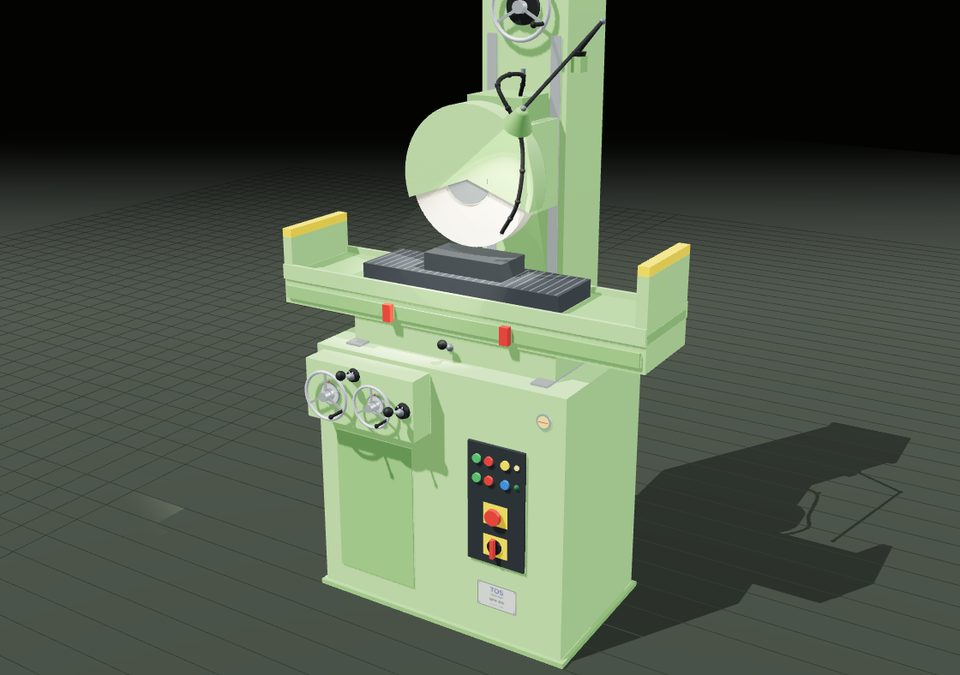 <b>Brúska</b> TOS Hostivař BPH 300</a></td>
<td align="center" width="33%"><a href="#gulato">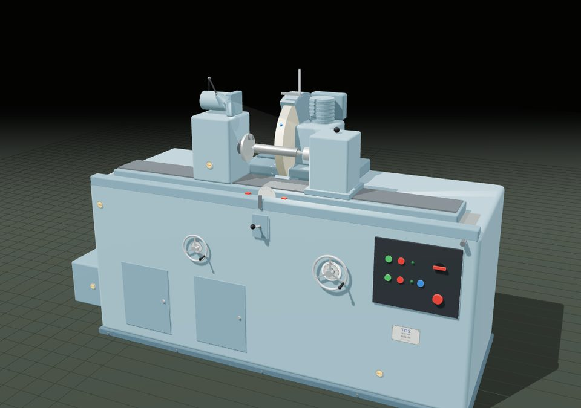 <b>Brúska na guľato</b> TOS Hostivař BUA 25</a></td>
<td align="center" width="33%"><a href="#bezhrot">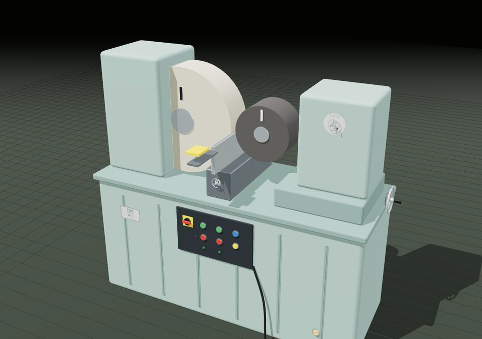 <b>Bezhrotová brúska</b> TOS Hostivař BBJ 6</a></td>
</tr>
<tr>
<td align="center" width="33%"><a href="#bn">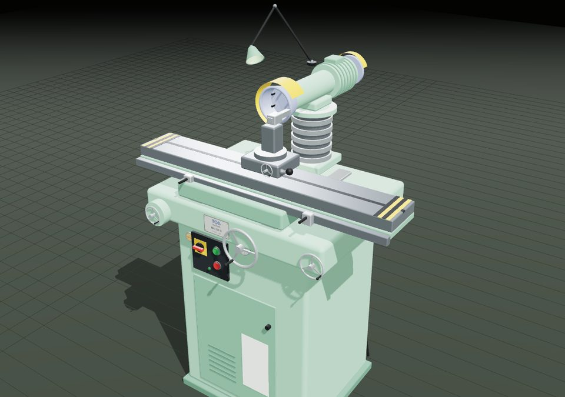 <b>Nástrojárska brúska</b> TOS Hostivař BN 102</a></td>
<td align="center" width="33%"><a href="#dvojkotuc">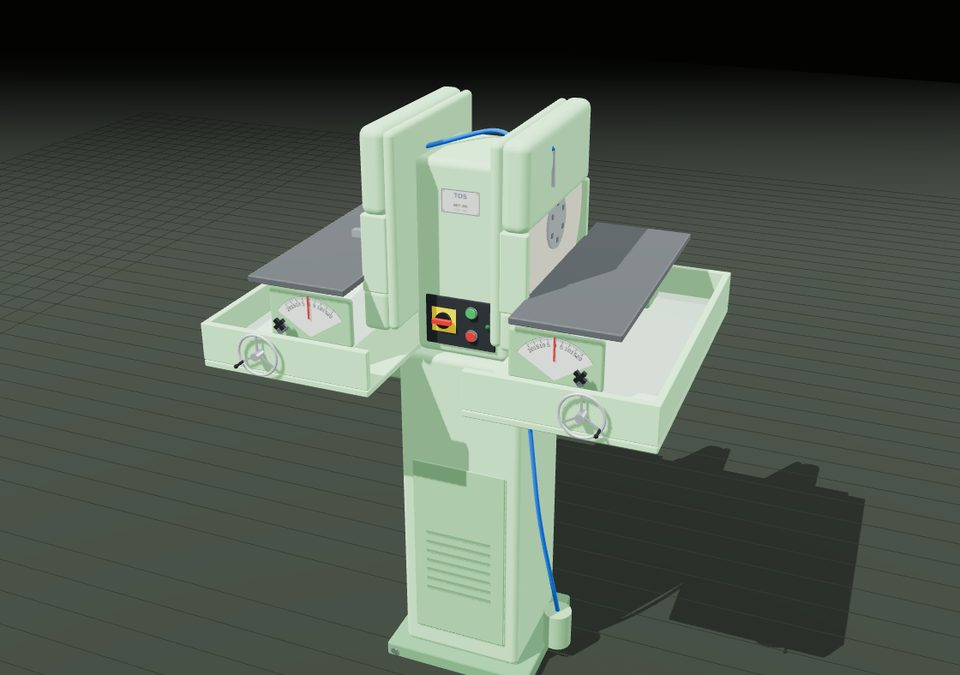 <b>Brúska nožov</b> TOS BBT 350</a></td>
</tr>
</table>

### Brúska – TOS Hostivař BPH 300

| | |
| --- | --- |
| **Stroj** | Rovinná brúska |
| **Predloha** | TOS Hostivař BPH 300 |
| **Parametre** | Kotúč Ø300 × 40 mm · Stôl 1 – 25 m/min · Prísuv 0,005 mm |
| **Simulátor** | [▶ Otvoriť `#bruska`](https://real-machine-tools.marcel-bucala.workers.dev/#bruska) |

Rovinné brúsenie na magnetickej doske: hydraulický pohyb stola tam a späť, priečny posuv na konci zdvihu, prísuv po stotinách mm, chladenie emulziou.

<b>Časti stroja (8)</b> – opis každej časti

- **Lôžko** – Skriňové lôžko s hydraulickým agregátom a nádržou chladiva. Vpredu sú ručné kolesá stola a priečneho posuvu a elektrický panel.
- **Stojan** – Stojan vzadu nesie brúsny vreteník a pracovnú lampu. Veľké koleso hore zvisle prisúva kotúč – 1 otáčka = 1 mm, dielik stupnice 0,01 mm.
- **Brúsny vreteník a kotúč** – Kotúč Ø300 × 40 mm sa točí 2 800 ot/min (obvodová rýchlosť ~44 m/s). Kryt zachytáva úlomky, hadica s dýzou privádza emulziu do miesta brúsenia.
- **Priečne sane** – Nesú stôl a posúvajú ho k stojanu a od neho (os Y) – ručne kolesom alebo automaticky o krok na konci každého zdvihu stola.
- **Stôl s hydraulickým pohonom** – Stôl sa hydraulicky pohybuje tam a späť (os X). Červené narážky vpredu prestavujú smer na konci zdvihu. Konce sú kryté zásterkami.
- **Elektromagnetická upínacia doska** – Doska 500 × 150 mm drží oceľový obrobok magneticky. Bez zapnutého magnetu sa nesmie brúsiť – kotúč by obrobok vymrštil.
- **Obrobok** – Oceľový hranol zvoleného rozmeru. Pri brúsení sa odoberajú stotiny milimetra – obrúsená plocha je lesklá, DRO ukazuje úbytok.
- **Elektrický panel** – Hlavný vypínač, hydraulika, kotúč, magnet a chladenie (štart / stop) a núdzový STOP.

[↑ 💎 Brúsenie](#brusenie) · [↑ Obsah](#obsah)

### Brúska na guľato – TOS Hostivař BUA 25

| | |
| --- | --- |
| **Stroj** | Hrotová brúska na guľato |
| **Predloha** | TOS Hostivař BUA 25 |
| **Parametre** | Kotúč Ø400 × 40 mm · Prísuv 0,005 mm · Tolerancia h5 / h6 |
| **Simulátor** | [▶ Otvoriť `#gulato`](https://real-machine-tools.marcel-bucala.workers.dev/#gulato) |

Brúsenie hriadeľov medzi hrotmi na mikróny: hydraulický stôl s dorazmi, prísuv kotúča po 0,005 mm, automatický prísuv na obrate, vyiskrovanie, prepal pri veľkom zábere a meranie mikrometrom.

<b>Časti stroja (7)</b> – opis každej časti

- **Lôžko s vaňou chladenia** – Liatinové lôžko nesie stôl a brúsny vreteník. Vpredu sú ručné kolesá stola a prísuvu, páka hydrauliky a vaňa na chladiacu kvapalinu.
- **Hydraulický agregát** – Nádrž s olejom, motor s čerpadlom a potrubie do lôžka. Tlakový olej posúva stôl tam a späť medzi dorazmi.
- **Stôl s vreteníkom a koníkom** – Na stole je pracovný vreteník s unášacím kotúčom a koník. Obrobok je medzi pevnými hrotmi a otáča sa ho unášač. Na prednej hrane sú dorazy obratu stola.
- **Brúsny vreteník** – Kotúč Ø400 × 40 mm sa točí obvodovou rýchlosťou asi 35 m/s. Vreteník sa prisúva k obrobku kolesom vpredu – 1 dielik = 0,005 mm na priemere.
- **Hriadeľ medzi hrotmi** – Kalený oceľový hriadeľ s prídavkom na brúsenie. Obrúsená plocha je lesklá, prepálené miesta sú tmavé.
- **Chladiaca emulzia** – Dýza nad kotúčom leje emulziu do miesta brúsenia. Bez chladenia sa povrch ľahko prepáli.
- **Ovládací panel** – Hlavný vypínač, chod kotúča, otáčanie obrobku a chladenie.

[↑ 💎 Brúsenie](#brusenie) · [↑ Obsah](#obsah)

### Bezhrotová brúska – TOS Hostivař BBJ 6

| | |
| --- | --- |
| **Stroj** | Bezhrotová brúska |
| **Predloha** | TOS Hostivař BBJ 6 |
| **Parametre** | Priemer do 63 mm · Kotúče Ø500 / Ø250 · Kolíky Ø20 ±0,01 |
| **Simulátor** | [▶ Otvoriť `#bezhrot`](https://real-machine-tools.marcel-bucala.workers.dev/#bezhrot) |

Priebežné brúsenie kolíkov medzi brúsnym a podávacím kotúčom: medzera = priemer, naklopenie α a rýchlosť prechodu, výška podpery a guľatosť, úber na prechod.

<b>Časti stroja (6)</b> – opis každej časti

- **Lôžko so saňami** – Lôžko nesie brúsny vreteník (pevne) a sane podávacieho kotúča, ktorými sa nastavuje medzera = výsledný priemer. Predloha: TOS Hostivař BBJ 6, priemer brúsenia do 63 mm.
- **Brúsny kotúč Ø500** – Rýchlo sa točiaci kotúč brúsi obvod kolíka (≈ 30 m/s).
- **Podávací kotúč Ø250 s naklopením** – Pomalý gumový kotúč točí kolíkom a tlačí ho dopredu – rýchlosť prechodu v = π · d · n · sin α. Naklopenie α sa nastavuje pri stojacom kotúči.
- **Podpera obrobku (lišta)** – Kolík leží na lište medzi kotúčmi. Stred kolíka má byť nad spojnicou osí kotúčov (≈ d/2) – inak vzniká mnohohran a kolík nie je guľatý.
- **Kolíky Ø20,3 × 100** – Oceľové kolíky prechádzajú brúskou jeden za druhým; po prechode padajú do debny.
- **Ovládací panel** – Hlavný vypínač, brúsny a podávací kotúč, chladenie.

[↑ 💎 Brúsenie](#brusenie) · [↑ Obsah](#obsah)

### Nástrojárska brúska – TOS Hostivař BN 102

| | |
| --- | --- |
| **Stroj** | Nástrojárska brúska na ostrenie nožov |
| **Predloha** | TOS Hostivař BN 102 |
| **Parametre** | Kotúč do Ø280 · 2 800 – 5 600 ot/min · Stôl 920 × 140 mm |
| **Simulátor** | [▶ Otvoriť `#bn`](https://real-machine-tools.marcel-bucala.workers.dev/#bn) |

Ostrenie sústružníckeho noža hrnčekovým kotúčom: univerzálny naklápací držiak so stupnicou, uhol chrbta α a čela γ, prísuv po stotinách, prepálenie pri veľkom prísuve.

<b>Časti stroja (6)</b> – opis každej časti

- **Podstavec s vedením stola** – Skriňový podstavec s dvierkami a ovládacím panelom vpredu nesie priečne sane a pozdĺžny stôl. Predloha: TOS Hostivař BN 102 – stôl 920 × 140 mm, X 510 / Y 250 mm, ≈ 1 000 kg.
- **Pozdĺžny stôl 920 × 140 mm** – Stôl s T-drážkou a narážkami jazdí pozdĺž kolesom vpredu (nôž prechádza po čele kotúča). Priečne sane s bubnom a stupnicou prisúvajú stôl ku kotúču. Stred stola je otočný so stupnicou.
- **Vreteník s hrnčekovým kotúčom** – Stĺp pod mechom nesie otočný vreteník s motorom 1,2 kW a otáčkami 2 800 – 5 600 ot/min, na oboch koncoch vretena sú kotúče. Čelo hrnčekového kotúča brúsi rovinnú plochu noža.
- **Univerzálny držiak s naklápaním** – Nôž je upnutý v zveráčiku, ktorý sa nakláňa podľa stupnice – uhol naklopenia je uhol brúsenej plochy. Páka prepína polohu noža: koncom alebo vrchom ku kotúču.
- **Sústružnícky nôž 16 × 16 HSS** – Rýchlorezná oceľ – pri veľkom prísuve sa prepáli (popúšťacie farby) a zmäkne.
- **Ovládací panel** – Hlavný vypínač, štart a stop kotúča.

[↑ 💎 Brúsenie](#brusenie) · [↑ Obsah](#obsah)

### Brúska nožov – TOS BBT 350

| | |
| --- | --- |
| **Stroj** | Brúska nožov s naklápacími stolmi |
| **Predloha** | TOS BBT 350 |
| **Parametre** | Stoly 560 × 210 mm · Vreteno ≈ 1 560 ot/min · Hrubý + jemný kotúč |
| **Simulátor** | [▶ Otvoriť `#dvojkotuc`](https://real-machine-tools.marcel-bucala.workers.dev/#dvojkotuc) |

Ostrenie sústružníckych nožov čelom kotúča: hrubý a jemný kotúč, naklápací stôl so stupnicou určuje uhol chrbta, medzera stola do 3 mm, mokré brúsenie a prepálenie nasucho.

<b>Časti stroja (5)</b> – opis každej časti

- **Stojan s motorom a čerpadlom** – V stojane je motor s remeňom k vretenu a čerpadlo chladiacej emulzie. Predloha: TOS BBT 350 – brúska nožov s dvoma kotúčmi a naklápacími stolmi 560 × 210 mm, vreteno ≈ 1 560 ot/min.
- **Kotúče brúsiace čelom** – Vľavo hrubý kotúč na hrubovanie, vpravo jemný na dokončenie. Brúsi sa rovinným čelom kotúča, nie obvodom – plocha noža je rovná.
- **Naklápacie stoly so stupnicou** – Nôž leží na stole a posúva sa ku kotúču. Sklon stola (hviezdicová matica, stupnica na segmente) je uhol brúsenej plochy. Ručné koleso na vani prisúva stôl ku kotúču – medzera najviac 3 mm.
- **Sústružnícky nôž 16 × 16 HSS** – Nôž sa posúva rukou po stole. Chladiaca emulzia odvádza teplo – bez nej sa ostrie prepáli.
- **Ovládanie na stojane** – Hlavný vypínač, štart, stop a páka ventilu chladenia.

[↑ 💎 Brúsenie](#brusenie) · [↑ Obsah](#obsah)

---

## 🪚 Obrážanie a delenie materiálu

_Zvislé obrážačky na drážky a tvary, pásové píly na delenie tyčí a profilov._

<table>
<tr>
<td align="center" width="33%"><a href="#hov">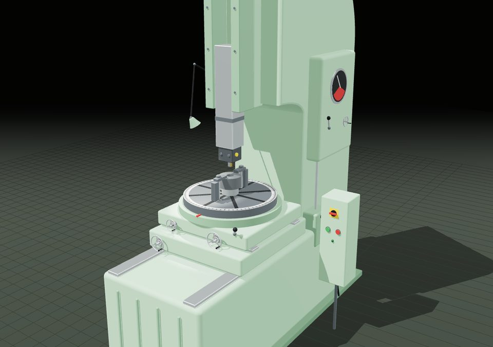 <b>Zvislá obrážačka</b> TOS HOV 25</a></td>
<td align="center" width="33%"><a href="#zobrazacka">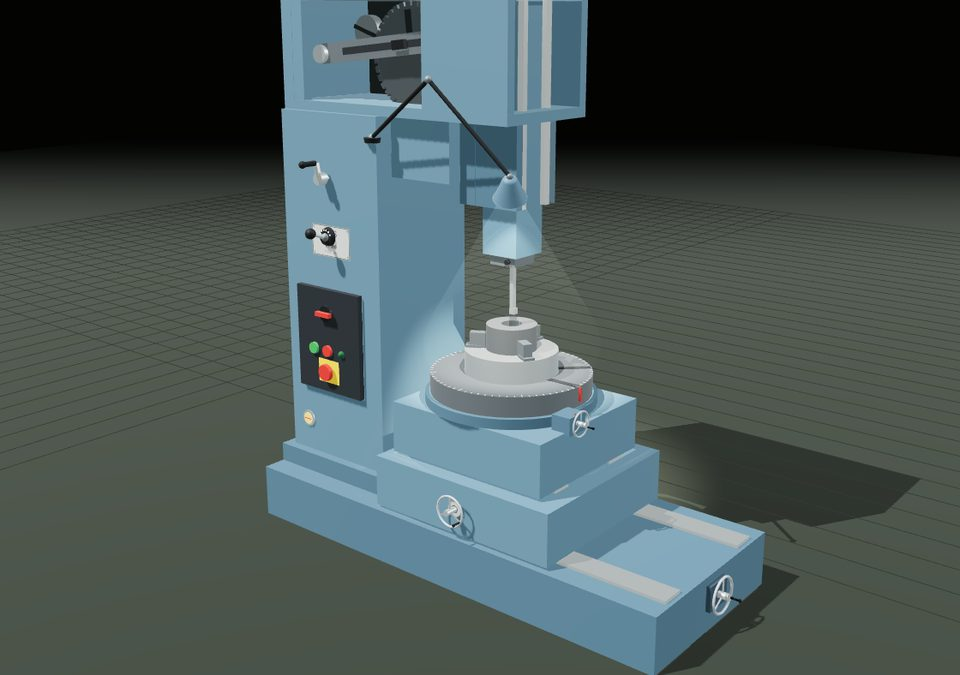 <b>Zvislá obrážačka</b> TOS ST 350</a></td>
<td align="center" width="33%"><a href="#pila">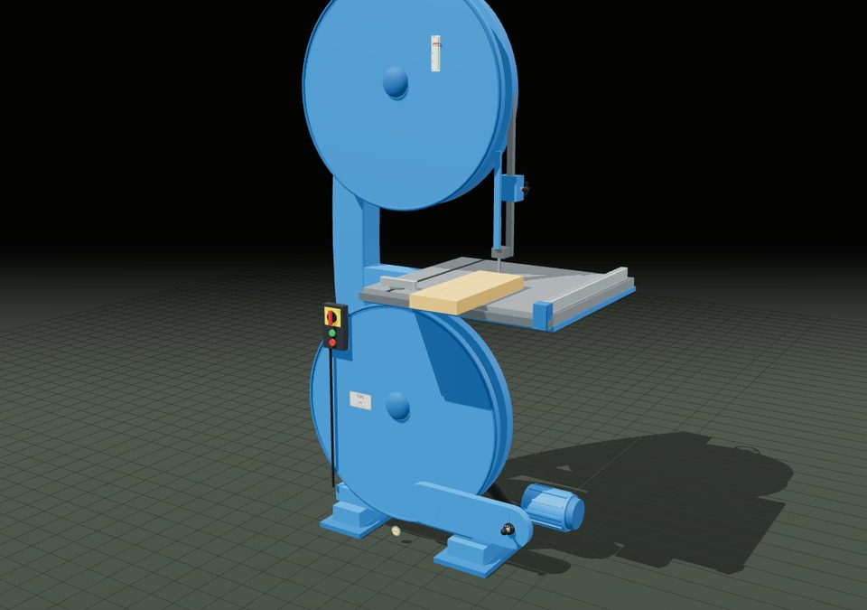 <b>Píla</b> TOS PPN</a></td>
</tr>
<tr>
<td align="center" width="33%"><a href="#pasovka">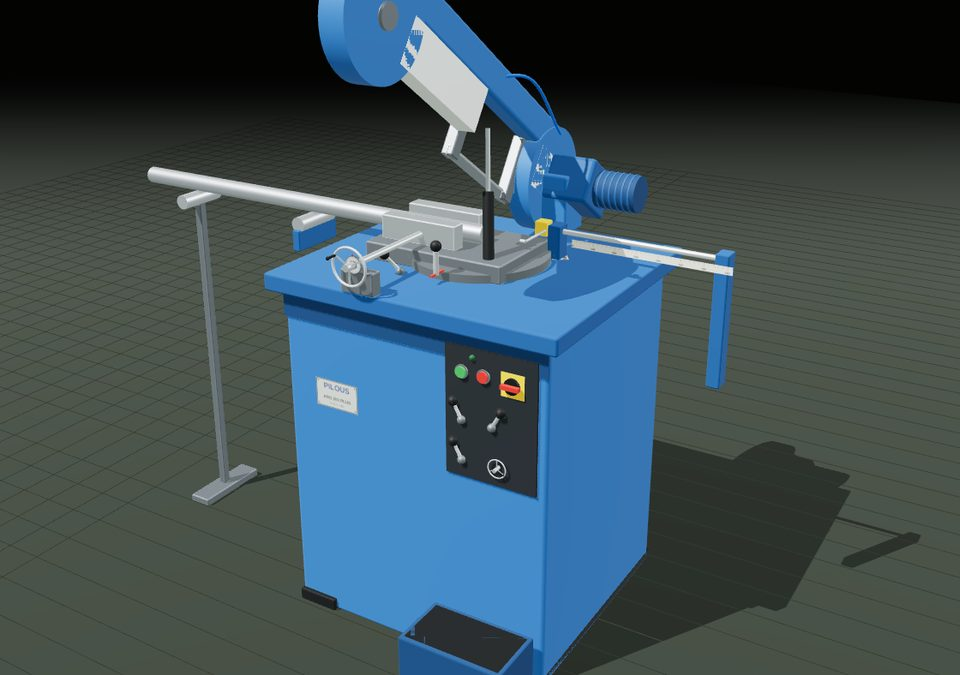 <b>Pásová píla</b> Pilous ARG 200 PLUS</a></td>
</tr>
</table>

### Zvislá obrážačka – TOS HOV 25

| | |
| --- | --- |
| **Stroj** | Zvislá obrážačka s otočným stolom |
| **Predloha** | TOS HOV 25 |
| **Parametre** | Zdvih do 250 mm · Otočný stôl Ø500 · Posuvy 560 × 450 mm |
| **Simulátor** | [▶ Otvoriť `#hov`](https://real-machine-tools.marcel-bucala.workers.dev/#hov) |

Oblúkový stojan so smykadlom vpredu, krížový a otočný stôl Ø500: viac drážok v náboji s delením otočného stola, vonkajší oblúk kruhovým posuvom, dĺžka a poloha zdvihu, narážky posuvov, nárazy do stola a upínok.

<b>Časti stroja (6)</b> – opis každej časti

- **Oblúkový stojan** – Liatinový stojan s oblúkom nesie vpredu vedenie smykadla, vzadu motor a prevodovku. Predloha: TOS HOV 25 – zdvih do 250 mm, otočný stôl Ø500, pozdĺžny posuv 560 mm, priečny 450 mm, vyloženie 365 mm, motor 4,5 kW, ≈ 2,85 t.
- **Zvislé smykadlo s držiakom noža** – Smykadlo kmitá zvisle – nadol reže, nahor sa vracia. Dĺžka zdvihu sa nastavuje na prevodovke, poloha zdvihu kolesom na hlave smykadla.
- **Prevodovka s ukazovateľom zdvihu** – Na boku stojana: páka stupňov zdvihov, štvorhran dĺžky zdvihu a okienko s ukazovateľom dĺžky zdvihu.
- **Krížový a otočný stôl Ø500** – Priečny a pozdĺžny suport s ručnými kolesami a samočinným posuvom po každom zdvihu; otočný stôl so šnekom (1 otáčka kolesa = 4°), stupnicou a zaistením.
- **Náboj Ø120 / Ø40 × 60** – Náboj leží na podložke a drží ho dve upínky.
- **Elektrická skriňa** – Hlavný vypínač, štart a stop.

[↑ 🪚 Obrážanie a delenie materiálu](#obrazanie) · [↑ Obsah](#obsah)

### Zvislá obrážačka – TOS ST 350

| | |
| --- | --- |
| **Stroj** | Zvislá obrážačka (drážkovačka) |
| **Predloha** | TOS ST 350 |
| **Parametre** | Zdvih 20 – 350 mm · 12 – 71 zdvihov/min · Otočný stôl, delenie 2 – 8 |
| **Simulátor** | [▶ Otvoriť `#zobrazacka`](https://real-machine-tools.marcel-bucala.workers.dev/#zobrazacka) |

Obrážanie drážok pre perá a tvarových otvorov v nábojoch: zvislé smykadlo s kulisovým pohonom, krížový stôl so západkovým posuvom a otočný stôl s delením.

<b>Časti stroja (10)</b> – opis každej časti

- **Lôžko stroja** – Liatinové lôžko nesie stojan a vedenia pozdĺžneho saní stola. V prednej časti je koleso pozdĺžneho posuvu.
- **Stojan s hlavou** – Vysoký stojan prechádza hore do vyloženej hlavy („labutí krk“). V hlave je prevodovka so šiestimi stupňami zdvihov a kulisový mechanizmus, vpredu zvislé vedenie smykadla.
- **Kulisový mechanizmus** – Veľké koleso má čap v radiálnej drážke; čap posúva kameň v kulise, ktorá sa kýve okolo zadného čapu a koncom ťahá smykadlo hore a dole. Vzdialenosť čapu od stredu určuje dĺžku zdvihu. Pracovný zdvih (dole) trvá dlhšie ako spätný.
- **Zvislé smykadlo** – Smykadlo sa pohybuje zvisle vo vedení hlavy. Poloha zdvihu sa nastavuje posunutím smykadla voči kulise pri stojacom stroji – nôž musí pri každom zdvihu prejsť celou výškou obrobku a vyjsť nad neho.
- **Drážkovací nôž** – Nôž je upnutý v držiaku na spodku smykadla, ostrie smeruje od stojana. Režie len pri zdvihu dole; prierez triesky = šírka × posuv na zdvih.
- **Krížový stôl** – Pozdĺžne sane (X, k stojanu a od neho) a priečne sane (Z). Oba posuvy majú ručné koleso (1 otáčka = 5 mm) a automatický západkový posuv o krok na začiatku každého pracovného zdvihu.
- **Otočný stôl** – Kruhový stôl so závitovkou: 1 otáčka kolieska = 4°. Delením sa obrobok pootočí o 360°/z – napr. o 90° pri štvorhrannom otvore.
- **Trojčeľusťové skľučovadlo** – Obrobok je upnutý za vonkajší priemer. Skľučovadlo aj stôl majú v strede otvor Ø60 – nôž doň vybehne pod obrobok. Mimo otvoru by narazil.
- **Náboj (obrobok)** – Oceľový náboj s predvŕtaným otvorom. Obrobená plocha otvoru je svetlá.
- **Elektrický rozvádzač** – Hlavný vypínač, Štart, Stop a núdzový STOP. Nad ním páka prevodovky zdvihov a štvorhran dĺžky zdvihu.

[↑ 🪚 Obrážanie a delenie materiálu](#obrazanie) · [↑ Obsah](#obsah)

### Píla – TOS PPN

| | |
| --- | --- |
| **Stroj** | Strojná pásová píla |
| **Predloha** | TOS PPN |
| **Parametre** | Kolesá Ø720 mm · Pás 3 / 10 / 25 m/s · Rez do 150 mm |
| **Simulátor** | [▶ Otvoriť `#pila`](https://real-machine-tools.marcel-bucala.workers.dev/#pila) |

Rezanie dreva, hliníka a ocele pásom: napínanie pásu, nastavenie horného vodidla, voľba rýchlosti pásu podľa materiálu.

<b>Časti stroja (9)</b> – opis každej časti

- **Podstavec s nohami** – Liatinový podstavec s dvoma pätkami nesie celý stroj. Vnútri je dolné hnacie koleso, vzadu motor s remeňovým prevodom.
- **Rameno (stojan)** – Oblúkové liatinové rameno spája dolnú a hornú časť. Jeho vyloženie určuje, aký široký obrobok sa zmestí medzi pás a rameno.
- **Kolesá pásu a kryty** – Dve kolesá Ø720 mm s gumovou bandážou vedú nekonečný pás. Horné koleso sa napína ručným kolesom navrchu, dolné je poháňané. Kryty chránia obsluhu.
- **Pílový pás** – Oceľový pás so zubami smerom k obsluhe. Reže smerom nadol; rýchlosť pásu sa volí podľa materiálu – drevo rýchlo, kov pomaly.
- **Horné vedenie pásu s krytom** – Vedenie s kladkami drží pás pri reze. Nastavuje sa hviezdicovým kolieskom čo najbližšie nad obrobok, kryt zakrýva zvyšok pásu.
- **Pracovný stôl** – Liatinový stôl 660 × 600 mm s drážkou pre pás. Obrobok sa po ňom posúva k pásu rukou alebo posuvom.
- **Elektromotor s remeňom** – Motor poháňa dolné koleso cez stupňovitú remenicu – tri rýchlosti pásu 3, 10 a 25 m/s. Prestavuje sa len pri stojacom stroji.
- **Obrobok** – Doska alebo platňa zvoleného materiálu a rozmeru. Posúva sa proti pásu; prerezaná časť sa po dorezaní oddelí.
- **Vypínač a tlačidlá** – Hlavný vypínač a tlačidlá Štart a Stop na ramene stroja.

[↑ 🪚 Obrážanie a delenie materiálu](#obrazanie) · [↑ Obsah](#obsah)

### Pásová píla – Pilous ARG 200 PLUS

| | |
| --- | --- |
| **Stroj** | Pásová píla na kov |
| **Predloha** | Pilous ARG 200 PLUS |
| **Parametre** | Kruh do Ø200 mm · Pás 20 × 0,9 mm, 40 / 80 m/min · Šikmo 60° vpravo, 45° vľavo |
| **Simulátor** | [▶ Otvoriť `#pasovka`](https://real-machine-tools.marcel-bucala.workers.dev/#pasovka) |

Delenie tyčí na kusy: zverák, dĺžkový doraz so stupnicou, otočné rameno na šikmé rezy, rýchlosť klesania ramena hydraulikou, rýchlosť pásu podľa materiálu, chladenie a preťaženie pásu.

<b>Časti stroja (6)</b> – opis každej časti

- **Stojan s vaňou chladiva** – Plechový stojan nesie otočný stôl, zverák a vaňu s čerpadlom chladiva. Predloha: Pilous ARG 200 PLUS (Česko) – kruh do Ø200 mm, pás 2 085 × 20 × 0,9 mm, šikmé rezy 60° vpravo a 45° vľavo.
- **Rameno s pílovým pásom** – Rameno so zotrvačníkmi pásu sa otáča okolo závesu vzadu. Pri reze klesá vlastnou váhou, rýchlosť klesania tlmí hydraulický valec.
- **Zverák s ručným kolesom** – Zverák drží tyč vľavo od pásu. Kus vpravo po dorezaní odpadne.
- **Dĺžkový doraz so stupnicou** – Doraz na tyči so stupnicou meria dĺžku kusa od pravej strany pásu.
- **Kruhová tyč Ø40, oceľ 11 523** – Tyč 1 m z valčekového stojana sa posúva cez zverák až k dorazu.
- **Ovládací panel** – Hlavný vypínač, štart, stop, prepínač rýchlosti pásu, chladenie, ventil a škrtenie hydrauliky.

[↑ 🪚 Obrážanie a delenie materiálu](#obrazanie) · [↑ Obsah](#obsah)

---

## 🛠️ Tvárnenie a kovanie

_Ohýbanie a strihanie plechu, lisovanie, zakružovanie profilov a plechu, kovanie bucharom._

<table>
<tr>
<td align="center" width="33%"><a href="#ohybacka">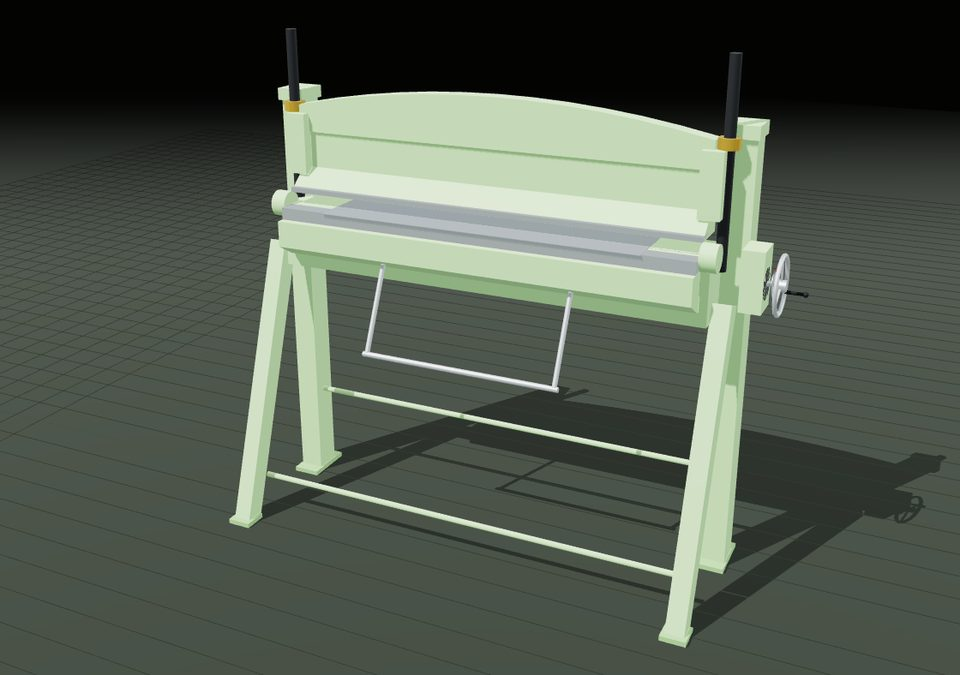 <b>Ohýbačka</b> FASTI 204-10-2</a></td>
<td align="center" width="33%"><a href="#noznice">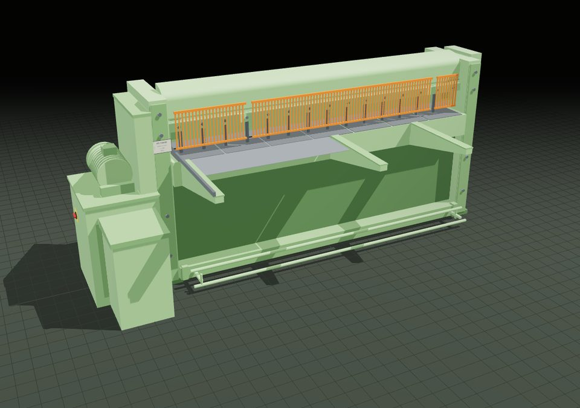 <b>Tabuľové nožnice</b> BS 2000/8</a></td>
<td align="center" width="33%"><a href="#lis">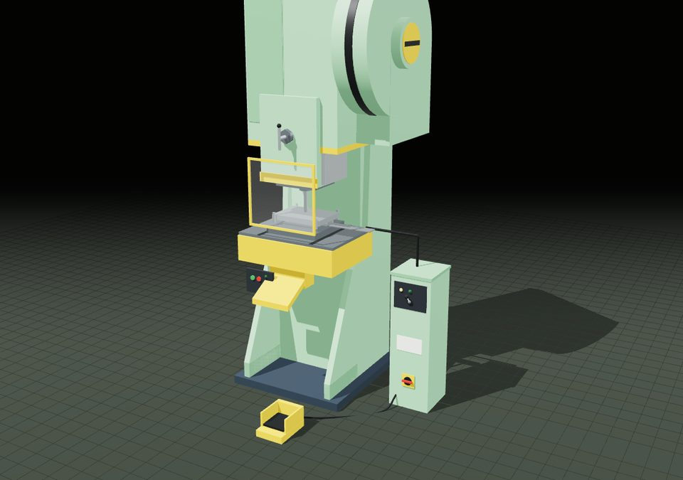 <b>Výstredníkový lis</b> TOMA LEN 40C</a></td>
</tr>
<tr>
<td align="center" width="33%"><a href="#profilova">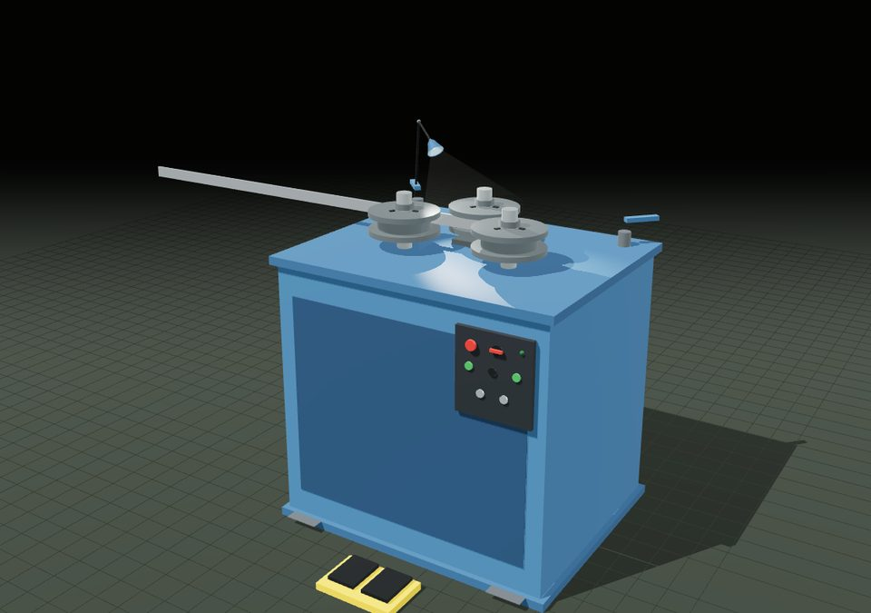 <b>Profilová ohýbačka</b> COMAC 3025 HV</a></td>
<td align="center" width="33%"><a href="#zakruzovacka">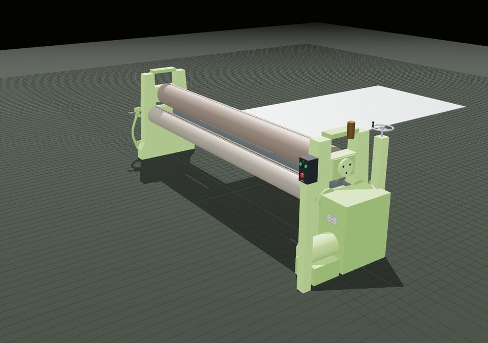 <b>Zakružovačka plechu</b> TOS XZC 3000/10</a></td>
<td align="center" width="33%"><a href="#buchar">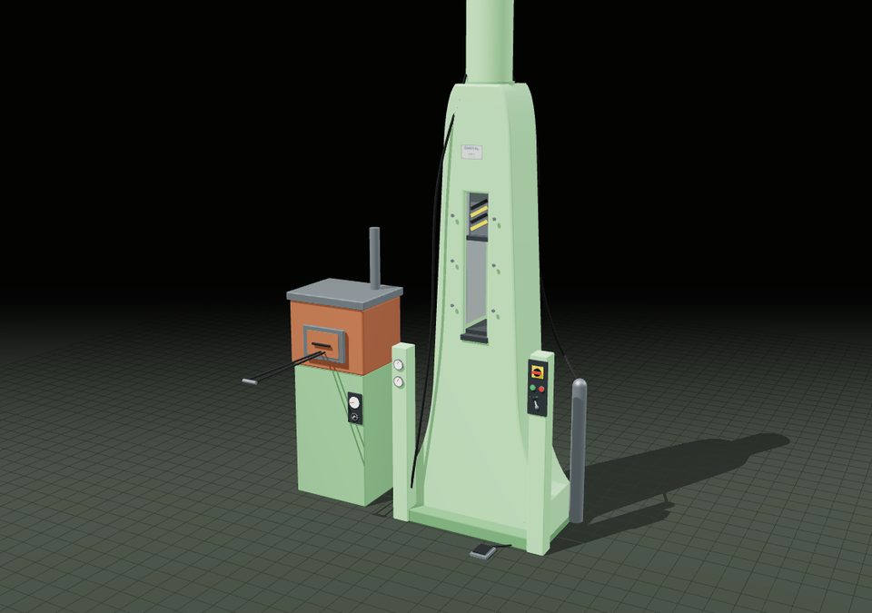 <b>Kovací buchar</b> Šmeral KHZ 2</a></td>
</tr>
</table>

### Ohýbačka – FASTI 204-10-2

| | |
| --- | --- |
| **Stroj** | Výkyvná ohýbačka plechu |
| **Predloha** | FASTI 204-10-2 |
| **Parametre** | Dĺžka ohybu 1 040 mm · Plech do 2 mm · Uhol ohybu do 130° |
| **Simulátor** | [▶ Otvoriť `#ohybacka`](https://real-machine-tools.marcel-bucala.workers.dev/#ohybacka) |

Ručné ohýbanie plechu: upnutie kolesom cez dve skrutky, vykývnutie ohýbacej lišty a odpruženie plechu podľa hrúbky.

<b>Časti stroja (6)</b> – opis každej časti

- **Bočné stojany** – Dva liatinové stojany s nohami a priečnymi tyčami nesú celý stroj. Na pravom je ručné koleso upínania so stupnicou.
- **Stôl (spodná lišta)** – Pevná spodná lišta s kalenou hranou – os ohybu leží presne na jej prednej hrane.
- **Upínacia lišta** – Horná lišta so skoseným nosom pritlačí plech k stolu. Spúšťa sa kolesom cez dve zdvíhacie skrutky; nos je skosený, aby ohyb mohol ísť až do 130°.
- **Ohýbacia (výkyvná) lišta** – Otáča sa okolo osi na prednej hrane stola. Za rukoväť pod lištou ju obsluha vykýva nahor a ohne vyčnievajúci okraj plechu.
- **Zdvíhacie skrutky** – Dve závitové skrutky na koncoch upínacej lišty, spojené cez koleso a ozubené prevody – lišta klesá rovnobežne. 1 otáčka kolesa = 5 mm.
- **Plech** – Oceľový plech zvoleného rozmeru hrúbky 0,5 – 2 mm (predloha FASTI 204-10-2: dĺžka ohybu 1 040 mm, max. 2 mm). Po ohnutí sa časť ohybu vráti – odpruží.

[↑ 🛠️ Tvárnenie a kovanie](#tvarnenie) · [↑ Obsah](#obsah)

### Tabuľové nožnice – BS 2000/8

| | |
| --- | --- |
| **Stroj** | Tabuľové nožnice |
| **Predloha** | BS 2000/8 |
| **Parametre** | Plech do 8 mm · Dĺžka strihu 2 000 mm · Zadný doraz do 750 mm |
| **Simulátor** | [▶ Otvoriť `#noznice`](https://real-machine-tools.marcel-bucala.workers.dev/#noznice) |

Strihanie plechov na pásy a prírezy: zadný doraz, bočný uholník, vôľa nožov podľa hrúbky, prítlaky, kryt prstov blokujúci pedál a kapacita stroja.

<b>Časti stroja (9)</b> – opis každej časti

- **Stojany a stôl** – Liatinové bočné stojany spája horný kryt výstredníkovej hriadele a stôl so spodným nožom. Vpredu sú tri podperné ramená, pravé s mierkou.
- **Nožový trám so šikmým nožom** – Horný nôž je uložený šikmo (uhol strihu) – plech sa strihá postupne od jedného konca, preto stačí menšia sila. Trám poháňa výstredník cez jednootáčkovú spojku.
- **Prítlaky plechu** – Pred nožom zovrú plech k stolu, aby sa pri strihu nepreklopil. Prsty pod prítlakmi = úraz – preto je pred nimi kryt prstov.
- **Ochranný kryt prstov** – Oranžový hrebeň z tyčiek pred prítlakmi a nožom – plech prejde pod ním, prsty nie. Pri zdvihnutom kryte pedál nespustí strih.
- **Zadný doraz** – Lišta za nožom nastavená na šírku pásu. Plech sa zasúva, kým sa jej nedotkne.
- **Bočný uholník** – Pravítko kolmé na nôž vľavo na stole. Plech priložený k uholníku sa odstrihne pravouhlo.
- **Pedálová tyč** – Tyč po celej šírke stroja – dá sa stlačiť z ktoréhokoľvek miesta. Stlačenie zapne jednootáčkovú spojku: jeden strih, jedna otáčka výstredníka.
- **Motor so zotrvačníkom** – Elektromotor 7,5 kW vľavo roztáča cez prevod zotrvačník; pri strihu odovzdá energiu výstredníkovej hriadeli v hornom kryte. Na podstavci je hlavný vypínač a prepínač.
- **Plech** – Oceľový plech S235 na stole. Odstrihnuté pásy padajú za nožom do zberného koša.

[↑ 🛠️ Tvárnenie a kovanie](#tvarnenie) · [↑ Obsah](#obsah)

### Výstredníkový lis – TOMA LEN 40C

| | |
| --- | --- |
| **Stroj** | Výstredníkový lis |
| **Predloha** | TOMA LEN 40C |
| **Parametre** | Sila 400 kN · Zdvih 10 – 80 mm · 80 zdvihov/min |
| **Simulátor** | [▶ Otvoriť `#lis`](https://real-machine-tools.marcel-bucala.workers.dev/#lis) |

Dierovanie a vystrihovanie z pásu: sila strihu podľa priemeru a hrúbky, prestavenie baranidla a zanorenie razníka, jednotlivý zdvih pedálom, kryt nástroja, preťaženie a zlomený razník.

<b>Časti stroja (9)</b> – opis každej časti

- **C-stojan** – Liatinový stojan tvaru C je otvorený spredu aj zboku – nástroj sa dobre zakladá, ale pri plnej sile sa stojan mierne rozovrie.
- **Zotrvačník s krytom** – Motor roztáča remeňom zotrvačník. Pri zdvihu odovzdá energiu výstredníkovému hriadeľu – pred prvým zdvihom ho nechaj rozbehnúť.
- **Baranidlo s prestavením** – Baranidlo ide hore a dole o nastavený zdvih výstredníka (10 – 80 mm). Skrutkou na čele sa prestavuje výška – tým sa nastaví, ako hlboko sa razník zanorí do matrice.
- **Upínacia doska stola** – Žltý stôl s T-drážkami a otvorom na prepad výstrižkov. Výstrižky a odpad padajú žľabom dopredu.
- **Strihadlo: razník a matrica** – Razník na baranidle, matrica na stole a vodiaca doska, ktorá stiahne pás z razníka. Sila strihu F = π · d · t · τ.
- **Ochranný kryt nástroja** – Sklopný kryt pred nástrojom. Kým je zdvihnutý, pedál zdvih nespustí.
- **Elektrický rozvádzač** – Hlavný vypínač, voľba režimu (jednotlivý zdvih / trvalý chod) a kontrolky.
- **Nožný pedál** – Stlačenie zapne spojku: v režime jednotlivý zdvih urobí lis jeden zdvih a zastaví v hornej úvrati.
- **Oceľový pás** – Pás S235 sa posúva medzi vodiacimi lištami. Poloha razníka sa meria od ľavého konca pásu.

[↑ 🛠️ Tvárnenie a kovanie](#tvarnenie) · [↑ Obsah](#obsah)

### Profilová ohýbačka – COMAC 3025 HV

| | |
| --- | --- |
| **Stroj** | Zakružovačka profilov |
| **Predloha** | COMAC 3025 HV |
| **Parametre** | 3 poháňané valce v pyramíde · Pracovná poloha H aj V · Rýchlosť 3 / 5 / 8 m/min |
| **Simulátor** | [▶ Otvoriť `#profilova`](https://real-machine-tools.marcel-bucala.workers.dev/#profilova) |

Zakružovanie plochých tyčí, rúr, jäklov a uholníkov tromi poháňanými valcami: prísuv stredného valca, odpruženie po ohybe, tvarové valce, bočné vodiace kladky a pracovná poloha vodorovná aj zvislá.

<b>Časti stroja (7)</b> – opis každej časti

- **Skriňa s pohonom** – Zváraná skriňa nesie tri hriadele. Vnútri je elektromotor s prevodovkou, ktorá poháňa všetky tri valce rovnakou obvodovou rýchlosťou, a hydraulika prísuvu stredného valca. Celý stroj sa dá sklopiť do zvislej polohy (V) – veľké prstence potom stoja vo zvislej rovine.
- **Krajné valce** – Dva krajné valce na pevných hriadeľoch podopierajú profil. Na hriadele sa nasadzujú tvarové valce podľa profilu: valce s nákružkami pre plochú tyč, jäkel a uholník, drážkové valce pre rúru.
- **Stredný (ohýbací) valec** – Stredný valec sa hydraulicky prisúva k profilu o δ. Čím väčší prísuv, tým menší polomer. Po prejdení valcami profil odpruží – nastavený polomer v zábere je vždy menší ako výsledný.
- **Bočné vodiace kladky** – Kladky na nastaviteľných ramenách pridržiavajú profil pri vstupe a výstupe. Pri profiloch ohýbaných nastojato a pri uholníkoch bránia vybočeniu a skrúteniu.
- **Ovládací panel** – Hlavný vypínač, chod valcov vpred a vzad, stop, núdzový STOP a tlačidlá prísuvu stredného valca. Na podlahe je dvojitý nožný pedál.
- **Nožný pedál** – Ľavý pedál = chod vzad, pravý = vpred. Obsluha má obe ruky voľné na vedenie dlhého profilu.
- **Ohýbaný profil** – Oceľový profil S235. Ohýba sa len úsek, ktorý leží na oboch krajných valcoch – asi 200 mm na každom konci zostane rovných.

[↑ 🛠️ Tvárnenie a kovanie](#tvarnenie) · [↑ Obsah](#obsah)

### Zakružovačka plechu – TOS XZC 3000/10

| | |
| --- | --- |
| **Stroj** | Zakružovačka plechu |
| **Predloha** | TOS XZC 3000/10 |
| **Parametre** | Pracovná dĺžka 3 000 mm · Plech do 10 mm · Odklopné ložisko |
| **Simulátor** | [▶ Otvoriť `#zakruzovacka`](https://real-machine-tools.marcel-bucala.workers.dev/#zakruzovacka) |

Trojvalcová pyramída: dva poháňané spodné valce, horný valec prisúvaný ručným kolesom, odpruženie podľa hrúbky, predohnutie koncov podložným plechom a vysunutie plášťa cez odklopné ložisko.

<b>Časti stroja (7)</b> – opis každej časti

- **Stojan na strane pohonu** – Liatinový stojan nesie ložiská všetkých troch valcov a prevodovku. Ručné koleso na stĺpiku prestavuje horný valec nadol o prísuv δ – na oboch koncoch naraz.
- **Vidlicový stojan s odklopným ložiskom** – Ložisko horného valca leží vo vidlici a drží ho kolík s rukoväťou. Po vytiahnutí kolíka sa ložisko odklopí, horný valec sa nadvihne a hotový plášť sa vysunie cez koniec valca.
- **Horný (ohýbací) valec** – Voľne uložený valec Ø280 mm. Čím viac sa prisunie nadol medzi spodné valce, tým menší polomer. Plech odpruží – prísuv musí byť väčší, ako zodpovedá žiadanému polomeru.
- **Spodné poháňané valce** – Dva valce Ø220 mm s rozostupom 360 mm poháňa motor cez prevodovku. Plech sa ohne len v úseku, ktorý leží na oboch – asi 180 mm na každom konci zostane rovných.
- **Motor s prevodovkou** – Elektromotor a prevodovka za stojanom poháňajú spodné valce, chod vpred a vzad.
- **Ovládací stĺpik** – Hlavný vypínač, chod vpred a vzad, stop a núdzový STOP.
- **Plech** – Oceľový plech S235 do hrúbky 10 mm a šírky 3 000 mm.

[↑ 🛠️ Tvárnenie a kovanie](#tvarnenie) · [↑ Obsah](#obsah)

### Kovací buchar – Šmeral KHZ 2

| | |
| --- | --- |
| **Stroj** | Hydraulický kovací buchar s pecou |
| **Predloha** | Šmeral KHZ 2 |
| **Parametre** | Energia úderu 20 kJ · Baran 920 kg, zdvih 400 mm · Kovanie 1 200 – 850 °C |
| **Simulátor** | [▶ Otvoriť `#buchar`](https://real-machine-tools.marcel-bucala.workers.dev/#buchar) |

Voľné kovanie hranola: ohrev v plynovej peci, prenos kliešťami, energia úderu voličom a pedál, otáčanie o 90°, kovacia teplota 1 200 – 850 °C, trhliny za studena a spálenie materiálu.

<b>Časti stroja (5)</b> – opis každej časti

- **Liatinový rám so šabotou** – Zúžený rám s pracovným oknom nesie vedenie baranu, dole je šabota so spodným kovadlom. Predloha: Šmeral KHZ 2 – energia úderu 20 kJ, baran 920 kg, zdvih 400 mm, 60 úderov/min.
- **Baran s horným kovadlom** – Baran zdvíha hydraulický valec hore na ráme. Pedálom sa spustí jeden úder; energiu určuje zdvih baranu nastavený voličom.
- **Plynová kovacia pec** – Obrobok sa ohrieva na kovaciu teplotu 1 200 °C. Nad ≈ 1 280 °C sa oceľ spáli (oxiduje po hraniciach zŕn) a je na odpad.
- **Hranol 60 × 60 × 120 v kliešťach** – Oceľový hranol sa drží kliešťami. Kuje sa medzi 1 200 a 850 °C – pod 850 °C sa už nesmie kovať, pod 750 °C praská.
- **Ovládacie stojany a pedál** – Vpravo hlavný vypínač, čerpadlo a volič energie úderu, vľavo tlakomery hydrauliky, na zemi pedál úderu.

[↑ 🛠️ Tvárnenie a kovanie](#tvarnenie) · [↑ Obsah](#obsah)

---

## 🔥 Zváranie

_Ručné oblúkové zváranie obalenou elektródou a MIG/MAG v ochrannom plyne._

<table>
<tr>
<td align="center" width="33%"><a href="#zvaranie">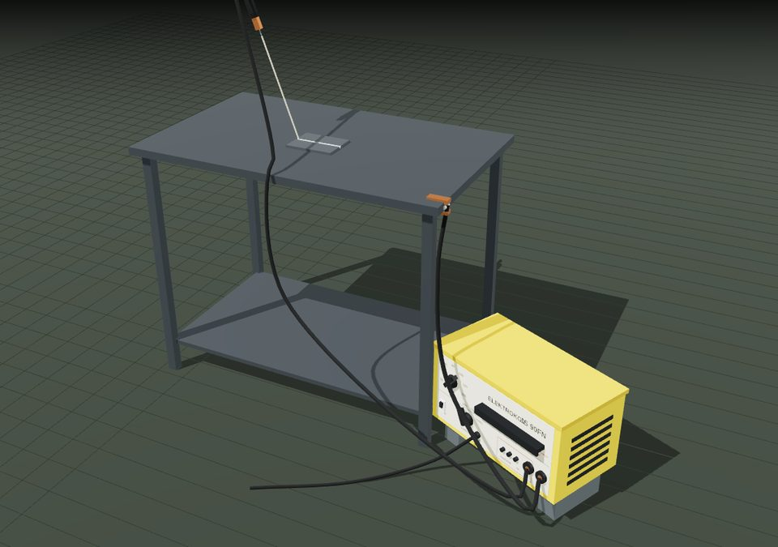 <b>Zváranie</b> Elektrokov JS 90FN</a></td>
<td align="center" width="33%"><a href="#mag">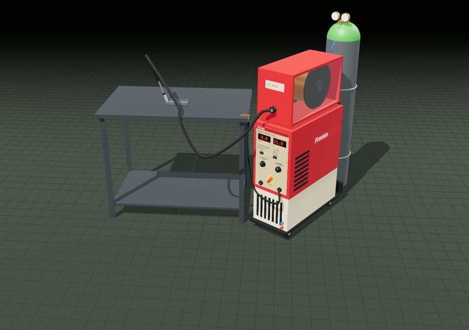 <b>Zváranie MIG/MAG</b> Fronius TransPuls Synergic TPS 450</a></td>
</tr>
</table>

### Zváranie – Elektrokov JS 90FN

| | |
| --- | --- |
| **Stroj** | Oblúková zváračka |
| **Predloha** | Elektrokov JS 90FN |
| **Parametre** | Prúd 55 – 155 A · 380 / 220 V · Elektródy Ø2 – Ø4 mm |
| **Simulátor** | [▶ Otvoriť `#zvaranie`](https://real-machine-tools.marcel-bucala.workers.dev/#zvaranie) |

Ručné zváranie obalenou elektródou: plechy v rovine aj kolmo, rúry a tvarové diely, polohy PA – PG aj rúrové, výmena elektródy, kukla proti zábleskom a hodnotenie húsenice.

<b>Časti stroja (5)</b> – opis každej časti

- **Transformátorová zváračka** – Elektrokov JS 90FN: rozptylový transformátor so stupňami prúdu 55 – 155 A. Prepínač 380 V / 220 V / nabíjanie; pri 220 V najviac 75 A, inak vypadne istič.
- **Držiak elektródy s káblom** – Izolovaný držiak so svorkou na elektródu. Vedie sa pravým tlačidlom myši, oblúk sa zapáli ľavým tlačidlom pri držanom pravom.
- **Zemniaca svorka** – Uzatvára zvárací obvod cez stôl a zvarenec. Bez pripojenej zeme sa oblúk nezapáli.
- **Zvárací stôl s prípravkom** – Oceľový stôl; pre polohy PC, PF, PE a rúrové polohy PH, PJ, H-L045 drží zvarenec stojan s upínačom.
- **Zvarenec s úkosmi** – Diely pripravené podľa druhu zvaru a hrúbky: medzera, otupenie a úkos. Húsenica sa tvorí podľa prúdu, rýchlosti posuvu a dĺžky oblúka.

[↑ 🔥 Zváranie](#zvaranie) · [↑ Obsah](#obsah)

### Zváranie MIG/MAG – Fronius TransPuls Synergic TPS 450

| | |
| --- | --- |
| **Stroj** | Zváranie v ochrannom plyne |
| **Predloha** | Fronius TransPuls Synergic TPS 450 |
| **Parametre** | Prúd 3 – 450 A · Drôt Ø0,8 – 1,2 mm · Ar + CO₂ / CO₂ |
| **Simulátor** | [▶ Otvoriť `#mag`](https://real-machine-tools.marcel-bucala.workers.dev/#mag) |

Poloautomatické zváranie drôtom v ochrannom plyne: synergický program podľa drôtu a plynu, štandardný aj impulzný oblúk, 2T / 4T, plynová fľaša a výlet drôtu.

<b>Časti stroja (8)</b> – opis každej časti

- **Invertorový zdroj Fronius TransPuls Synergic TPS 450** – Digitálne riadený zdroj 3 – 450 A. Synergia: k zvolenej rýchlosti drôtu nastaví prúd a napätie podľa programu (drôt, plyn), korekciou sa dolaďuje dĺžka oblúka. Režimy štandard a impulz, 2-takt a 4-takt.
- **Podávač drôtu VR 4000** – Cievka s drôtom a štvorkladkový podávač; drôt ide cez hadicové vedenie do horáka. Spúšťač na horáku zapne plyn, podávanie a prúd naraz.
- **Chladiaci modul FK** – Čerpá chladiacu kvapalinu do horáka – pri vysokých prúdoch sa horák neprehrieva.
- **Fľaša s ochranným plynom a redukčným ventilom** – Ochranný plyn chráni kúpeľ pred vzduchom. Bežne Ar + 18 % CO₂ (M21) s prietokom 12 – 16 l/min. Bez plynu je zvar pórovitý.
- **Zvárací horák s hadicovým vedením** – Plynová hubica, kontaktná špička a drôt. Výlet drôtu (vzdialenosť špičky od dielu) 10 – 15 mm. Vedie sa pravým tlačidlom myši, spúšťač je ľavé tlačidlo.
- **Zemniaca svorka** – Uzatvára zvárací obvod cez stôl a zvarenec.
- **Zvárací stôl s prípravkom** – Oceľový stôl; pre polohy PC, PF, PE a rúrové polohy PH, PJ, H-L045 drží zvarenec stojan s upínačom.
- **Zvarenec s úkosmi** – Diely pripravené podľa druhu zvaru a hrúbky. Pri MAG zváraní plným drôtom nevzniká troska.

[↑ 🔥 Zváranie](#zvaranie) · [↑ Obsah](#obsah)

---

## 🚀 Moderné CNC stroje

_5-osé obrábacie centrá, HSC, hĺbiaca elektroerózia, vláknový laser a CNC ohraňovací lis s živým HMI._

<table>
<tr>
<td align="center" width="33%"><a href="#hermle">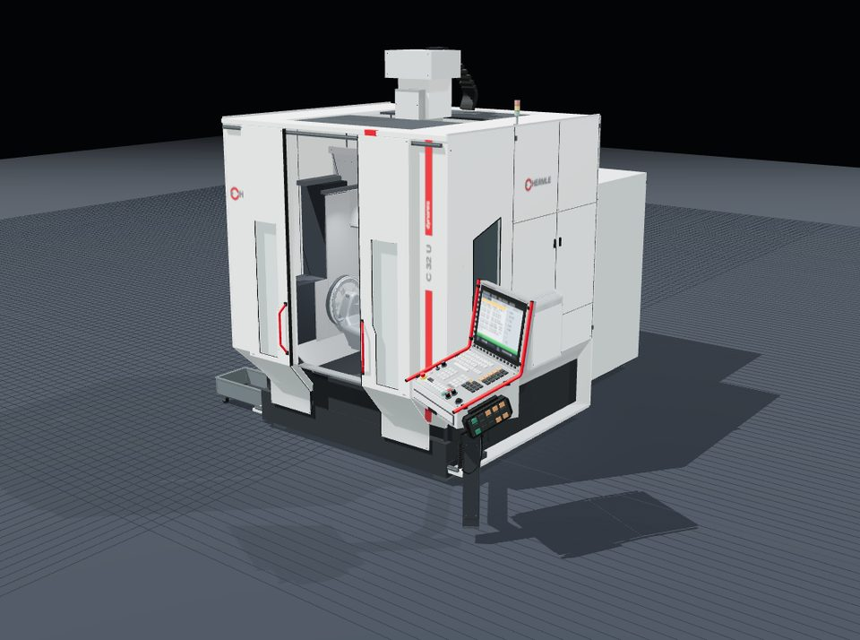 <b>5-osé obrábacie centrá</b> </a></td>
<td align="center" width="33%"><a href="#roeders">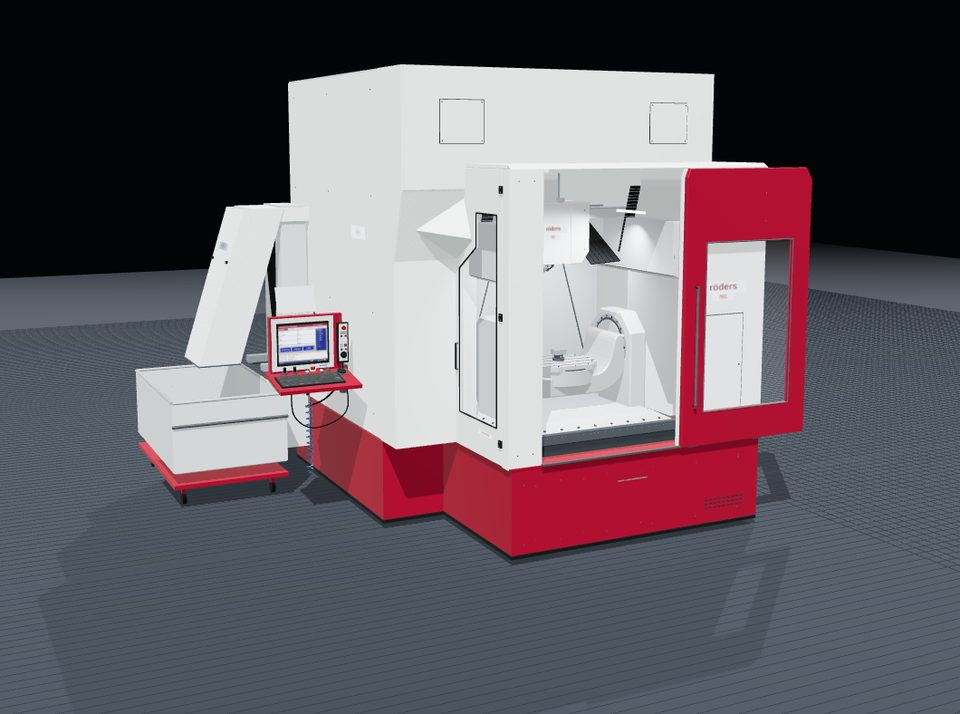 <b>5-osé HSC · QUADROGUIDE</b> </a></td>
<td align="center" width="33%"><a href="#oscarmax">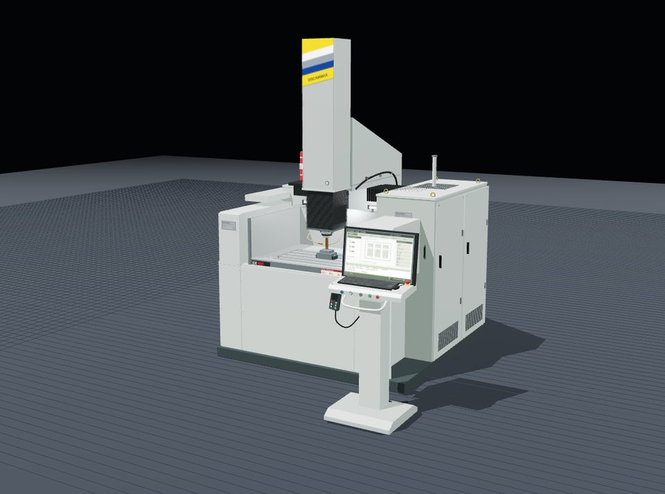 <b>Hĺbiaca elektroerózia</b> </a></td>
</tr>
<tr>
<td align="center" width="33%"><a href="#amada">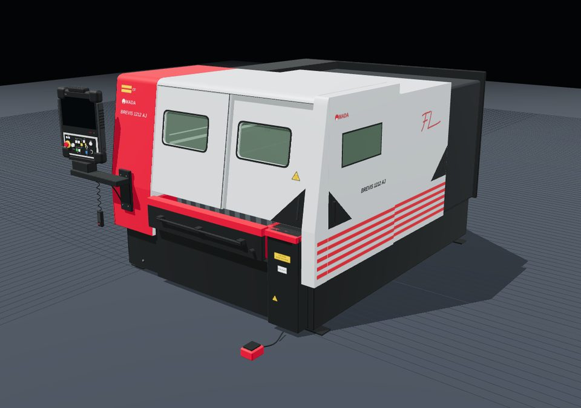 <b>Vláknový laser</b> </a></td>
<td align="center" width="33%"><a href="#bystronic">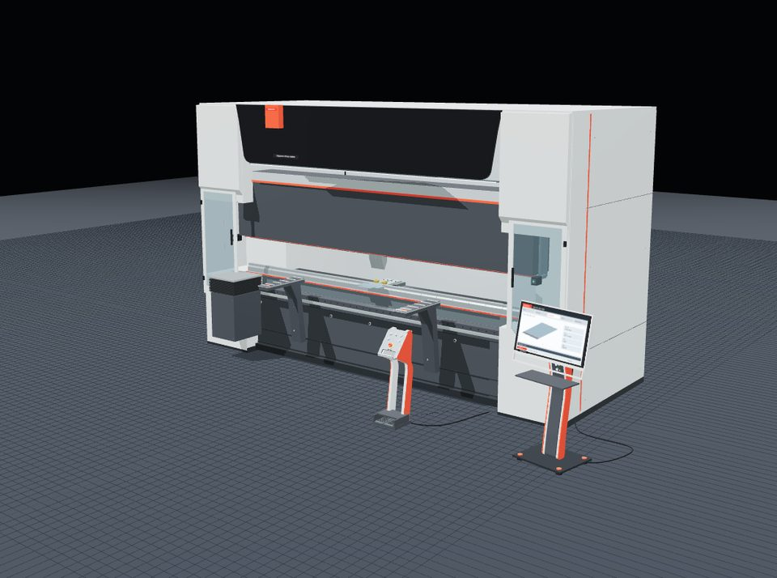 <b>CNC ohraňovací lis</b> </a></td>
</tr>
</table>

### 5-osé obrábacie centrá – Hermle C 32 U / C 42 U

| | |
| --- | --- |
| **Stroj** | Hermle C 32 U / C 42 U |
| **Parametre** | C 32: 650 / 650 / 500 mm, stôl Ø650 · C 42: 800 / 800 / 550 mm, stôl Ø800 · A ±130°, C 360° · TNC 640 |
| **Simulátor** | [▶ Otvoriť `#hermle`](https://real-machine-tools.marcel-bucala.workers.dev/#hermle) |
| **Podklady modelu** | [Rozmery, zdroje a obmedzenia](../precision-machines.md) |

Obrábanie podľa CNC programu: ISO / G-kód aj Heidenhain Klartext, programy z CAM, 3-osé, 3+2 aj simultánne 5-osé obrábanie s TCP, skutočný úber materiálu, kolízie, zaťaženie vretena a export obrobku do STL.

<b>Časti stroja (8)</b> – opis každej časti

- **Kabína s posuvnými dverami** – Uzavretý pracovný priestor s veľkými oknami. Dvere majú bezpečnostný zámok – pri otvorených dverách sa program nespustí a posuv sa zastaví.
- **Lôžko z minerálneho liatia** – Masívne lôžko z minerálneho liatia tlmí chvenie. Os A stola je uložená priamo v lôžku.
- **Upravený portál – osi nad pracovným priestorom** – Tri lineárne osi nesie vreteno; priečnik Y jazdí po stenách minerálneho lôžka. Dráhy 650 × 650 × 500 mm, rýchloposuv 45 / 45 / 40 m/min.
- **Motorové vreteno HSK-A63** – 18 000 ot/min, 42 kW / 148 Nm (20 % ED), HSK-A63.
- **Otočno-sklopný stôl Ø650 × 540 mm** – Os A sklápa stôl ±130° okolo osi X, os C ho otáča o 360°. Os A leží v obrobku (stôl tvaru U) – pri sklopení sa obrobok málo vychýli.
- **Pick-up zásobník 36 / 42 miest** – 36 miest v karuseli integrovanom do lôžka. Obvodové držiaky, nosný bubon, bočný pohon a vedenia nad prstencom. Výmena pick-up priamo vretenom.
- **Riadiaci systém Heidenhain TNC 640** – Otočný ovládací panel s 19" dotykovou obrazovkou. Simulátor číta programy ISO (G-kód) aj Heidenhain Klartext.
- **Polotovar na upínači** – Polotovar na nulovom upínacom systéme. Nulový bod G54 je v strede hornej plochy.

[↑ 🚀 Moderné CNC stroje](#moderne) · [↑ Obsah](#obsah)

### 5-osé HSC · QUADROGUIDE – Röders RXU 1001 DSH

| | |
| --- | --- |
| **Stroj** | Röders RXU 1001 DSH |
| **Parametre** | 800 / 855 / 500 mm · Ø600 mm · A ±115° · C 360° · 24 000 ot/min · HSK-A63 · 24 miest |
| **Simulátor** | [▶ Otvoriť `#roeders`](https://real-machine-tools.marcel-bucala.workers.dev/#roeders) |
| **Podklady modelu** | [Rozmery, zdroje a obmedzenia](../precision-machines.md) |

Presné vysokorýchlostné frézovanie s priamymi pohonmi, obojstranne uloženým stolom A/C a štyrmi vedeniami osi Z. ISO program, skrinka nástrojov, úber materiálu a prehliadka obrobku.

<b>Časti stroja (8)</b> – opis každej časti

- **Pracovná kabína RXU** – Ľavé bočné pozorovacie okno a červené čelné dvere posúvané doprava po spodnej koľajnici.
- **QUADROGUIDE** – Masívne lôžko, priame pohony a teplotná stabilizácia.
- **QUADROGUIDE · X/Y/Z** – Dráhy 800 × 855 × 500 mm; štyri vedenia v rohoch osi Z.
- **HSK-A63 · 24 000 ot/min** – Štandardné vreteno 67 Nm S1, nástroj max. Ø35 mm.
- **A/C · Ø600 mm** – Obojstranné uloženie, A ±115°, C neobmedzene; nosnosť 800 kg.
- **24 miest / pockets** – Štandardný rotačný zásobník. Čas výmeny v simulácii je odhad.
- **Röders RMS6** – Výukové ISO rozhranie; nejde o emuláciu proprietárneho RMS6.
- **Polotovar na upínači** – Polotovar na nulovom upínacom systéme. Nulový bod G54 je v strede hornej plochy.

[↑ 🚀 Moderné CNC stroje](#moderne) · [↑ Obsah](#obsah)

### Hĺbiaca elektroerózia – OSCARMAX EX 500

| | |
| --- | --- |
| **Stroj** | OSCARMAX EX 500 |
| **Parametre** | 500 / 400 / 450 mm · 850 × 450 mm · 2 300 kg · 60 A · 10 kVA · 850 l |
| **Simulátor** | [▶ Otvoriť `#oscarmax`](https://real-machine-tools.marcel-bucala.workers.dev/#oscarmax) |
| **Podklady modelu** | [Rozmery, zdroje a obmedzenia](../precision-machines.md) |

Tvarová medená elektróda hĺbi dutiny v oceli bez otáčania. Pohyblivý stĺp, dielektrická nádrž, výplach a generátor 60 A. Viac operácií, aktuálna geometria dutín a export prerušeného procesu.

<b>Časti stroja (8)</b> – opis každej časti

- **EX 500 · masívne lôžko** – Stroj 3 000 kg, nosnosť obrobku 2 300 kg. Obrysy plechov podľa fotografií výrobcu.
- **Servoposuvy** – Dráhy X 500 / Y 400 / Z 450 mm. Elektróda sa pri hĺbení netočí.
- **Stôl 850 × 450 mm** – Obrobok je pevne upnutý. Pohyblivý stĺp nesie elektródu v XY; stôl a obrobok stoja.
- **Pracovná nádrž** – Dvere umožňujú nakladanie. Pri výboji musí hladina siahať aspoň 40 mm nad obrobok.
- **60 A · 10 kVA** – Nádrž 850 l, filtrácia 20 µm, šesť vložiek. Úber a opotrebenie sú výučbové odhady.
- **Ochrana pracovného priestoru** – Model UV snímača, hasiaceho zariadenia a trysiek. Simulácia kontroluje dvere, hladinu a výplach.
- **Mobilný panel EX** – PC monitor, klávesnica a fyzické tlačidlá. V ručnom režime dvojklik na displej otvorí HMI.
- **Hĺbená dutina** – Tvar elektródy a výbojová medzera určujú geometriu dutiny. Export zachová aj prerušené hĺbenie.

[↑ 🚀 Moderné CNC stroje](#moderne) · [↑ Obsah](#obsah)

### Vláknový laser – Amada BREVIS 1212 AJ

| | |
| --- | --- |
| **Stroj** | Amada BREVIS 1212 AJ |
| **Parametre** | 3 kW · 1 270 × 1 270 × 200 mm · Oceľ, nerez, hliník do 12 mm · Rýchloposuv 40 m/min · AMNC 3i |
| **Simulátor** | [▶ Otvoriť `#amada`](https://real-machine-tools.marcel-bucala.workers.dev/#amada) |
| **Podklady modelu** | [Rozmery, zdroje a obmedzenia](../precision-machines.md) |

Rezanie plechu vláknovým laserom 3 kW: výklopné čelné dvere a blokované servisné dvere, výsuvný stôl s lamelami, nakladanie tabule, program dielov, rezné podmienky podľa materiálu a hrúbky (plyn, tlak, ohnisko, rýchlosť), kvalita hrany a vyberanie dielov.

<b>Časti stroja (7)</b> – opis každej časti

- **Laserová ochranná kabína** – Uzavretá kabína triedy 1 s tmavými ochrannými oknami: úzke čelo s červeným stĺpom, boky z troch sekcií s piatimi červenými pruhmi a nižšia tmavá skriňa laserového zdroja vzadu. Čelné dvere s posuvnými dielmi (otvára ich aj nožný pedál) a tri servisné dvere sú blokované – ich otvorenie zastaví lúč. Predloha: Amada BREVIS 1212 AJ – 3 088 × 2 389 × 1 900 mm.
- **Dvere so zaoblenými oknami, pravý bok so strechou z dvoch dielov** – Dve čelné krídla sa posúvajú kaskádovo doľava: pravé zájde pod ľavé, potom idú obe spolu pod pevný červený stĺp a úplne otvorené sú celé mimo otvoru, prečnievajú cez ľavý bok pod stĺpom. Potom sa pravý bok so strechou – delený na predný a stredný diel – kaskádovo zasunie dozadu – predný diel cez stredný, potom oba spolu nad nižšiu skriňu laserového zdroja, bez presahu za stroj: čelo, strecha aj pravý bok rezacieho priestoru sú otvorené pre paletu, žeriav a údržbu.
- **Výsuvná paleta s hrotovým roštom** – Rezacia paleta sa vysúva k obsluhe na nakladanie tabule 1 250 × 1 250 mm a vyberanie dielov. Rošt má dve sady lamiel: párne sa vysúvajú s paletou, nepárne ostávajú v stroji. Pri vysúvaní sa paleta s plechom mierne nadvihne nad pevné lamely, po zasunutí klesne a plech znova leží na hrotoch všetkých lamiel.
- **Lineárny portál s rezacou hlavou** – Rýchloposuv 40 m/min, zdvih Z 200 mm. Hlava drží dýzu nad plechom, lúč 3 kW vláknového laseru taví materiál a rezný plyn ho vyfukuje.
- **Tabuľa 1 250 × 1 250 mm** – Výrezy otvorov po prerezaní vypadnú, diely ostanú v tabuli až do vybratia.
- **Robustný tablet na konzole na čele stroja** – Tablet na výšku s gumenými rohmi a bočnými úchopmi na ramene pripevnenom na červenom stĺpe. Pod obrazovkou strieborná doska: núdzový stop, regulátor rýchlosti rezu, štvorcové tlačidlá štartu, zastavenia, dverí, palety (PALLET) a resetu, kľúčový spínač laseru a tlačidlo napájania. Obrazovka ukazuje program a priebeh rezania; vpravo dole je nožný pedál dverí.
- **Odsávanie a chladič** – Odsávanie dymu z rezacieho priestoru a chladič laserového zdroja za strojom.

[↑ 🚀 Moderné CNC stroje](#moderne) · [↑ Obsah](#obsah)

### CNC ohraňovací lis – Bystronic Xpert Pro 320

| | |
| --- | --- |
| **Stroj** | Bystronic Xpert Pro 320 |
| **Parametre** | 3 200 kN · 4 300 mm · Zdvih 250 mm · otvorenie 640 mm · Zadný doraz do 1 050 mm |
| **Simulátor** | [▶ Otvoriť `#bystronic`](https://real-machine-tools.marcel-bucala.workers.dev/#bystronic) |
| **Podklady modelu** | [Rozmery, zdroje a obmedzenia](../precision-machines.md) |

Ohýbanie plechu do V-matrice: synchronizovaný baran, zadné dorazy X/R/Z, predné podpery a mobilné dotykové HMI. Nastavenie materiálu, nástrojov, uhla a kontrola lisovacej sily.

<b>Časti stroja (11)</b> – opis každej časti

- **Xpert Pro 320/4300** – Rám 5 260 × 2 000 × 3 170 mm. Sila 3 200 kN, hmotnosť 24,3 t.
- **Horné okrytovanie** – Čierny tvarovaný kryt, biele bočnice a pracovné osvetlenie podľa fotografií.
- **Synchronizovaný baran** – Zdvih 250 mm, otvorenie bez nástrojov 640 mm. Horný nástroj sa pohybuje s baranom.
- **V-matrica a spodný stôl** – Pracovná dĺžka 4 300 mm, stôl 74 mm. Vymeniteľná V-matrica a kazeta bombírovania.
- **Zadné dorazy** – Rozsah X do 1 050 mm, zdvih R 250 mm, dráha Z 2 900 mm. Prsty sa rozostavia podľa plechu.
- **Predné podpery plechu** – Posuvné ramená s valčekmi a pomocná podpera. Tvary príslušenstva sú odhadnuté z fotografií.
- **Bočné dvere a laserové snímače** – Otvorené kryty alebo prekážka v ochrannom poli zastavia simulovaný cyklus.
- **Mobilný dotykový panel** – Displej v modeli a vo veľkom okne používa rovnaké údaje. Výučbové rozhranie, nie emulácia ByVision.
- **Nožné ovládanie** – V ručnom režime ľavý pedál spustí cyklus, pravý zdvihne baran.
- **Zadná časť stroja** – Ventilácia, rozdelenie panelov, pánty a servisné uzávery podľa zadného pohľadu.
- **Ohýbaný diel** – Súvislý plech s hrúbkou a polomerom ohybu. Po zdvihnutí barana sa dá prezrieť a exportovať.

[↑ 🚀 Moderné CNC stroje](#moderne) · [↑ Obsah](#obsah)

---

Simulátory sú výučbové rekonštrukcie podľa verejných katalógov a fotografií. Názvy a značky strojov patria ich vlastníkom a slúžia len na identifikáciu predlohy – pozri [Ochranné známky](../../README.md#ochranné-známky).
